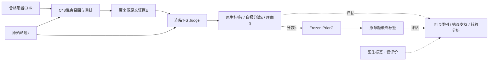

> 阅读镜像：已省略8行病例原文／标识；原始文件SHA见MIRROR_MANIFEST.json。

# 冻结大模型的患者级临床事实核验：全队列分类质量、错误支持与证据约束

**Patient-Specific Clinical Fact Verification with a Frozen LLM: Full-Cohort Evaluation, False Support, and Evidence Constraints**

> **编辑状态（投稿前删除）**：本稿更新至任务095，依据仓库提交 `28daf95e9b12270d8089246176023c66c4cf298e`。已完成9,065个目标ID的B回执覆盖；主分类比较是8,997条共同核心有效命题，不是9,065条均有有效最终分类。095近邻构造完成，但E/C最终Judge均未调用，本文不填造其分类结果。系统主线仍为无示例B＋Frozen PriorG，092仅作监督式参照。段落职责、证据出处、图表重绘及下一轮修改接口见 `02_revision_handoff_zh.md`。

**作者、单位、通讯作者：**【由作者按实际情况填写】

## 摘要

患者临床文本的事实核验需要将陈述与该患者电子病历对应，而非仅判断其是否符合一般医学知识。检索证据、模型判断与类别决策共同决定核验结果，较高的一致率可能掩盖错误支持和少数类损失。本文构建不微调核心大模型的患者级核验链路，并以共享评分和逐例转移分析分开评价证据利用与最终决策。系统通过患者内混合检索构造原文证据包，由冻结大模型产生原生判断和三类自报分数，再施加冻结的类别比例修正。我们覆盖VeriFact-BHC的100名患者、9,065条有效原子命题，在8,997条共同核心有效命题上与原作者发布预测配对比较。系统的PA由80.97%提高至83.94%，MCC由0.4983提高至0.5976，Macro-F1由0.5931提高至0.6663，错误支持由564条减少至347条。收益主要来自Not Addressed召回由40.24%提高至70.69%，Supported和Not Supported召回则分别下降1.63和3.35个百分点。同一次原生评分经过决策修正净增加685条正确，同时新增180条错误支持，表明总体改进与风险取舍需要联合解释。进一步的来源约束近邻构造在质量预检中暴露了时点与对象绑定问题，未进入最终分类实验。结果表明，冻结核心模型能够在该基准上取得较好的综合分类表现，但输入可追溯、辅助构造合格和最终核验有效必须分别验证。

**关键词：** 临床事实核验；电子病历；检索增强；冻结大模型；错误支持；类别决策

<!-- SEC:S1 -->
## 1 引言

<!-- I1 应用对象、问题及意义 -->
临床文档描述的是某位患者在特定时间的检查、治疗与病程，而不只是一般医学知识。因此，一种治疗在临床上合理，并不能证明该患者确实接受过治疗；记录中出现某种药物，也不足以支持关于给药时点、剂量或目的的完整陈述。面向人工撰写和大模型生成的病程摘要，患者级事实核验需要将具体命题与该患者的参考电子病历对应，定位需要复核的内容。VeriFact将这一需求落实为病历检索与命题级判断，并提供相应数据和发布系统预测，为这一任务的可重复评价建立了基础[1,2]。

<!-- I2 相关路线归纳 -->
现有事实核验主要从外部证据组织与专用模型学习两条路线获得判别信息。FActScore将长文本拆为原子事实并检查来源支持，QAGS通过问题和答案的一致性评价摘要事实性[3,5]；MiniCheck则利用构造的训练材料学习文档与陈述之间的支持关系[7]。患者EHR场景对来源范围提出了更具体的要求。VeriFact结合检索增强生成与大模型裁判，将现成模型用于患者自己的记录，而无需先用该任务标签训练一个新的核心分类器[1,2]。这种设置便于复用已有模型，但最终表现仍同时受证据内容、推理配置和类别决策规则影响。

<!-- I3 具体研究空白，不将广泛领域描述成无人研究 -->
这些影响在临床三分类中需要进一步分开考察。提高Supported的判定倾向可以恢复被过度拒绝的真支持，也可能错误接受真实非支持陈述；补入相关原文或辅助命题可以改变模型输出，却未必提供新的有效判别信息。只比较最终一致率，难以说明改善是来自更好的证据核验，还是来自错误在类别之间重新分配。本文关注的具体问题是：在不微调核心Judge的约束下，能否获得优于原发布系统的综合表现，以及这一表现由哪些可核查的组件作用和类别取舍构成。

<!-- I4 目标导出的三个挑战 -->
实现这一目标有三个挑战。第一，模型只能读取有限检索证据，而医生标签依据数据集参考EHR，局部信息缺失不能直接等同于完整记录未涉及。第二，临床标签需要区分完整支持、不完整支持和未涉及；多数类正确数的提高可能掩盖这两类非支持判断的损失。第三，同一回答的原生标签、三类分数和最终映射可以产生不同结论，辅助证据的收益也可能在后处理后缩小。因此，评价既需要同ID的整体比较，也需要类别、原生—最终转移和来源约束的独立检查。

<!-- I5 真实观察与设计关系；不伪造研究先后 -->
前期受控比较揭示了上述挑战的具体形式。固定评分的支持偏置提高了正确数，但同时增加错误支持；在同一Judge下，较短证据包与原发布上下文的最终正确数接近，原生结果却不同；示例输入的原生优势还可能被基线自身的后处理收益追平。这些观察促使我们将证据包、原生判断和最终类别决策分别作为可测对象。对后续的证据锚定近邻构造，我们进一步检查“原文字串可定位”是否足以保证修改只涉及同一事件的一项属性，而不将格式正确自动当作语义正确。

<!-- I6 方法及完成的实验概述 -->
基于这一思路，本文采用患者内证据构造、冻结大模型评分和冻结类别决策三个连接阶段，统一保存原文来源、原生输出和最终预测。我们补齐100名患者、9,065条目标命题的B请求覆盖，在共同有效集合上重评原作者发布预测与已有监督模型，结合历史组件消融解释系统优势。对比近邻模块仅完成构造与质量预检，未产生最终分类结果；其作用在本文中是揭示来源约束的实际边界，而不是作为已经有效的主模块。

<!-- I7 贡献需与全文一致 -->
本文的贡献体现在三个方面：

1. **完成冻结核心Judge的全队列同ID评价。** 在100名患者的共同有效命题上，系统同时提高PA、MCC与Macro-F1并减少错误支持，明确报告回执覆盖、有效性及与原作者的类别差异。
2. **解释综合收益与类别代价的来源。** 结合共享评分、标准对照及逐例转移，区分真支持恢复、非支持类损失和原本已错再转为错误支持的路径，而不把决策边界变化解释为新增证据理解。
3. **建立辅助证据操作的可检验边界。** 利用固定输入对照和构造源文核查，区分程序层面的来源绑定、同事件语义对应与下游分类效用，给出继续或停止新增核验流程的具体依据。

本文的贡献以冻结系统的实证评价与可解释分析为主，不将混合检索、固定偏置或尚未实测的近邻对比包装成新的通用算法。以下先给出任务和动机观察，再介绍系统与实验设置，最后讨论全队列结果及适用范围。

<!-- SEC:S2 -->
## 2 任务定义与动机观察

### 2.1 命题、证据与标签

设患者参考记录为$H$，待核验原子命题为$x$。检索器构造有限证据$E=R(x,H)$，系统输出$\hat y\in\mathcal Y$，其中$\mathcal Y=\{\mathrm S,\mathrm{NS},\mathrm{NA}\}$。沿用发布任务的标签契约，S表示命题获得完整支持，NS表示相关内容被涉及但不完全支持、部分支持或存在矛盾，NA表示参考记录未涉及足以判断的相应内容[2]。本文不把NS收窄为“必须找到显式反证”，也不重新裁决医生标签。

标签$y$相对于数据集参考EHR，而模型只能读取$E$。因此，当前包里没有某项信息既不证明完整记录没有该信息，也不能机械转换成NS或NA。实验单位始终是原命题；内部生成的问题或近邻命题不继承原GT。整篇文档的问题定位属于应用目标，本研究验证的是其中的命题核验环节。

### 2.2 观察一：正确数与错误支持可以同时增加

固定输出才能区分决策作用与模型变化。在早期40名保留患者的3,571条共同有效命题上，同一非思考评分由U0改为固定U2，正确数从2,731增加到2,908，错误支持从81增加到204。逐例分解为219条真S恢复、42条原正确非S被改错、81条原本已错的非S进一步转为S。净正确增加177与错误支持增加123可以同时成立。

该观察说明，低自由度决策映射可以改变可用工作点，但不会自动增加输入信息。因此，本文同时报告分类、风险和错误转移。上述结果属于早期非思考系统，不能当作当前T-S＋PriorG的全队列证据。

<!-- EVIDENCE:E036 -->
### 2.3 观察二：输入预算与核验效用不是同一指标

在固定Judge的192条桥接比较中，原发布上下文与C48平均约22,474和8,056字符；两者经过相同T-S与PriorG后均有162条正确，raw正确数却分别为151和146。较短输入降低了Judge调用费用，但没有证明精度优势或非劣效性。后续精确重复正文折叠也仅保证原包可机械恢复，并不保证省出的空间中加入的是决定性信息。

这意味着证据构造至少需要回答两个不同问题：实际给模型的内容怎样变化，以及变化是否提高目标分类。来源检查能够回答前者的一部分，只有匹配的分类比较能够回答后者。

<!-- EVIDENCE:E078,E093 -->
## 3 核验系统与分层分析方法

### 3.1 三阶段系统概述

系统由患者内证据构造、冻结Judge和冻结类别决策三个阶段组成，如图1所示。证据阶段接收$(x,H)$并输出带来源原文$E$；Judge接收$(x,E)$，输出原生标签$r$、自报分数$s$和理由$q$；决策映射$f$将$s$转换为最终标签$\hat y$：

$$
(x,H)\xrightarrow{R}E,\qquad J(x,E)=(r,s,q),\qquad \hat y=f(s). \tag{1}
$$

核心Judge权重保持固定。历史类别比例和偏置使用过任务标签，因此“不微调核心模型”不等于“完全不使用监督”。目标病例的GT不进入检索或模型请求。



**图1　实际部署链路与评价边界。** 图中不包含095未运行的候选终判模块。独立源文件为`assets/fig01_framework.mmd`，投稿前可转换为矢量图；箭头表示实际数据流，GT不进入Judge。

### 3.2 患者内原文证据构造

证据阶段的目标是在有限上下文内保留患者相关事实及其来源。系统检索已知患者、目标住院的合格病历，排除用于生成待核验摘要的出院小结；按段落与固定长度形成片段，保留note、日期、时间及字符位置。BM25和BGE-M3分别提供词面与稠密语义候选[9]，按冻结交替规则合并至最多48个不同候选，再由BGE重排器基于原claim排序。

打包保留完整片段，每份note最多两段，总计最多16段，记录头与正文名义预算为8,000字符，额外住院头按原实现另计。去重使用日期、类别和正文等冻结条件，最终按日期、时间、note和原始位置排列。C48因此是候选容量，不表示模型一定读取48段。

该阶段提供固定、可追溯的输入基础，而不是以“混合检索”名称宣称新算法。095评价中保留不同历史来源分支，精确绑定实际reference；本地BGE补齐分支不被视为与历史API输出逐字等价。

### 3.3 一次回答中的原生判断与评分

Judge使用`deepseek-v4-flash-0731`，thinking-high，temperature为0，输出上限8,192 token，不加F4。一次回答同时给出原生三分类标签、理由/检查项及三类`label_scores`，减少由两次独立判断引入的额外差异。非思考历史对照的上限为2,048 token，因此模式对照同时涉及输出预算，不能单独解释为内部推理能力的变化。

自报分数$s_c$不是原生token概率或经临床校准的后验。原生标签$r$与分数最大类U0分别定义和保存；即使在本次共同有效集合中相同，也不是两个独立的有效方法。引用可定位只说明来源存在，不证明理由完整或标签正确。

### 3.4 冻结的类别决策

决策阶段针对固定评分的类别倾向，沿用历史参数而不在095重新拟合。设

$$
z_c=\log\max(s_c/100,10^{-6}),\qquad
\hat y=\arg\max_{c\in\mathcal Y}\left[z_c+\log\frac{\pi_{\mathrm{ref},c}}{\pi_{\mathrm{cal},c}}+g\,\mathbf{1}(c=\mathrm S)\right]. \tag{2}
$$

类别顺序为S/NS/NA，$\pi_{\mathrm{ref}}=(1108,100,170)/1378$、$\pi_{\mathrm{cal}}=(48,47,48)/143$，$g=0.1342909508820116$。平分时沿冻结实现依次优先NS、NA、S。该映射称为PriorG；G是一个偏置，不是双模型Gate。U2则仅在S的log分数上增加2，并不等同PriorG。

式（2）是经验工作点，不保证所得分数为真实概率。温度缩放、多类偏置和向量缩放等属于已有校准方法[4]，在本文中承担对照角色。095沿用完整映射，不由最终结果重新选参数；去除小G是否在全队列同标签尚未报告，不能把384条上的相等直接外推。

### 3.5 原生—最终与类别转移

为说明结果在哪一层改变，对相同ID记救回数$n_{\mathrm{fix}}$为基线错误、候选正确的数量，伤害数$n_{\mathrm{break}}$为基线正确、候选错误的数量，则

$$
\Delta C=n_{\mathrm{fix}}-n_{\mathrm{break}}. \tag{3}
$$

对于固定分数将非S改为S的路径，另记$n_{\mathrm{w2s}}$为原本已经判错的非S再转为S的数量。在只有朝S翻转的该路径上，新增错误支持为$n_{\mathrm{break}}+n_{\mathrm{w2s}}$，而后一类不再次减少正确数。二者是不同的评价对象。更一般的原生/最终差异分别计数，不假设任意候选都只有朝S的翻转。

对配置$M$，记$C_r(M)$、$C_f(M)$为原生和最终正确数，$D(M)=C_f(M)-C_r(M)$。两配置满足

$$
C_f(M_1)-C_f(M_0)=C_r(M_1)-C_r(M_0)+D(M_1)-D(M_0). \tag{4}
$$

这些是核对结果的计数恒等式，不是新理论或因果归因。理由$q$仍对应原生回答，不因$f$改变标签自动成为最终结论的有效解释。

### 3.6 来源锚定近邻的构造可行性原型

为了检验能否用明确属性差异辅助核验，我们实现了一个构造原型：从原claim选择唯一连续跨度，以C48中可定位的值替换，保留其他文字，至多生成一个近邻命题。替换值必须出现在近邻跨度及一至两处原文引用中；程序校验位置、来源编号和字串关系。第二个冻结模型接口再检查单属性、实质差异、同事件和无新增事实。

该原型不要求近邻为假、两命题互斥，或近邻完整地被证据证明。它要求的是替换值与保留的事件上下文不发生不受支持的转移。预登记的摘录对照E只提供同样原文锚点，对比臂C进一步加入近邻，最终仍评价原claim。B/E/C的思想是区分摘录与对比作用；**实际只完成构造和质量核查，E/C最终Judge没有运行**。因此，本稿将该原型用于分析构造可靠性，不将其放入式（1）的已验证主链路。

<!-- EVIDENCE:E095_code,E095_quality; STATUS:CONSTRUCTION_ONLY -->
<!-- SEC:S4 -->
## 4 实验设置

### 4.1 数据、回执覆盖与有效分母

实验使用VeriFact-BHC v1.1.0，来自MIMIC-III v1.4的100名患者[2,11]。本文采用9,065条有效原子命题，保留原GT，排除既定有效性标记中的30条invalid atomic，不混合句子粒度。三类为S 7,035、NS 693、NA 1,337；human/LLM分别5,624/3,441。

095已对全部9,065个ID取得B成功回执。其中核心评分有效8,997条，冻结解析规则下raw有效9,034条，68份核心无效。主要比较在前者上重评所有方法，类别为S 6,983、NS 687、NA 1,327；raw另有独立有效性表，不跨分母直接相减。核心无效中52S、6NS、10NA，41份因输出长度结束、27份正常停止但不满足字段协议。它们不由旧答案、其他模型或默认NA补齐。

**表1　主要集合及证据角色。不同集合存在交集，不相加为独立样本。**

| 集合 | 命题／患者 | 角色 | 有效性与关系 |
|---|---:|---|---|
| Full-ID | 9,065／100 | 全部目标ID、回执覆盖 | 不是全部有效最终分类 |
| F8997 | 8,997／100 | 本文主系统比较 | B核心有效；所有参照同ID重评 |
| Raw9034 | 9,034／100 | B原生输出补充 | 受冻结解析规则限定 |
| C384／Core374 | 384／24；374／24 | 历史当前组件消融 | 384保留该轮冻结回退，374不含相关无效 |
| E192 | 192／24 | 固定Judge替换reference | C384子集，原上下文未截短 |
| H956 | 956／24 | F4、文本模型与融合参照 | 历史混合选样，非新增全量比较 |
| R3571 | 3,571／40 | 早期边界与标准方法 | 非当前T-S，历史冻结确认 |
| Construct300 | 300 | 095构造质量研究 | 自然200、富集100，最终E/C分类未执行 |

构造样本在生成前确定，自然200的GT为162S/14NS/24NA，富集100为34S/33NS/33NA；两者分报。80例发现性原文回查独立于构造样本，其标签为重叠的研究者描述，不是总体错误比例或新增医学gold。

### 4.2 缓存选择与实际模型输入

为避免重复调用，095扫描标准原生请求材料，从符合当前B的回答中按预先确定的最早成功时间及路径选择，每ID只取一份，不按标签正确性选优。最终复用1,885份旧B回执，并新增7,180次B调用。旧回执中的14份核心无效也保留，没有因结果差而重发。

实际reference来自3,675条032历史输入、3,573条036历史输入及1,817条092本地BGE补齐。每个ID校验原claim、reference哈希、模型、提示、思考设置和输出协议，不将早期非thinking、F4或其他模型当作B。主表因此是跨历史缓存与本轮补齐的冻结配置评价，不是所有9,065条在同一时刻重新运行。本轮未新增同期桥接，来源分层也不用于估计随机化的实现或时间因果效应。

### 4.3 参照与受控比较

Original始终是作者发布系统在同ID上的预测，不是用本文新模型重建的原系统。主表包括B raw、同评分U2、完整B＋PriorG，以及092的Text-Frozen与Text-FT。后两者直接读取claim/C48，不使用T-S分数或PriorG；Text-Frozen训练6,148个聚合/分类参数，Text-FT另更新DeBERTa顶部一层，共12,602,372个参数[10]。五折每折64名患者训练、16名选择epoch、20名外层预测；这些患者分组OOF性质只属于相应文本模型，不能赋予历史B。

历史消融保留N-V/T-V、N-S/T-S、标准多类偏置与向量缩放，以识别模式、评分接口和决策作用。F4加入四条固定示例；P90仅压缩示例reference。093研究目标证据的重复折叠/补证，094研究答案可见性；均不因为095全量B成功而自动获得有效性。

### 4.4 质量、风险与统计方法

报告PA、MCC、Gwet’s AC1、Macro-F1及各类precision/recall/F1。PA为与医生三分类一致的比例，其他指标补充描述类别混淆与机会校正一致性。错误支持定义为真实NS/NA被预测S，分别报告计数和两种分母：

$$
\mathrm{FS}=\sum_i\mathbf{1}(y_i\ne\mathrm S,\hat y_i=\mathrm S),\quad
\mathrm{FSR}=\frac{\mathrm{FS}}{\sum_i\mathbf{1}(y_i\ne\mathrm S)},\quad
\mathrm{FDR}_{\mathrm S}=\frac{\mathrm{FS}}{\sum_i\mathbf{1}(\hat y_i=\mathrm S)}. \tag{5}
$$

FSR描述真实非S的错误接受率，$\mathrm{FDR}_{\mathrm S}$描述S预测中的错误比例，不可互换。没有某一真实类别的面板，该类召回不作为有效能力估计；固定三类Macro-F1仍沿既有零分约定。

评价使用统一实现，配对区间为1,000次患者cluster bootstrap，重抽时固定已经取得的预测。区间衡量该样本和输出下的差异，不涵盖历史方法选择、模型服务变化或外部医院泛化。全体患者已有研究暴露，本文不称其为新的未接触测试；不同分批、粒度、作者和有效性范围明确区分。

### 4.5 工程复核与成本

095独立子执行者逐ID核对全部选中request/receipt身份、输入和标签，重算主指标及患者配对区间，并逐笔核对7,597次新调用费用。这里的独立复核是实现者之外的计算和来源检查，不是独立医生标注或外部验证。

费用按实际usage、缓存字段和适用目录价计算，新增研究费用与完整部署费用分开。旧实验费用维持原阶段口径，不用本轮闲时价格追溯改写。GPU、检索缓存、人力和API计费属于不同项目；无新增费用不能解释为全部流程免费。

<!-- SEC:S5 -->
## 5 实验结果

### 5.1 全队列共同有效比较

在同一8,997条命题上，B＋PriorG相对Original同时提高PA、MCC、Macro-F1和AC1，并减少错误支持。表2也保留直接原生判断和同评分U2，以显示这一优势不是原生模型在所有指标上自然占优。

**表2　F8997主结果。100名患者，真实非S为2,014；所有行同ID。**

| 配置 | MCC ↑ | PA ↑ | 正确数／8,997 | Macro-F1 ↑ | AC1 ↑ | false-S ↓ |
|---|---:|---:|---:|---:|---:|---:|
| Original | 0.4983 | 80.97% | 7,285 | 0.5931 | 0.7661 | 564 |
| T-S raw | 0.5262 | 76.33% | 6,867 | 0.6242 | 0.6926 | 167 |
| T-S＋U2 | 0.5713 | 81.53% | 7,335 | 0.6508 | 0.7664 | 274 |
| **B：T-S＋PriorG** | 0.5976 | 83.94% | 7,552 | 0.6663 | 0.7998 | 347 |
| Text-Frozen | 0.4444 | 79.52% | 7,154 | 0.5167 | 0.7496 | 756 |
| Text-FT | 0.5161 | 83.08% | 7,475 | 0.5568 | 0.7956 | 737 |

<!-- EVIDENCE:E095_metrics; DATA:F8997 -->

相对Original，B救回878条、伤害611条，净多判对267条。PA差为+2.97个百分点，95%患者区间[1.84,4.05]；MCC差为+0.0993，区间[0.0780,0.1188]。Macro-F1增加0.0732。错误支持减少217条，相对减少38.5%；FSR从28.00%降为17.23%，S预测中的错误比例从8.08%降为5.22%。这些指标共同支持本基准上的综合优势，而非只依赖最高准确率。


**图2　F8997上的MCC与错误支持率。** 横轴FSR的分母固定为2,014个真实非S；纵轴为MCC。各点为固定系统或工作点，不是优化后的Pareto曲线。Text-FT来自患者分组OOF，和B的监督范围不同。

回执覆盖与分类有效性须同时解释。全9,065个目标中，B已知最终正确7,552条；将68份无有效最终分数的回执视为未判对时，保守正确比例为83.31%，而非主表的83.94%。该下界仍不依赖填造无效标签，但不能给68条指定预测来计算虚构的全量MCC。补充raw比较使用9,034条自身有效分母，其结果不与表2按不同分母作差。

### 5.2 改善主要来自NA，不能称所有少数类同时增强

全队列优势具有明确的类别构成，见表3。B比Original多正确识别404条NA，却少识别114条S和23条NS，合计净增267。这一构成比“少数类整体更强”更准确：NA召回明显提升，NS召回略降，但NS precision由26.65%提高到31.76%，其F1由0.3461提高到0.3757。

**表3　F8997的类别表现及同ID转移。**

| 真实类别 | 分母 | Original 召回 | B 召回 | B precision | B F1 | B 相对 Original 救回／伤害／净值 |
|---|---:|---:|---:|---:|---:|---|
| S | 6,983 | 91.82% | 90.19% | 94.78% | 0.9243 | 291／405／-114 |
| NS | 687 | 49.34% | 46.00% | 31.76% | 0.3757 | 124／147／-23 |
| NA | 1,327 | 40.24% | 70.69% | 69.12% | 0.6990 | 463／59／+404 |


**图3　Original、B及Text-FT在同一F8997上的类别召回。** 三类各自使用真实类别分母。Text-FT的较高S召回不意味着非S判断更好；原作者的NS召回仍略高于B。

错误支持的减少同时涉及两类非S：NS→S由250降至158，NA→S由314降至189。与此同时，B仍有371条真实NS未被识别，其中158条被判S、213条被判NA。不能通过统一提高NS倾向就假定能修复这些错误，因为B的NS预测还包含479条真实S和200条真实NA。后续改进必须区分这些相互竞争的错误，而非只提高某个类别的输出频率。

<!-- EVIDENCE:E095_metrics,E095_transitions -->
### 5.3 作者、患者与来源分层

B的综合优势并非所有子组的准确率都提高。表4显示，人写命题净增加298条正确，而LLM命题净减少31条；两组MCC和错误支持仍为正向。高S比例的LLM文本因而是总体结论的重要例外，不能从合并指标推断其准确率也提升。

**表4　F8997按命题作者分层。**

| 分层 | N | Original 正确／PA | B 正确／PA | MCC：Original → B | false-S：Original → B |
|---|---:|---|---|---|---|
| human | 5,577 | 4,100／73.52% | 4,398／78.86% | 0.4813 → 0.5922 | 459 → 274 |
| LLM | 3,420 | 3,185／93.13% | 3,154／92.22% | 0.3066 → 0.3576 | 105 → 73 |


**图4　B相对Original在两类作者命题上的净正确数变化。** 纵轴为净计数，不是百分比；两子组规模不同。总净增为298−31=267，错误支持分别减少185和32条。

逐患者正确数方向为61胜、32负、7平，98名患者存在至少一条被B救回的错误。胜负数描述异质性，不能取代按命题计的总体指标。按实际reference来源分层，032、036及本地BGE三组中B的PA/MCC均高于同ID Original；新调用和历史缓存层也保持相同总体方向（附录A.3）。这些材料的患者和类别组成不同，不能将层间分数差解释为本地BGE优劣或服务漂移。

<!-- EVIDENCE:E095_findings -->
### 5.4 共享评分下的决策收益与错误接受代价

相对B raw，完整PriorG在F8997上救回769条、伤害84条，正确数由6,867增加到7,552。PA差为+7.61个百分点，患者95%区间[6.93,8.29]；MCC差为+0.0714，区间[0.0614,0.0811]。三分数与原文没有变化，因此该收益可以归于确定性决策映射，不能称为新增证据理解。

**表5　raw→PriorG在相同8,997条上的转移。**

| 路径 | S | NS | NA | 合计及含义 |
|---|---:|---:|---:|---|
| 原错→正确 | 769 | 0 | 0 | 769，全部是真S恢复 |
| 原正确→错误 | 0 | 76 | 8 | 84，原正确非S被改为S |
| 原错误非S→另一错误S | 不适用 | 2 | 94 | 96，不再减少正确数但新增false-S |
| 新增false-S | 不适用 | 78 | 102 | 180，167→347 |


**图5　同一次B评分经PriorG后的两种计数。** 左侧三项用于解释净正确769−84=685，右侧新增错误支持为84+96=180；图中类别是路径而非独立抽样组。

这也解释了一个表面矛盾：B＋PriorG相对原作者错误支持更少，但相对自己的raw错误支持更多。两句话的参照不同，不能互相替代。U2在相同评分上为7,335条正确、274条false-S；PriorG再多对217条，但多73条false-S，反映了不同固定工作点的取舍。

历史C384消融提供了进一步的组件对照：N-S raw到T-S raw净增5条正确、false-S减少6条；T-S raw到PriorG净增32条、false-S增加4条；prior-only与完整PriorG在该集合逐例相同。故“思考模式”“评分接口”“类别比例”“小G”不能按名称各自算作独立创新。095补齐的是现有系统全队列位置，不是对所有组件重新随机化确认。

<!-- EVIDENCE:E095_transitions,E095_report,E078 -->
### 5.5 与监督文本替代路线的同ID比较

F8997中B比Text-FT多判对77条，MCC高0.0815，错误支持少390条。PA差约+0.86个百分点，患者区间[−0.17,1.90]，尚不能确认PA优势；MCC差区间[0.0581,0.1053]。B的NS/NA召回为46.00%/70.69%，Text-FT为8.88%/66.39%，而Text-FT的S召回更高。因此，当前B相对这一个具体监督方案具有更好的综合折中，不据此推论所有微调方法都更差。

092的完整9,065条匹配Frozen/FT实验仍保留独立意义：顶部表示更新净增加326条正确，类别净增S +311、NS +17、NA −2。它证明该固定训练方案优于匹配冻结编码器，但不能自动替代当前生成式链路。完整9065文本模型表与历史H956融合结果放入附录，避免不同N的主分数直接比较。

<!-- EVIDENCE:E095_metrics,E095_report,E092 -->
### 5.6 证据与辅助推理的历史控制

E192固定Judge后，原上下文与C48的T-S＋PriorG正确数均为162，MCC为0.5774/0.5970，false-S为7/5。C48输入更短，Judge费用约低32%，但MCC差区间跨0，也没有设定非劣效界限。因此，短证据包的实测价值是预算折中，不是已证明的精度贡献。

093/094也未随095大表转为成功组件。FoldAdd在自然共同有效88条上与B均76正确、false-S多一条；压力30条多对一条。IsolatedQA在自然20条与B同为19正确，机制12条均9正确但错误支持多一条；相对可见问答的唯一最终优势涉及引用无效。P90相对F4的raw优势还从+7缩小至最终+2。它们分别说明来源保留、答案隔离和原生改善不能直接替代最终收益证据。

这些是受控但范围有限的结果。本文不据它们否定所有证据处理，而是保留“操作是否发生—是否提供有效信息—是否改善分类”三层区分。完整对照和路径图见附录A.4。

<!-- EVIDENCE:E078,E091,E093,E094 -->
### 5.7 近邻构造的数量可行性不等于语义可用性

095构造原型得到300份成功回答，117条通过字面来源校验并进入核对，95条、65名患者被自动判为拟触发，其中自然67条、富集28条。数量上具备继续条件，但语义预检发现自动通过并不可靠，见表6。

**表6　095近邻原型的实际完成范围。不同检查层次不可合成分类准确率。**

| 检查层次 | 实际数量 | 可支持的解释 |
|---|---:|---|
| 已执行构造 | 300 | 200自然＋100富集；成功调用不是有效构造 |
| 字面来源绑定通过 | 117 | 替换值、来源与跨度可定位 |
| 自动语义核对通过 | 95／65患者 | 只是核对器的拟通过判断 |
| 初始预检16例中的自动通过 | 3 | 2例明确违反，1例同事件不确定 |
| 后续分层质量审查 | 24 | 8可读单属性、8明确违反、8未确定 |
| E／C最终Judge | **0／0** | 无C−B或C−E分类效应估计 |


**图6　095原型执行到哪一步。** 300、117、95是构造层次的数量；24例质量审查是95中的分层子样本，不是新的总体分母。最后的零表示未发送最终Judge，不表示分类准确率为零。

来源回查揭示了三类关键错误。其一，治疗后的值被置入仍保留初始时点的句子，字面值存在但时间关系错位。其二，一个连续文本跨度同时改变两药状态或液体类型与总量，单跨度并非单属性。其三，另一药物或另一事件的值被移给原命题保留的对象。另有同义缩写替换，没有构造出实质事实差异。

24例为自然/富集各12例的固定抽样，不能把8/24直接当作95条总体失败率，也不把“可读”认证成医生真值。原型在未可靠解决上述问题前停止，没有人工挑出好例再运行最终Judge。因此，本结果是构造可靠性不足的证据，**不是300条分类实验得出了对比核验无效**。

<!-- EVIDENCE:E095_quality,E095_code,E095_review -->
### 5.8 成本、解析有效性与复核

095新增7,597次调用，全部HTTP200、无重试：B补齐7,180次，构造300次，核对117次。按实际适用目录价和usage，总费用估算95.769536元，其中前段基准78.359575元、构造/核对1.946946元、后续B补齐15.463016元。该金额不是账户实扣账单，也不等于9,065条完整重跑的端到端部署成本，因为复用了旧回执、检索及重排缓存，E/C终判没有运行。

B全体选中回执平均约3,171输入、1,849输出token，中位分别3,161和1,496，输出计入思考消耗。68份核心无效不是68次HTTP失败；解析覆盖99.25%与服务成功覆盖100%是不同指标。对可恢复raw和非标准JSON的诊断保留原冻结解析，不事后换解析器增加主表分数。

历史相同输入的重复子集也提示服务输出并非绝对确定：385条共同核心有效重复中有39条最终标签改变，最晚相对最早净少对5条。该子集经过历史选择，不能作为全体病例波动率。095没有新增重复或同期桥接，因此整体比较的批次限制仍需保留。

独立复核重算全部主指标、五组配对及费用，并核对各请求不含GT；本稿资源包则进一步以公开矩阵和转移张量复核聚合算式。两者分别是原生材料审计和写作包数字检查，均不认证临床标签或模型内部推理过程。

<!-- EVIDENCE:E095_report,E095_findings,E095_review -->
<!-- SEC:S6 -->
## 6 讨论与局限

### 6.1 已获得的系统优势与尚未获得的方法贡献

全队列结果把此前子集上的优势推进为覆盖全部目标ID的系统评价：B相对发布系统在PA、MCC、Macro-F1和错误支持上具有一致的总体方向。然而，这一优势来自已冻结链路，不能记到095未运行的近邻终判上。当前有依据的特色是NA识别与较少错误支持的综合取舍，以及可复查的分层证据；“新的对比推理算法改善临床判断”仍没有实测依据。

这种区分也决定了工作如何与相关文献对接。一个复杂流程即使能够运行，也可能没有增加有效信息；一个简单系统即使总体更好，也不因此具有全新的基础算法。本文将两者分别报告，而不通过命名或隐藏简单对照放大贡献。

### 6.2 后续机制首先需要保住事件和限定关系

构造失败提示，临床原文中的一个值必须连同对象、事件、时间和作用域理解。单处字符串编辑与引用校验只约束表面形式，无法确保这些关系被保留。后续若继续对比路线，应先把可编辑属性和不可变上下文显式绑定，再在无需逐例人工选择的条件下检验构造可靠性；仅给原核对器增加一句“注意时间”不足以补上本轮证据缺口。

这仍是由失败材料支持的研究建议，不是已实现的方法。80例目的性来源阅读中的标签重叠且含较多unknown，有限包外搜索也没有建立可外推的缺失证据占比。因此，本文不据它断言检索已解决，或所有剩余错误都属于推理。

### 6.3 评价范围与迁移

数据来自100名患者，所有患者已有研究使用，完整回执覆盖不意味着独立外部测试。主结果采用固定配置与同ID参照，但缓存跨时段，reference存在API历史和本地补齐分支，Original也来自作者历史系统。分层方向和患者区间提高了结果透明度，不能消除这些组成和服务差异。Text-FT的OOF只说明其预测未用对应患者训练或选择epoch，不赋予所有比较方法相同监督协议。

医生标签描述的是相对提供记录的支持关系，而不是对真实世界所有事实的直接认证。NS/NA的边界、跨记录冲突以及不完整信息仍可能需要临床裁定。研究者的来源回查不等于新增专家gold。

### 6.4 命题结果与临床应用

命题输出可作为文档复核的基础，但本研究没有评价自由拆分后的新命题标签、医生使用后的工作量变化或真实患者结局。基准上的false-S减少不能直接写成减少医疗事故。实际部署还需解决数据权限、运行时失败策略、理由与最终标签的一致性，以及人工复核负担。现阶段保存原生与最终标签可避免把未经同步的理由直接显示为最终解释，但其用户效用仍需另行验证。

<!-- SEC:S7 -->
## 7 相关工作

本节按“判别信息从何处获得”组织相关研究，依次讨论外部/患者证据、固定模型辅助核验、对比信息构造，以及监督学习和决策调整。该分类用于明确比较范围，不暗示各类互斥。

### 7.1 通用来源与患者特定证据

FEVER将支持/反驳/信息不足判断与证据识别结合[12]，FActScore以原子事实衡量长文本的来源支持[3]。患者核验还要求证据属于特定患者、事件和时点。VeriFact将检索与LLM裁判应用于患者EHR，并提供人写及模型摘要的标注[1,2]。本文沿用该任务，比较原发布预测和冻结新链路，不把医学问答或百科事实验证的论文分数直接放入同一主表。

### 7.2 冻结模型的辅助核查

QAGS通过问答一致性检查摘要事实，CoVe使用独立核查问题降低初始回答的影响[5,6]。本文094的可见/隔离取证对照借鉴这些思想，但没有观察到当前单问题方案的系统增量。其价值在于固定输入和接口后识别具体效果边界，而不是声称已在临床三分类中复制原论文收益。

### 7.3 对比证据、论据与近邻命题

VitaminC利用近似证据对检查核验模型对事实变化的敏感性，并研究相应训练[13]；RAFTS从检索证据形成支持/反驳论据，并结合示例完成核验[14]。这些工作说明对比信息和多视角判断有既有研究基础。ACV的出版方摘要进一步描述了原子分解、图约束变体和逐项对比[15]；本研究尚未取得其全文完成实现级核对，不声称近邻命题思想首创。

095原型的局部设置是固定患者C48、单属性原文锚定与摘录对照，不复现上述完整方法。它暴露了值级来源与事件级关系之间的可靠性问题，但没有最终分类成绩。因此这些文献用于定位方法邻近关系，不作为已经运行的性能基线。

### 7.4 监督核验与低自由度决策

MiniCheck研究基于构造训练材料的文档核验，MedNLI提供医生标注下的临床自然语言推断任务[7,8]。本文实际运行的监督替代是同输入的Text-Frozen/Text-FT，而不是直接采用外部论文数字。校准研究区分温度、类别尺度与偏置[4]；本文也分别分析概率或分数变化与标签变化，固定PriorG不被视为新增语义信息。冻结核心Judge降低了自行训练任务模型的需求，但其可用性仍由分类、来源和成本的实测取舍决定。

<!-- SEC:S8 -->
## 8 结论

本文在患者EHR事实核验中建立了冻结大模型的可追溯链路，并完成100名患者、9,065个目标ID的回执覆盖与8,997条共同有效命题的配对评价。相对原VeriFact发布系统，B＋PriorG提高了PA、MCC和Macro-F1并减少错误支持，主要收益来自NA识别，S和NS召回仍有代价。共享评分分析进一步表明，决策修正能够恢复真支持，也会引入额外错误接受，不能被解释为新证据增益。来源约束近邻原型则在语义质量预检中停止，尚无分类效应证据。后续研究应在保持现有系统优势的同时，提高同事件、时间与作用域约束的可靠性，再验证辅助核验是否具有超出简单摘录的独立增量。

<!-- END_MAIN_TEXT -->
## 数据、代码与伦理声明（作者按真实材料补充）

本研究使用受相应数据使用条件约束的去标识化VeriFact-BHC/MIMIC-III资料[2,11]，不随本稿公开临床原文或私有模型回执。代码、汇总预测及来源指纹按仓库权限管理。数据访问资格、伦理审批/豁免、第三方API处理许可、资助、利益冲突与作者信息由作者按真实记录填写；去标识化不自动代表所有第三方处理已获许可。本稿不推定这些手续已经完成。

## 参考文献


> 以下为稳定引用编号，投稿排版时可按目标格式重排。可编辑条目见 `references.bib`；实验工件及证据出处见 `sources/reference_map.md`。ToothFairy 仅用作写作结构参考，不作为本文科学结果依据。

[1] Chung P, Swaminathan A, Goodell AJ, et al. VeriFact: Verifying Facts in LLM-Generated Clinical Text with Electronic Health Records. arXiv:2501.16672, 2025. DOI: 10.48550/arXiv.2501.16672.（用于方法背景；发布系统实验口径以 [2] 及项目冻结记录为准。）

[2] Chung P, Swaminathan A, Goodell A, et al. MIMIC-III-Ext-VeriFact-BHC: Labeled Propositions From Brief Hospital Course Summaries for Long-form Clinical Text Evaluation. PhysioNet, version 1.1.0, 2026. DOI: 10.13026/7cqh-bc36.

[3] Min S, Krishna K, Lyu X, et al. FActScore: Fine-grained Atomic Evaluation of Factual Precision in Long Form Text Generation. EMNLP, 2023. DOI: 10.18653/v1/2023.emnlp-main.741.

[4] Guo C, Pleiss G, Sun Y, Weinberger KQ. On Calibration of Modern Neural Networks. ICML, PMLR 70:1321–1330, 2017.

[5] Wang A, Cho K, Lewis M. Asking and Answering Questions to Evaluate the Factual Consistency of Summaries. ACL, 2020. DOI: 10.18653/v1/2020.acl-main.450.

[6] Dhuliawala S, Komeili M, Xu J, et al. Chain-of-Verification Reduces Hallucination in Large Language Models. Findings of ACL, 2024. DOI: 10.18653/v1/2024.findings-acl.212.

[7] Tang L, Laban P, Durrett G. MiniCheck: Efficient Fact-Checking of LLMs on Grounding Documents. EMNLP, 2024. DOI: 10.18653/v1/2024.emnlp-main.499.

[8] Romanov A, Shivade C. Lessons from Natural Language Inference in the Clinical Domain. EMNLP, 2018. DOI: 10.18653/v1/D18-1187.

[9] Chen J, Xiao S, Zhang P, Luo K, Lian D, Liu Z. M3-Embedding: Multi-Linguality, Multi-Functionality, Multi-Granularity Text Embeddings Through Self-Knowledge Distillation. arXiv:2402.03216, 2024.（本稿核对页面显示 v5；模型实际使用版本见项目记录。）

[10] He P, Gao J, Chen W. DeBERTaV3: Improving DeBERTa Using ELECTRA-Style Pre-Training with Gradient-Disentangled Embedding Sharing. ICLR, 2023. arXiv:2111.09543.

[11] Johnson AEW, Pollard TJ, Shen L, et al. MIMIC-III, a Freely Accessible Critical Care Database. Scientific Data, 3:160035, 2016. DOI: 10.1038/sdata.2016.35.

[12] Thorne J, Vlachos A, Christodoulopoulos C, Mittal A. FEVER: a Large-scale Dataset for Fact Extraction and VERification. NAACL, 2018. DOI: 10.18653/v1/N18-1074.


[13] Schuster T, Fisch A, Barzilay R. Get Your Vitamin C! Robust Fact Verification with Contrastive Evidence. NAACL, 2021: 624–643. DOI: 10.18653/v1/2021.naacl-main.52.

[14] Yue Z, Zeng H, Shang L, et al. Retrieval Augmented Fact Verification by Synthesizing Contrastive Arguments. ACL, 2024: 10331–10343. DOI: 10.18653/v1/2024.acl-long.556.

[15] Kim HG, Jun TS, Lee T. Atomic Contrastive Verification: Fine-Grained Fact-Checking via Claim Decomposition and Knowledge Graph-Grounded Contrastive Reasoning. Mathematics, 2026, 14(10):1769. DOI: 10.3390/math14101769.（当前仅核对出版方摘要与元数据；未完成全文算法级比对。）


## 附录A　补充结果与复现信息

### A.1 主表完整混淆矩阵

下列行是真实S/NS/NA，列是预测S/NS/NA，全部N=8,997。机器可读数据位于`data/evidence.json`的`F8997`，不是患者级原文数据。

```text
Original    [[6412,454,117], [250,339,98],  [314,479,534]]
B raw       [[5529,1242,212],[80,392,215], [87,294,946]]
T-S+U2      [[6053,724,206], [130,344,213],[144,245,938]]
B+PriorG    [[6298,479,206], [158,316,213],[189,200,938]]
Text-Frozen [[6227,80,676],  [335,44,308], [421,23,883]]
Text-FT     [[6533,49,401],  [359,61,267], [378,68,881]]
```

### A.2 完整9,065条文本模型结果

**表A1　仅对发布预测与两种文本模型的全9065比较。不得与8997主表直接作差。**

| 配置 | 正确数 | PA | MCC | Macro-F1 | false-S／2030 |
|---|---:|---:|---:|---:|---:|
| Original | 7,331 | 80.87% | 0.4959 | 0.5918 | 573 |
| Text-Frozen | 7,204 | 79.47% | 0.4433 | 0.5167 | 764 |
| Text-FT | 7,530 | 83.07% | 0.5156 | 0.5569 | 745 |


**图A1　Text-FT相对Text-Frozen的类别净正确数。** 两者输入与聚合头匹配，S +311、NS +17、NA −2。该结果不能代表所有微调方案，也不是B的训练消融。

### A.3 来源与批次分层

**表A2　F8997按实际证据来源分层。层间不是随机化对照。**

| 分层 | N | Original 正确／PA | B 正确／PA | MCC：Original → B | false-S：Original → B |
|---|---:|---|---|---|---|
| 032 | 3,649 | 2,953／80.93% | 3,065／84.00% | 0.4786 → 0.5917 | 231 → 123 |
| 036 | 3,547 | 2,853／80.43% | 2,958／83.39% | 0.5209 → 0.6077 | 230 → 146 |
| Local BGE | 1,801 | 1,479／82.12% | 1,529／84.90% | 0.4855 → 0.5840 | 103 → 78 |

**表A3　新B调用与历史缓存层。层间组成不同，不能据此量化服务漂移。**

| 分层 | N | Original 正确／PA | B 正确／PA | MCC：Original → B | false-S：Original → B |
|---|---:|---|---|---|---|
| 095 new | 7,126 | 5,809／81.52% | 5,997／84.16% | 0.5040 → 0.5954 | 418 → 271 |
| Historical cache | 1,871 | 1,476／78.89% | 1,555／83.11% | 0.4780 → 0.6044 | 146 → 76 |

### A.4 历史组件和候选结果

**表A4　C384的主要组件比较。该轮冻结回退保留，不能冒充无回退核心有效表。**

| 配置 | 正确／384 | MCC | false-S | 回退 |
|---|---:|---:|---:|---:|
| Original | 310 | 0.4840 | 19 | 0 |
| N-S raw | 284 | 0.4406 | 12 | 0 |
| N-S＋U2 | 310 | 0.4708 | 23 | 0 |
| N-S＋StdM | 320 | 0.4955 | 27 | 0 |
| N-S＋StdV | 319 | 0.4876 | 27 | 0 |
| T-S raw | 289 | 0.5019 | 6 | 6 |
| T-S＋U2 | 307 | 0.5430 | 9 | 6 |
| T-S＋prior-only | 321 | 0.5887 | 10 | 6 |
| T-S＋PriorG | 321 | 0.5887 | 10 | 6 |

相关条件共同核心有效374条中，B为313正确/MCC0.5875/false-S10，Original为302/0.4834/19。H956历史混合比较中，B/F4/文本融合正确783/793/795，false-S41/52/64，F4及融合未形成综合默认升级；这一集合与其他历史样本重叠，不构成独立重复。

**表A5　早期R3571的固定边界和标准对照。**

| 方法 | 正确／3571 | PA | MCC | false-S | NS／NA召回 |
|---|---:|---:|---:|---:|---|
| Original | 2,866 | 80.26% | 0.5173 | 233 | 52.00%／41.71% |
| N-S＋U0 | 2,731 | 76.48% | 0.5293 | 81 | 64.36%／54.19% |
| N-S＋U2 | 2,908 | 81.43% | 0.5520 | 204 | 50.55%／53.53% |
| Gate A | 2,886 | 80.82% | 0.5621 | 141 | 56.00%／54.19% |
| StdM | 2,999 | 83.98% | 0.5850 | 251 | 37.45%／61.25% |
| StdV | 3,004 | 84.12% | 0.5850 | 254 | 10.55%／73.40% |

**表A6　093/094已执行候选的最终配对结果，面板不合并。**

| 操作／面板 | B正确 | 候选正确 | MCC：B→候选 | false-S：B→候选 |
|---|---:|---:|---|---|
| FoldAdd／自然core | 76/88 | 76/88 | 0.6250→0.6130 | 1→2 |
| FoldAdd／非S压力 | 17/30 | 18/30 | 0.4103→0.4382 | 10→9 |
| IsolatedQA／自然 | 19/20 | 19/20 | 0.7935→0.7935 | 0→0 |
| IsolatedQA／机制 | 9/12 | 9/12 | 0.6316→0.6316 | 0→1 |

095不加入表A6，因为它没有候选最终分类。历史P90路径图及其他图源保留在资源包，篇幅允许时可作为补充材料，不需全部置于短会议主文。

### A.5 有效性、计费与计算复核

37条B回执raw有效但core无效；冻结解析下另31条raw无效。41份非标准JSON中有可恢复原生标签的情况，不能把全部解析无效写成没有输出任何标签。主表使用冻结规则，不在写作时修改解析策略。需要研究新的格式恢复时，应另行登记并与语义重判区分。

原生审计工件见095的`final_review.md`和相应机器检查；本资料包的`095_aggregate_audit.json`记录公开矩阵与转移算式复核。患者bootstrap区间来自仓库报告及独立审计，不在本包用聚合矩阵重造患者抽样。运行`python scripts/check_package.py`可重新检查聚合算式和资源链接，`python scripts/build_figures.py`可离线重绘本稿统计图。
