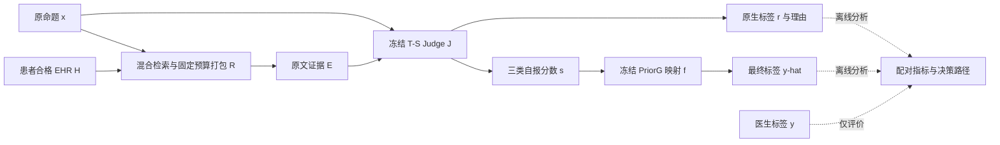

# 面向患者病历的临床事实核验：证据利用、判定边界与错误支持的分层研究

**英文工作标题：** Patient-Specific Clinical Fact Verification: Disentangling Evidence Use, Decision Boundaries, and False Support

> **草稿版本说明（投稿前删除）：** 本稿的事实与数值截止于仓库提交 `5ec748edd63be29d35fa920f10874aa158501ae5`，即 094 结项。它是一份以已完成结果为依据的中文论文正文，而非 095 的预期结果稿。当前采用“冻结核心 Judge 的核验系统＋受控组件研究”的论证主线；095 的方法及全量结果仅留有明确插入点。正文中的 `SOURCE`、`PARA`、`UPDATE` 注释用于后续修改溯源，不进入投稿正文。参考文献编号 `[1]` 等为论文文献；实验来源见配套说明文件与 `data/evidence_registry.json`。

作者、单位、通讯作者：⟦待作者填写⟧

## 摘要

利用患者电子病历核验临床文本，需要判断记录是否支持完整命题，而不只是检索到相近主题。核验系统的总体一致率提升还可能来自类别判定边界变化，从而掩盖错误支持及少数类识别的损失。针对这一问题，本文构建无需微调核心大模型的患者级核验链路，并将证据构造、原生判断与最终分数映射分开评价。系统采用有预算约束的混合检索证据、冻结的推理评分 Judge 和固定类别修正；研究通过同命题配对、组件替换及逐例决策路径分析，区分信息利用变化与类别取舍。在 VeriFact-BHC 的 24 名患者、956 条历史共同命题上，该系统相对原 VeriFact 发布预测将 PA 从 79.39% 提高到 81.90%，MCC 从 0.4807 提高到 0.5706，错误支持从 68 条减少到 41 条；但 NS 召回由 47.06% 降至 40.20%，总体优势并非所有类别同时改善。固定证据与后处理的受控实验进一步表明，原生净增益不一定保留到最终结果，来源可追溯或输入可逆也不自动带来核验增量。结果支持在有限证据与计算预算下联合评价分类质量、错误支持和成本，并为冻结 Judge 的后续改进提供可核查的依据。

**关键词：** 临床事实核验；电子病历；检索增强；大语言模型；错误支持；决策边界

<!-- SOURCE:E092,E092T,E078,E091,E093,E094. UPDATE: ABSTRACT_REPLACE_AFTER_095. 956不是全量或独立外测；不得把这些数字换成095假设值。 -->

## 1 引言

<!-- PARA:I1 应用问题与意义：从患者临床文本落到患者自身EHR，不泛谈AI革命。 -->
临床文本概括患者的病情、治疗和病程，文本中的陈述应当与该患者已有记录相一致。对于大语言模型生成的病程摘要，一项治疗在医学上合理，并不意味着这位患者实际接受了治疗；同样，记录中出现某个检查结果，也不意味着它属于命题所指的时间或事件。因此，临床事实核验的目标不是判断一句话是否符合一般医学知识，而是核查患者记录是否支持这条具体陈述。VeriFact 将长篇临床文本分解为命题，并利用患者电子病历进行检索和模型判断，为这一任务提供了系统实现与医生标注数据[1,2]。

<!-- PARA:I2 相关工作按路线概括，然后提出与本题对应的差别。 -->
现有事实核验研究大体沿两条路线展开。一条路线面向文本中的声明检索证据，再判断声明是否被支持，FEVER、FActScore 和 VeriFact 分别在开放知识、长文本事实精度和患者记录核验中体现了这一思路[1,3,4]。另一条路线通过问答或独立核查过程发现生成内容的不一致，例如 QAGS 比较来源文本与摘要的回答，Chain-of-Verification 则将核查问题与初始回答的影响分开[5,6]。这些工作说明了证据检索与核查过程的重要性，但它们的任务标签、证据范围和评价对象并不相同，不能直接用各自论文中的总体数字判断患者级三分类核验的优劣。

<!-- PARA:I3 具体研究缺口：不指控文献均未报告风险，而是明确本文要解释的量。 -->
在患者级核验中，仍需回答一个具体问题：当系统提高了与医生标签的一致率，这种改善来自更充分的证据利用，还是来自更倾向于输出某一类别？两者可能给出相近的总体成绩，却具有不同的错误结构。尤其当 Supported 占多数时，将部分非支持判断改为 Supported，既可能恢复正确陈述，也可能错误接受原本不受支持的内容。单一总体指标不能区分这两种效果；同样，能追溯到原文的引用只表明来源存在，并不能单独证明引用支持了完整命题。

<!-- PARA:I4 目标→要求→客观挑战，避免将方法清单当挑战。 -->
本文的目标是在不微调核心 Judge 的条件下，形成一个具有竞争力的患者级核验参照系统，并识别证据处理与最终决策分别带来的收益和代价。为达到这一目标，需要满足三个要求。首先，在有限输入预算内保留核验所需的患者信息，而不仅是主题相关段落；其次，分别评价原生判断与最终标签，避免把分数边界变化误认为语义能力提升；最后，在总体一致率之外保留 NS、NA 与错误支持指标，使改进不依赖对少数类损失的隐藏。难点在于这些要求相互影响：新增证据可能改变模型评分，冻结边界又可能放大或抵消这种变化。

<!-- PARA:I5 中心思路与问题分解，不宣称尚未完成的新算法。 -->
为此，我们将核验链路分为证据构造、原生推理评分和最终决策三个环节。证据构造采用固定预算的混合检索与重排；原生推理评分在同一次模型回答中保留判断、理由和三类分数；最终决策沿用冻结的类别修正。与仅比较系统总分不同，本文在固定命题、证据或模型输出的条件下构造对照，并追踪每条命题从原生标签到最终标签的变化。该分层设计不增加部署时的模型训练，其作用是使“何处改变、改变了什么、是否付出新的类别代价”能够被分别检验。

<!-- PARA:I6 实验概述：总体位置+一个关键解释，不罗列全部任务编号。 -->
我们在 VeriFact-BHC 上组织同 ID 系统比较、组件消融、证据预算对照及决策路径分析，并将监督式文本核验器作为替代路线参照。在已有 956 条共同命题上，冻结 Judge 系统相对原作者预测同时取得更高的 PA、MCC 和 Macro-F1，并减少错误支持；类别分解则显示 NS 识别仍有损失。在另一组组件比较中，推理评分与类别修正的组合优于单独观察原生标签，但小偏置并未产生额外标签增量。这些结果表明，系统层面的竞争力与组件层面的作用解释需要同时建立。

<!-- PARA:I7 贡献只写已完成内容；095若成功按指南更换，不把B的收益移交给095。 -->
本文的贡献主要体现在三个方面：

1. **建立无需微调核心 Judge 的患者级核验参照链路及统一比较。** 在同一命题集合上比较原作者系统、固定示例和监督式替代方法，同时呈现总体质量、类别识别和错误支持的取舍。
2. **给出证据—原生判断—最终决策的分层效应分析。** 通过固定输入、匹配对照及逐例转移，定位原生收益被保留、被追平或被抵消的具体路径，而不把总体分数提升归于未经检验的语义机制。
3. **提供前处理与辅助核验的可复查效用证据。** 对有预算约束的证据、重复原文折叠及答案隔离核验分别检验操作有效性、分类增量与计算代价，明确哪些组件有收益、哪些尚未形成系统升级。

全文先定义患者级核验任务并总结研究观察，再介绍系统与分层分析，随后通过总体比较、组件对照和成本实验验证各项结论，最后讨论相关工作与适用边界。

## 2 任务定义与研究观察

### 2.1 核验对象、输入和输出

设患者的合格参考病历集合为 $H$，待核验的原子命题为 $x$，检索与打包得到有限证据包 $E=R(x,H)$。系统输出 $\hat y\in\mathcal{Y}$，其中 $\mathcal{Y}=\{S,NS,NA\}$。医生参考标签记为 $y$，三类含义沿用数据集定义[2]。

**表1　任务标签及其判断对象。**

| 标签 | 含义 | 容易混淆但不等价的情况 |
|---|---|---|
| S：Supported | 患者参考 EHR 充分支持完整命题 | 仅出现相同疾病、药物或检查名称，不自动构成完整支持 |
| NS：Not Supported | 命题不被支持、仅部分支持或与记录矛盾 | 不只限于存在一句明确反向表述 |
| NA：Not Addressed | 参考 EHR 未涉及相应内容 | 当前检索包未找到内容，不自动等于完整参考 EHR 未涉及 |

这里需要区分两个对象：医生标签依据的参考病历 $H$，以及模型实际可见的有限证据 $E$。参考病历本身也不是患者现实经历的完整记录。因此，本文测量的是系统与发布医生标签的一致性，而非对患者所有临床事实的绝对真值认证。当前实验以发布的原子命题为单位；整篇文档的问题定位是应用目标，不将命题级结果直接解释为已经完成整篇文档端到端验证。

<!-- SOURCE:E092；文献[2]。 -->

### 2.2 设计目标与约束

系统应在同一有效命题集合上提高三分类质量，同时控制真实非 S 被错误接受为 S 的数量，并保持可承担的输入和调用成本。由于本研究没有临床专家给定的统一损失权重，我们不将这些目标压缩成一个人为设定的加权总分，而是联合报告 PA、MCC、Macro-F1、类别指标和错误支持。

核心 Judge 的模型权重保持冻结；证据只能来自对应患者的合格 EHR，不将模型生成的解释当作新病历。历史冻结的分数修正使用了开发标签，因此“核心模型无需微调”不等于“整个研究完全不使用监督”。这一约束保留现成大模型的使用方式，也要求新增流程通过真实的信息作用而非重新训练核心分类器来证明价值。

### 2.3 三项观察及其设计含义

**观察一：提高总体一致率可能同时增加错误支持。** 在历史 40 名保留患者的 3,571 条共同有效命题上，对同一次非 thinking 评分采用固定 S 偏置后，正确数净增加 177 条，错误支持却增加 123 条。它说明边界修正确实能产生分类增量，也说明增量必须与错误流向一起解释。由此，本文在系统比较中同时保留原生标签、最终标签和错误支持，而不只保留最终正确数。

<!-- SOURCE:E036。此观察来自历史非thinking系统，不是当前B的全量验证。 -->

**观察二：更长的检索输入不自动带来更高的最终正确数。** 在相同 Judge 的证据桥接实验中，作者发布证据与 C48 的平均字符量相差明显，但接同一 T-S 与冻结修正后，192 条命题的正确数相同。这一观察支持将证据预算作为独立变量考察，而不是用输入长度推断证据质量；它并不证明任意压缩都不会损失性能。

<!-- SOURCE:E078。 -->

**观察三：原生优势与最终优势可能不同。** 固定示例压缩实验中，P90 相对完整示例 F4 的原生净优势为 7 条，最终只保留 2 条。逐例核查显示，既有候选被后处理改错，也有基线被后处理救回而追平候选。因此，不能把净差缩小统一解释成后处理“破坏了推理”；需要对两臂的全部决策路径作配对分解。

<!-- SOURCE:E091。这些观察是对已完成实验的逻辑归纳，不虚构研究发现的先后顺序。 -->

## 3 核验系统与分层分析方法

### 3.1 系统概览

系统由三个部署环节组成：第一步从患者 EHR 构造固定预算证据；第二步由冻结 Judge 产生原生标签和评分；第三步将评分映射为最终三分类。相应数据流为

$$
(x,H)\xrightarrow{R}E,\qquad J(x,E)=(r,s),\qquad \hat y=f(s),\tag{1}
$$

其中 $r$ 是原生标签，$s=(s_S,s_{NS},s_{NA})$ 是模型自报三类分数。原生理由与引用保留用于分析，但不因 $f$ 改变标签而自动变成最终标签的有效解释。医生标签 $y$ 只进入离线评价，不进入目标病例的推理请求。

**图1　系统及分析流程（可编辑结构稿）。** 实线箭头为真实部署数据流，虚线箭头为离线评价。图中没有训练核心 Judge 的步骤；离线标签不反馈给正在核验的目标命题。



> 图1在支持 Mermaid 的 Markdown 阅读器中可直接显示；独立源文件为 `assets/fig01_system_overview.mmd`。期刊排版时将其绘制为矢量图。不得在095未完成时向图中加入一个被画成已验证的新模块。

### 3.2 固定预算的患者证据构造

证据构造的目标是在限制输入长度的同时，保留词面和语义两类召回信息。系统以原 claim 分别进行 BM25 和 BGE 稠密检索，将候选合并到 C48，再用原 claim 重排。最终按冻结顺序打包原文，约束为最多 16 段、每份 note 最多 2 段，并采用约 8,000 字符的证据预算。C48 指候选规模，不表示最终输入包含 48 段。日期、来源和原文范围用于回查，而不是额外的医学证据。

不同历史任务的序列化前缀与来源头使实际 reference 总字符数略有差异，因此本文以请求中保存的实际 reference 及其指纹为比较依据，而不假定所有输入严格等于 8,000 字符。证据替换对照固定其余 Judge 条件；同一配置的重复记录按照冻结来源规则使用，不根据分类正确性挑选回答。

这一环节不预设检索相关性等于核验充分性。C48 的实用作用是提供预算可控、可复用的证据参照；它能否保持分类质量，需要第5.3节的同 Judge 证据替换实验验证。

<!-- SOURCE:E078,E078T,E092。C48具体工程源链见指南；未声称检索器创新或普遍无损压缩。 -->

### 3.3 原生推理评分与冻结判定

为了区分模型判断与后处理作用，T-S 在一次调用中返回原生 verdict、理由、核查字段及三类 `label_scores`。当前配置使用 `deepseek-v4-flash-0731` 的 thinking-high 设置，温度为 0，最大输出预算为 8,192 token；它不加入 F4 示例。自报分数用于类别排序，不视为模型原生 token 概率或已校准的临床正确概率。

设 $\ell_c=\log\max(s_c/100,10^{-6})$。冻结 PriorG 的最终规则写为

$$
\hat y=\arg\max_{c\in\mathcal{Y}}
\left[\ell_c+\log\frac{\pi_{\mathrm{ref},c}}{\pi_{\mathrm{cal},c}}
+g\,\mathbf{1}(c=S)\right].\tag{2}
$$

类别次序为 S、NS、NA，冻结比例分别为 $\pi_{\mathrm{ref}}=(1108,100,170)/1378$ 与 $\pi_{\mathrm{cal}}=(48,47,48)/143$，$g=0.1342909508820116$。这些值来自历史开发材料；本文的组件比较不重新拟合它们。平分采用冻结实现的 NS、NA、S 优先次序。G 是一个类别偏置，不是历史双模型 Gate。

为识别每部分作用，我们同时保留 U0、U2 和 prior-only。U0 直接取原始分数最大类；U2 在 S 的对数分数上加固定值 2；prior-only 只使用式(2)中的类别比例项。原生 verdict 与 U0 定义不同，即使某一队列中逐例相同，也分别存储。冻结映射是明确的判定工作点，不自动保证跨证据包、提示或患者分布的概率校准。

<!-- SOURCE:E053CODE,E078,E092MS。 -->

### 3.4 将分类增量分解到可观察路径

本节的目标是区分“模型原生判断改变”与“同一分数经过不同决策边界产生的改变”。对固定的共同有效集合，记配置 $a$ 的原生、最终正确数为 $C_a^{\mathrm{raw}}$ 和 $C_a^{\mathrm{final}}$，则任意候选 $a$ 与对照 $b$ 满足

$$
C_a^{\mathrm{final}}-C_b^{\mathrm{final}}
=\left(C_a^{\mathrm{raw}}-C_b^{\mathrm{raw}}\right)
+\left(C_a^{\mathrm{final}}-C_a^{\mathrm{raw}}\right)
-\left(C_b^{\mathrm{final}}-C_b^{\mathrm{raw}}\right).\tag{3}
$$

式(3)是计数恒等式，而非模型内部推理的因果定理。它将最终净差写为原生净差与两臂后处理净作用之差。随后依据每条命题的 $y,r,\hat y$，检查候选救回是否被保留、基线是否被追平，以及候选是否新增伤害。无效或回退病例先单独标记，避免把备用答案造成的变化归于上游机制。

错误支持还需要独立于净正确数计量。对于只把非 S 改为 S 的决策操作，可将改变分为真 S 被救回 $R$、原本正确非 S 被改错 $H$、原本已错的非 S 再变为错误 S 的 $W$，于是净正确变化为 $R-H$，新增错误支持为 $H+W$。这一分解只适用于上述单向改变；对一般三分类方法，我们使用完整混淆转移，不套用单向公式。

证据侧采用相同的可观察原则：来源引用是否可定位、正文是否保留、实际取证内容是否改变、变化是否对应新增正确，分别记录。来源校验是必要工程条件，但它本身不是分类机制有效的充分条件。

<!-- SOURCE:E036,E091,E093C,E094C；式(3)为对现有计数分析的统一表达，不主张首创。 -->

### 3.5 后续方法插入点

> **⟦待补：METHOD_095⟧**　本节暂不陈述095已实现或已有效的方法。若095确实完成“证据锚定的最小差异核验”，并有匹配的锚点对照支持其独立增量，应按“目标→原理→可执行设计→输入输出→代价→小结”增加正式方法小节，更新图1和算法。若未运行、仅基线完成或新机制无增量，删除本占位节并保留当前实证主线。详细分支见《后续实验与改稿指南》。

## 4 实验设置

### 4.1 数据与评价单元

使用 MIMIC-III-Ext-VeriFact-BHC v1.1.0[2]。该资源来自 MIMIC-III[7]，包含 100 名患者的 human-written 与 LLM-written 简要住院经过、句子级和原子命题级陈述，以及医生判定和作者发布系统预测。资源总计 13,070 条命题；本文主要使用其中 9,065 条有效原子命题，排除发布有效性标记为无效的 30 条原子命题。有效集合的 S/NS/NA 数量为 7,035/693/1,337，human/LLM 数量为 5,624/3,441。

本文不重新拆分原子命题或调整医生标签。325 条时间元数据冲突记录予以保留并在源分析中分层；对照使用相同 claim 和参考输入指纹。9,065 条中，7,248 条沿用历史 C48，1,817 条按既有规则以本地 BGE 补齐，两条文本模型使用相同输入；这一来源差别登记为实现分支，不称本地与 API 路径逐字等价。

<!-- SOURCE:E092。 -->

### 4.2 比较队列及各自用途

**表2　实验队列与能回答的问题。不同队列可能重叠，不相加作为独立样本数。**

| 队列 | 命题／患者 | 用途 | 分母及适用边界 |
|---|---:|---|---|
| 历史保留患者评价 | 3,571／40 | 同次非thinking评分的边界与标准校准比较 | 原3,573条中的共同有效集合；不是当前B验证 |
| 组件主队列 | 384／24 | 模式、评分接口与冻结决策消融 | 保留事前回退；374条共同核心有效另验 |
| 证据桥接子集 | 192／24 | 相同Judge下替换原作者证据与C48 | 组件队列子集，不是新增192条独立样本 |
| 历史共同系统集合 | 956／24 | 原作者、B、F4和文本模型同ID比较 | 历史混合选样；935条共同core、924条排示例患者另验 |
| 示例压缩决策子集 | 167／22 | 同ID分解原生与最终增益 | 自然176条中的四臂共同core；非新独立试验 |
| 重复折叠面板 | 自然90／18；压力30／17 | 程序可逆与补证效用 | 自然最终共同core为88；两面板不合并 |
| 答案隔离面板 | 自然20／19；机制12／12 | 匹配可见／隔离取证流程 | 实际问答分别16与10条；自然无NS |
| 文本模型全量集合 | 9,065／100 | Frozen/Fine-tuned患者分组预测 | OOF适用于新增文本模型，不赋予历史B同样身份 |

历史保留患者评价在当时按冻结协议进行；后续开发与文本交叉验证使用了既有材料。本文保留这些证据的形成方式，不把较晚方法自动赋予早期保留患者试验的验证资格。历史共同集合按照固定来源优先级连接原始回答，不能把多次出现的同一命题计为新样本。

<!-- SOURCE:E036,E078,E078T,E091,E092,E093,E094。 -->

### 4.3 比较方法与公平控制

**原作者系统。** 使用数据集发布的固定 VeriFact 配置对应预测，项目绑定为 R1-70B、100 sentence facts、rerank、absolute time 等发布条件；按当前各表的同一 ID 重评，不取论文摘要的最高分，也不把现代模型替换运行称为原系统复现。原作者系统与 B 的整体比较含证据、模型及实现差别；单独的证据效应通过同 Judge 桥接检验。

**冻结 Judge 变体。** N-V/T-V 表示非thinking/thinking-high 的普通判断接口，N-S/T-S 表示增加三类评分的接口。thinking与非thinking的最大输出预算分别为8,192与2,048 token，因此该对照包含推理设置及生成预算，不视为纯内部思考机制消融。F4只在T-S输入中加入四个固定医生示例。Std-M、Std-V和Gate-A沿各自历史患者外参数使用，分别代表多类偏置、逐类缩放及风险筛选对照。

**监督式替代方法。** Frozen和Fine-tuned均直接输入claim与C48，独立输出三分类，不经过T-S或PriorG。两者使用DeBERTa-v3-large NLI checkpoint、512-token窗口与注意力聚合；Frozen只训练6,148个头部参数，Fine-tuned另更新第24层，总可训练参数12,602,372。五折每折64名患者梯度训练、16名内部验证、20名外层预测；最多5个epoch，以内部MCC优先选epoch。两臂的输入、聚合头、普通交叉熵和拆分保持一致。它们作为需要任务监督的替代参照，不组成本文的冻结Judge部署主链路。

**前处理与辅助核验。** 重复折叠采用B／仅折叠／折叠后补证；答案隔离采用B／答案可见问答／答案隔离问答。各任务只在自身共同ID内比较；相同请求共享回执是去重执行，不是独立重复。模型生成的辅助记录与EHR原文分离。

<!-- SOURCE:E078,E092,E093,E094。 -->

### 4.4 指标、配对和缺失处理

PA衡量与医生三分类标签完全一致的比例；MCC反映整体混淆结构，Gwet AC1衡量机会校正一致性；Macro-F1对三个类别等权。还报告每类precision、recall、F1及完整混淆矩阵。对于真实非S被判为S的错误，定义

$$
N_{\mathrm{FS}}=\sum_i\mathbf{1}(y_i\ne S\land\hat y_i=S),\qquad
\mathrm{FSR}=\frac{N_{\mathrm{FS}}}{\sum_i\mathbf{1}(y_i\ne S)}.\tag{4}
$$

预测S中的错误比例另记为S假发现率，其分母是预测S数量，而非真实非S数量。两者不混用。仅包含NS/NA的压力面板中，任何预测S都必然错误；该面板的S假发现率不能外推到自然分布。Macro-F1遵循固定三类评价及零除处理，某类不存在时的零项不解释为该类已被充分检验。

成对比较优先使用项目公共评价实现及1,000次患者cluster bootstrap，重抽患者及其所有命题而非将命题视为独立患者。区间条件于已保存预测，不覆盖模型训练随机性或所有历史方法选择。正文仅对已有源结果提供区间，不由聚合混淆矩阵推造患者配对显著性。

原生标签有效性与分数核心有效性分别检查。历史任务的事前回退结果保留并标明；较晚任务没有最终分数时，另报共同core结果和完整分母覆盖，不补造分数或自动置为NA。不同规则的分母不混合。

### 4.5 计算与费用口径

API费用由实际输入、输出usage和对应历史价格计算；缓存命中、未知费用与物理请求去重按任务记录处理。本文的历史费用表沿用当时的统一未优惠估算，不用之后的闲时价回写旧数字。单个部署配置的逻辑费用与完成多臂试验的物理总费用分开，复用同一回执不会在总账中重复计费。

局部Judge成本不包含未实测的完整检索成本；本地文本模型的缓存层推理也不代表新患者端到端耗时。涉及人工问题审核的原型单独说明审核要求，未知GPU租金或人工时间不记为零。

## 5 实验结果与分析

### 5.1 冻结Judge系统的总体位置与类别取舍

在956条历史共同命题上，B相对原作者预测具有更高的总体一致性和更少的错误支持，但没有同时提高所有类别召回。表3给出同ID主比较，图2进一步拆出类别差异。

**表3　956条共同命题上的比较。B/F4沿历史冻结回退；文本模型为患者外预测。**

| 配置 | MCC↑ | PA↑ | 正确数／956 | false-S／231↓ | AC1↑ | Macro-F1↑ |
|---|---:|---:|---:|---:|---:|---:|
| Original | 0.4807 | 79.39% | 759 | 68 | 0.7432 | 0.5952 |
| B＋PriorG | 0.5706 | 81.90% | 783 | **41** | 0.7711 | **0.6543** |
| F4＋PriorG | **0.5722** | **82.95%** | **793** | 52 | **0.7871** | 0.6488 |
| Frozen文本模型 | 0.4132 | 76.15% | 728 | 83 | 0.7025 | 0.5032 |
| Fine-tuned文本模型 | 0.4863 | 80.54% | 770 | 83 | 0.7614 | 0.5228 |

<!-- SOURCE:E092,E092T；data/results_verified.json:common956。 -->

B相对Original多判对24条，错误支持少27条。该优势主要来自NA识别：NA召回从41.09%提高到72.87%，而S与NS召回分别从90.76%和47.06%降至89.38%和40.20%。因此，B在该集合上具有较好的整体及错误支持取舍，但不能据此称其矛盾识别或全部少数类能力均更强。

F4相对B多判对10条，同时增加11条错误支持。S召回提高到92.14%，NS与NA召回则分别降到35.29%与68.99%。MCC点值只有很小变化，Macro-F1略低。它体现的是固定示例带来的类别取舍，而不是一个可以由总体正确数单独决定的升级。


**图2　相同命题集合上的三类召回。** 真实S/NS/NA分别为725/102/129。B的主要识别收益在NA；F4增加S召回但损失NS/NA。该图没有患者置信区间，不作显著性标注。

移除两名实际示例患者后，924条上B/Original正确数为756/736，错误支持为41/67；F4为765正确、51条错误支持。仅保留B/F4双方核心有效的935条时，B/F4正确数为764/772，MCC为0.5716/0.5700，错误支持仍为41/52。主要类别取舍并非仅由回退或实际示例患者造成，但这些集合相互包含，不作为独立重复证据。

<!-- SOURCE:E092T。 -->

### 5.2 组件消融：主要收益来自哪一个环节

组件主队列的结果表明，当前配置的主要分类增量来自推理评分与最终修正的组合，而非仅增加一个输出字段。表4保持384条相同ID，同时呈现有竞争力的标准后处理，避免将弱对照当作系统优势来源。

**表4　同384条命题的组件比较。raw行含该任务预定无效回退；回退不是组件的原生成功。**

| 配置 | MCC↑ | PA↑ | 正确数 | false-S↓ | 回退数 |
|---|---:|---:|---:|---:|---:|
| Original | 0.4840 | 80.73% | 310 | 19 | 0 |
| N-V：非thinking普通判断 | 0.4341 | 73.96% | 284 | 12 | 0 |
| N-S raw：非thinking评分 | 0.4406 | 73.96% | 284 | 12 | 0 |
| N-S＋U2 | 0.4708 | 80.73% | 310 | 23 | 0 |
| N-S＋Std-M | 0.4955 | 83.33% | 320 | 27 | 0 |
| N-S＋Std-V | 0.4876 | 83.07% | 319 | 27 | 0 |
| T-V：thinking普通判断 | 0.4910 | 75.00% | 288 | 6 | 4 |
| T-S raw：thinking评分 | 0.5019 | 75.26% | 289 | 6 | 6 |
| T-S＋U2 | 0.5430 | 79.95% | 307 | 9 | 6 |
| T-S＋prior-only | 0.5887 | 83.59% | 321 | 10 | 6 |
| B：T-S＋PriorG | 0.5887 | 83.59% | 321 | 10 | 6 |

<!-- SOURCE:E078,E078T。 -->

首先，要求额外输出分数本身没有形成明显原生增量：N-V与N-S raw正确数相同，T-S raw比T-V仅多一条。评分接口的重要作用是提供可检查的后续判定输入，而不是仅凭“多打分”提高判断能力。其次，在同一U2规则下，从N-S改为T-S使错误支持从23降到9，却少判对3条；因此，thinking配置的主要变化也不能只用准确率改善概括。

在T-S自己的输出上，Frozen PriorG将原生正确数从289提高到321，对应34救回、2伤害，错误支持从6增至10。与T-S＋U2相比，正确数净增14，MCC差为0.0457，已有患者区间为[0.0150, 0.0754]。不过，prior-only与完整PriorG在该队列逐例同标签，小G没有独立分类贡献。因此，类别比例项是本队列中主要的边界作用来源，小G不构成额外分类增量。

相对Original，B的MCC差为0.1047，95%患者区间为[0.0251, 0.1785]；PA差为2.86个百分点，区间为[−0.52, 6.25]。374条共同核心有效敏感性中，B仍为313条正确、MCC 0.5875，Original为302条正确、MCC 0.4834。该组实验支持MCC方向的改善，但不能将其替代为956条或全量9,065条的显著性结果。

### 5.3 证据预算：较短输入的作用与代价

证据桥接实验的目的，是在相同Judge下检验C48能否以更短输入保持有竞争力的结果，而不是把原作者和当前系统的全部差异归于检索。表5显示，两套证据接同一T-S与PriorG后正确数相同；C48的MCC点值略高、错误支持略少，但差异不足以建立普遍的精度优势。

**表5　192条相同命题、同一T-S＋PriorG下的证据替换。费用仅为共同有效桥接中的Judge平均估算。**

| 实际证据 | 平均reference字符 | 正确／192 | MCC | false-S | Judge均费（元／例） |
|---|---:|---:|---:|---:|---:|
| 作者发布reference | 22,474 | 162 | 0.5774 | 7 | 约0.03819 |
| C48 | 8,056 | 162 | 0.5970 | 5 | 约0.02592 |

<!-- SOURCE:E078。字符统计与费用共同有效范围不同，应保留表注，不重命名全系统成本。 -->

C48的平均字符量约为发布reference的36%，Judge平均费用约低32%。这说明当前有限证据方案具有成本上的实际价值。另一方面，在原生T-S层，C48比作者证据少判对5条；最终正确数相同还包含后处理的作用。由于本实验没有预设非劣效边界，结论应限于“较短输入获得相近点估计和较低Judge费用”，而非“已经证明压缩无损”。

### 5.4 为什么原生收益会缩小：同例决策路径分析

P90在四条固定示例中抽取信息覆盖原文，目标claim和C48保持不变。在167条四臂共同核心有效命题上，P90相对F4的raw为9救回、2伤害，净增7；接Frozen PriorG后变为4救回、2伤害，净增2。图3给出式(3)的逐例展开。


**图3　同一167条命题中，P90相对F4的正确数差由+7变为+2。** 四条基线被后处理救回使差距减少4；一条候选原生正确被改错使差距减少1；两条原生伤害被修复使差距增加2；另外两条最终层新增伤害使差距减少2。该图是计数分解，不是对内部推理的因果估计。

结果表明，原生改进没有完全保留，并不全是候选被改坏：相当一部分来自原本较弱的F4被后处理追平。与此同时，P90最终错误支持为10条，高于F4的7条，也高于该子集B的9条。因而，P90的原生信号值得保存，但不构成替换默认B的最终系统优势。

类别对分数排序也没有提供一致增强的证据：自然子集S–NS、S–NA、NS–NA对数分数比AUC的P90−F4点差分别为−0.0079、−0.0324、−0.0385，三个患者区间均跨0。固定类别偏置只平移类对对数分数比，不改变其排序，因此原生和最终工作点差异还需与分数可分性分开理解。

<!-- SOURCE:E091。 -->

### 5.5 前处理与辅助核验：操作成功不等于方法增量

重复折叠和答案隔离提供了两种性质不同的受控检验。前者检验在不丢原证据、不给更多字符的条件下补入候选是否有用；后者检验取证时不见待证答案能否改善后续分类。表6只比较各面板内部，不合并自然与压力组成。

**表6　两类原型的最终结果。每格为“正确数／MCC／false-S”。**

| 实验面板 | Original | B | 中间对照 | 完整候选 |
|---|---|---|---|---|
| 重复折叠：自然共同core 88 | 72／0.4960／3 | 76／0.6250／1 | 仅折叠：77／0.6335／2 | 折叠补证：76／0.6130／2 |
| 重复折叠：压力30 | 11／0.1796／14 | 17／0.4103／10 | 仅折叠：16／0.3487／10 | 折叠补证：18／0.4382／9 |
| 答案隔离：自然20 | 19／0.8013／0 | 19／0.7935／0 | 可见问答：19／0.7935／0 | 隔离问答：19／0.7935／0 |
| 答案隔离：机制12 | 5／0.1387／3 | 9／0.6316／0 | 可见问答：8／0.5164／2 | 隔离问答：9／0.6316／1 |

<!-- SOURCE:E093,E093T,E094,E094T。 -->

**重复折叠。** 程序确实可将折叠输入展开为原B，并在同字符预算内增加旧候选原文，但自然90条和压力30条中实际补证仅12条与4条。自然共同core上，完整候选相对B没有新增正确，错误支持增加一条；压力上只多识别一条NS。病例显示，最终唯一救回的三臂原生标签均为NS，差异来自分数跨边界，新增原文未被确认是决定性反证。因此，本轮没有建立由空间回收获得关键新信息、进而改善分类的证据链。

**答案隔离。** 32条问题中26条通过执行者语义审核并进入问答，取证请求确实隔离了登记的待证取值。26对可见／隔离记录中，只有3对被内容核查识别为有效覆盖变化，而这3对均未改变raw或final标签。机制面板的隔离问答相对B救回一条NS、伤害一条NA，并把另一条原本已错的NA推为S。相对可见问答的唯一最终优势，还涉及可见臂引用无效，不能归因于双方有效条件下的纯隔离效应。

这两类结果的共同含义不是“证据组织和独立核验都无效”，而是新增操作需要完成更长的证据链：先确认操作真正改变了可用信息，再检验信息是否改变判断，最后确认这种变化保留为系统收益。来源合法、格式正确、回答不同，均不能替代最后一步。

<!-- SOURCE:E093C,E094C。 -->

### 5.6 监督式文本模型：总体学习增量与少数类能力不同

监督文本模型作为替代路线，检验允许医生标签更新文本表示时能获得多少增量。表7只在完整9,065条集合内部比较，不将B的956条分数混入全量表。

**表7　9,065条全量原子命题上的监督式参照。Frozen/Fine-tuned为患者分组OOF；Original为同ID发布预测。**

| 配置 | MCC | PA | 正确／9,065 | false-S／2,030 | Macro-F1 | S／NS／NA召回 |
|---|---:|---:|---:|---:|---:|---|
| Original | 0.4959 | 80.87% | 7,331 | 573 | 0.5918 | 91.74%／49.06%／40.16% |
| Frozen | 0.4433 | 79.47% | 7,204 | 764 | 0.5167 | 89.14%／6.49%／66.42% |
| Fine-tuned | 0.5156 | 83.07% | 7,530 | 745 | 0.5569 | 93.56%／8.95%／66.27% |

<!-- SOURCE:E092,E092T。 -->

Fine-tuned相对Frozen净多判对326条，来自603救回与277伤害，MCC差0.0722的95%患者区间为[0.0565, 0.0887]。这一增量成立于匹配输入与聚合头下的顶部单层更新。不过，类别净正确变化为S +311、NS +17、NA −2，收益主要来自真S恢复。相对Original，Fine-tuned虽然多判对199条，但NS正确数少278条，错误支持多172条，Macro-F1更低；它不能据总体PA直接替换冻结Judge主链路。

在共同956条上的一次融合相对B增加12条正确，同时增加23条错误支持，MCC略降。相对匹配的bias-only对照，融合多判对9条、错误支持少15条，说明有有限互补信息，但尚未兑现为默认系统升级。文本监督与冻结Judge是不同计算和监督条件下的参照，不能把训练所得优势称为免训练改进。补充类别图见附录A。

### 5.7 运行代价与可用范围

成本比较显示，输入预算控制与增加辅助核验并不是同一种效率变化。C48在证据桥接中的Judge均费下降，而答案隔离增加了问题生成和取证调用。自然面板Q均费约0.03652元，B约0.02550元；机制面板Q约0.03845元，B约0.02630元，分别增加约43.2%和46.2%，但未取得最终净正确增量。

重复折叠试验的物理总费用为4.097118元，答案隔离为2.508135元；这些是完成各自多臂试验的费用，不是每个部署方案的价格。答案隔离还需要执行者问题审核，其人工时间没有计入上述API数值。文本模型的本地推理没有新增API费用，但训练、GPU和缓存仍消耗计算资源，不能记为零总成本。

因此，实际可用性需要同时回答三件事：每个病例是否真的触发新操作，触发后是否提高分类，以及为此付出了多少额外调用或人工负担。仅压缩字符量或仅减少某类错误，均不足以独立证明部署优势。

<!-- SOURCE:E078,E093,E094,E092ARCH。 -->

### 5.8 全量冻结Judge与095新机制结果：待补区

> **⟦待补：FULL_B_AND_095_RESULTS⟧**　截至本稿版本，当前B没有在本稿中被赋予一组已核验的9,065条全量结果，095也没有可写入的完成结果。表8只保留已知全量原作者行，其余为显式缺失。若095最终只完成部分ID，应按该部分ID重新计算Original及所有比较方法，不能复制7,331／9,065到部分范围。

**表8　后续全量主表模板。以下“待补”不是0，也不是预期效果。**

| 配置 | 目标N／实际有效N | MCC | PA | 正确数 | false-S／真实非S | Macro-F1 | 额外调用率／成本 |
|---|---|---|---|---|---|---|---|
| Original（仅当实际ID为完整9065） | 9,065／9,065 | 0.4959 | 80.87% | 7,331 | 573／2,030 | 0.5918 | 历史系统，不虚构当前费用 |
| 当前B＋PriorG | ⟦B_FULL_COVERAGE⟧ | ⟦B_FULL_MCC⟧ | ⟦B_FULL_PA⟧ | ⟦B_FULL_CORRECT⟧ | ⟦B_FULL_FALSE_S⟧ | ⟦B_FULL_MACRO_F1⟧ | ⟦B_FULL_COST⟧ |
| 095匹配的证据锚点对照 | ⟦E095_COVERAGE⟧ | ⟦E095_MCC⟧ | ⟦E095_PA⟧ | ⟦E095_CORRECT⟧ | ⟦E095_FALSE_S⟧ | ⟦E095_MACRO_F1⟧ | ⟦E095_COST⟧ |
| 095实际完成的候选（名称待核对） | ⟦C095_COVERAGE⟧ | ⟦C095_MCC⟧ | ⟦C095_PA⟧ | ⟦C095_CORRECT⟧ | ⟦C095_FALSE_S⟧ | ⟦C095_MACRO_F1⟧ | ⟦C095_COST⟧ |

<!-- UPDATE:此节不是投稿正文可保留的空表。用实际结果整体替换，或在对应分支中删除。模板字段见data/pending095.template.json。 -->

## 6 相关工作

本节按“证据与任务对象、核查过程、监督表示与决策校准”组织相关研究，使每类方法的输入、输出和边界先被明确，再定位本文的比较范围。

### 6.1 以文本证据为参照的事实核验

FEVER将声明分类与证据寻找结合，并为支持和反驳类别标注相应证据[3]。FActScore面向长文本，将生成内容拆为原子事实并估计其中被可靠来源支持的比例[4]。VeriFact进一步把证据范围限定到患者个人EHR，使用检索增强与LLM-as-a-Judge进行命题核验，并发布医生标签、模型预测和实际检索上下文[1,2]。这三类研究在粒度和证据对象上构成由通用声明到患者记录的递进，但其标签和评价分母不能直接互换。

本文沿用VeriFact的患者级任务与发布标签，不重新创造评价对象。研究焦点是固定证据或模型输出后的组件增量，以及这种增量对错误支持和少数类的影响，而不是用跨数据集最高分证明优越性。

### 6.2 问答与独立核查过程

QAGS通过分别对来源和摘要提问、比较回答来检测事实不一致[5]。CoVe先生成核查问题，再独立回答并形成修订后的输出，以降低其他回答对核查的影响[6]。这些方法说明，改变核查过程可以成为不同于单次直接判断的技术路线，但其输出常是文本一致性评分或修订回答，并非患者EHR的S/NS/NA标签。

本文的答案隔离试验借鉴独立核查的思想，增加了明确的答案可见对照、原文引用检查和固定最终判定规则。由于当前原型未取得匹配对照下的分类增量，本文将它作为边界证据，而不声称已经复现原论文在其他任务上的优势。

### 6.3 临床监督表示与分数校准

MedNLI提供基于患者病史的医生标注自然语言推断数据，并研究迁移学习与领域知识利用[8]。DeBERTaV3通过预训练设计改善通用语言理解，为本文的文本监督参照提供模型基础[9]。在另一个层面，温度缩放和向量缩放属于已有的后处理校准技术，其目的与直接更新文本表示不同[10]。因此，表示更新、概率校准和类别判定改变应分别评价。

本文不将注意力聚合、顶部解冻或类别偏置作为首创。与仅比较一个训练后最高分不同，我们使用匹配的冻结文本对照和标准决策对照，明确任务监督带来的增量，以及其不能自动解决的NS识别和错误支持问题。

## 7 讨论与局限

### 7.1 当前结果意味着什么

冻结核心Judge并不妨碍构建有竞争力的临床核验系统。在已覆盖的共同范围内，B比原作者预测减少错误支持并提高多个总体指标；然而，这一结果仍伴随NS召回损失。对应用而言，它支持将B作为后续改进的清楚参照，而不是据此宣称可以直接替代临床判断。新增模块应证明超出B的独立效用，而不能继承B已有的全部优势。

### 7.2 证据充分性与判定边界不能相互替代

边界修正能恢复被原生Judge过度拒绝的真S，也可能放行不受支持的命题。降低错误支持可以通过更保守的判定获得，但如果同时拒绝大量真S，这只是工作点变化。反过来，更长、来源合法或经过结构化整理的证据也不自动充分。本文的逐例路径分析将这些现象区分开，为后续模块提供了可检验的设计要求：既要证明增加了哪种信息，也要证明这种信息保留为最终分类收益。

### 7.3 数据与统计边界

目前只有一个患者级数据资源，不同实验范围在患者或命题层面存在重叠。历史保留患者评价、新增开发面板和文本OOF不能合并为同一种验证。现有患者已被研究过程接触，患者bootstrap只反映固定预测下的重抽样不确定性。本文没有提供跨医院、前瞻性或新外部测试结果；缺少新增标注的证据充分性gold，也限制了对retrieval与reasoning错误的完全分离。

### 7.4 原型自动化与解释边界

重复折叠只保证字节可逆，不保证模型对共享正文与多处来源的理解完全不变。答案隔离依赖执行者审核问题，尚未形成全自动流程；引用校验只检验文本定位，不认证其医学含义。后处理改变标签时，原生理由也可能不再支持最终结果。因此，可追溯输出与正确解释是两个目标，不能仅通过保存引用ID就宣称系统具有可靠解释能力。

### 7.5 后续改进应由当前缺口驱动

后续研究应优先补齐冻结B的全量同ID结果，再针对具有足够可观察实例的事件、状态或关系差异设计匹配对照。对任何新机制，都需要同时保留正常样本、少数类与原本正确病例，检验新增信息是否优于简单证据呈现。只有在实际结果支持时，才能将新的信息操作提升为主方法贡献，而不以流程复杂程度代替证据。

## 8 结论

本文围绕患者EHR中的临床事实核验，建立冻结核心Judge的证据—推理评分—最终决策链路，并用同ID比较和逐例转移区分证据利用与类别边界作用。已有共同集合中，系统相对原VeriFact取得更高的总体一致性和更少的错误支持，但NS识别仍存在取舍；组件实验进一步表明，原生收益、可追溯来源和辅助核验流程都需要通过最终分类及成本验证。这些发现为有限计算预算下的患者级核验提供了可核查的系统参照和组件取舍依据，验证范围限于发布数据上的命题级判断。后续将以全量配对评价和具有独立信息增量的核验机制完善该研究。

<!-- UPDATE: CONCLUSION_REPLACE_AFTER_095，与摘要和引言贡献必须联动。 -->

## 数据、代码与伦理声明

本研究二次使用受访问要求约束的去标识化VeriFact-BHC及其来源MIMIC-III数据。共享材料包括方法代码、聚合指标和必要的复现说明；患者原文、私有模型回执及访问凭据不随本文草稿分发。机构伦理审查或豁免的适用情况、实际数据授权、作者贡献、资金来源、利益冲突及生成式AI辅助写作披露，须由作者在投稿前根据真实情况填写，不预填批准号或“无需审查”的结论。

## 参考文献

[1] Chung P, Swaminathan A, Goodell A J, et al. Verifying Facts in Patient Care Documents Generated by Large Language Models Using Electronic Health Records. *NEJM AI*, 2026, 3(1). DOI: 10.1056/AIdbp2500418. 在线发表日期：2025-12-24。对应预印本：*VeriFact: Verifying Facts in LLM-Generated Clinical Text with Electronic Health Records*, arXiv:2501.16672.

[2] Chung P, Swaminathan A, Goodell A, et al. *MIMIC-III-Ext-VeriFact-BHC: Labeled Propositions From Brief Hospital Course Summaries for Long-form Clinical Text Evaluation*, version 1.1.0. PhysioNet, 2026. DOI: 10.13026/7cqh-bc36.

[3] Thorne J, Vlachos A, Christodoulopoulos C, Mittal A. FEVER: a Large-scale Dataset for Fact Extraction and VERification. *NAACL-HLT*, 2018: 809–819. DOI: 10.18653/v1/N18-1074.

[4] Min S, Krishna K, Lyu X, et al. FActScore: Fine-grained Atomic Evaluation of Factual Precision in Long Form Text Generation. *EMNLP*, 2023: 12076–12100. DOI: 10.18653/v1/2023.emnlp-main.741.

[5] Wang A, Cho K, Lewis M. Asking and Answering Questions to Evaluate the Factual Consistency of Summaries. *ACL*, 2020: 5008–5020. DOI: 10.18653/v1/2020.acl-main.450.

[6] Dhuliawala S, Komeili M, Xu J, et al. Chain-of-Verification Reduces Hallucination in Large Language Models. *Findings of ACL*, 2024: 3563–3578. DOI: 10.18653/v1/2024.findings-acl.212.

[7] Johnson A E W, Pollard T J, Shen L, et al. MIMIC-III, a freely accessible critical care database. *Scientific Data*, 2016, 3: 160035. DOI: 10.1038/sdata.2016.35.

[8] Romanov A, Shivade C. Lessons from Natural Language Inference in the Clinical Domain. *EMNLP*, 2018: 1586–1596. DOI: 10.18653/v1/D18-1187.

[9] He P, Gao J, Chen W. DeBERTaV3: Improving DeBERTa using ELECTRA-Style Pre-Training with Gradient-Disentangled Embedding Sharing. *ICLR*, 2023. arXiv:2111.09543.

[10] Guo C, Pleiss G, Sun Y, Weinberger K Q. On Calibration of Modern Neural Networks. *ICML*, PMLR 70, 2017: 1321–1330.

> 文献格式待目标刊会确定后统一；本稿只概括已核实的一手来源，没有把未运行的文献方法列入实测基线。导师提供的ToothFairy只用于写作结构参考，不作为本研究技术相关工作引用。

## 附录A　监督式参照的类别结构


**图A1　全量9,065条中的类别召回。** Fine-tuned的S识别提高，但NS召回仍低；Original在NS上更强。图中Frozen/Fine-tuned采用患者分组OOF，不能据此宣称历史B具有相同训练协议。

Frozen与Fine-tuned的全量混淆矩阵如下，行是真实类别、列是预测类别，顺序均为S/NS/NA：

```text
Frozen:     [[6271, 81, 683], [338, 45, 310], [426, 23, 888]]
Fine-tuned: [[6582, 49, 404], [362, 62, 269], [383, 68, 886]]
```

其他矩阵、逐类指标与作图数值见配套 `data/results_verified.json`；患者级区间须回到原始逐例预测计算，不能由上述矩阵恢复。

## 附录B　历史固定边界与标准对照

**表B1　历史3,571条共同有效命题。该表的N-S为早期非thinking评分，不是当前B。**

| 配置 | PA | MCC | AC1 | 正确数 | false-S／884 | NS召回 | NA召回 |
|---|---:|---:|---:|---:|---:|---:|---:|
| Original | 80.26% | 0.5173 | 0.7532 | 2,866 | 233 | 52.00% | 41.71% |
| N-S＋U0 | 76.48% | 0.5293 | 0.6933 | 2,731 | 81 | 64.36% | 54.19% |
| N-S＋U2 | 81.43% | 0.5520 | 0.7666 | 2,908 | 204 | 50.55% | 53.53% |
| Gate-A | 80.82% | 0.5621 | 0.7560 | 2,886 | 141 | 56.00% | 54.19% |
| Std-M | 83.98% | 0.5850 | 0.8017 | 2,999 | 251 | 37.45% | 61.25% |
| Std-V | 84.12% | 0.5850 | 0.8044 | 3,004 | 254 | 10.55% | 73.40% |

U2相对U0的PA差95%患者区间为[3.96, 5.96]个百分点，MCC差区间为[0.0078, 0.0370]。Std-V比Std-M仅多判对5条、MCC近似相同，NS正确数却少74条，NA正确数多74条；这个例子表明总体排名不能替代类别分析。


**图B1　历史工作点的质量—错误支持取舍。** 横轴为错误支持占真实非S的比例，纵轴为PA；图中只有已运行的固定规则，不是理论最优前沿，也不是当前B的全量表现。

<!-- SOURCE:E036。 -->
