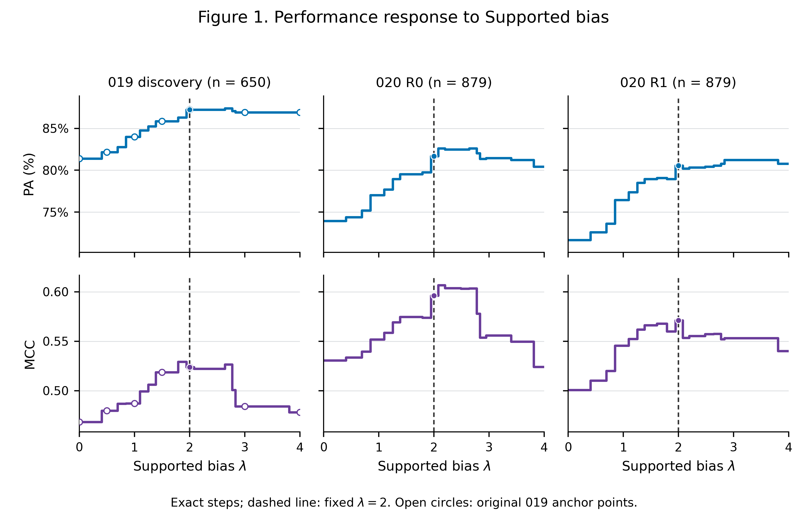
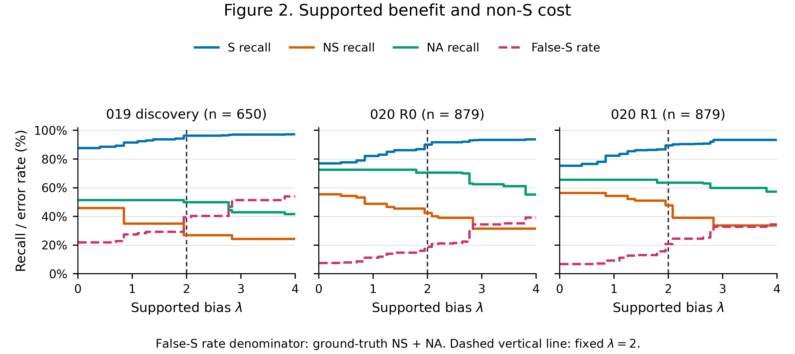

# 023：固定λ=2的决策边界响应与敏感性

2026-09-19。**执行与自检完成，待独立审计。0新增API；固定λ=2未修改，没有新winner或后续实验。**

## 结论先行

**λ=2不是必须精确取到2.0000才有效的孤立尖峰。** 三组冻结评分在约1.946–2.079之间标签完全相同，±0.05没有任何claim改判；在预先定义的较宽“近U2性能”范围内，三组也有重叠。

但这不等于λ不敏感或风险不变：跨过相邻台阶后，020两轮的改判收益方向可以相反；PA最高台阶与MCC最高台阶并不总在同一区间。继续增大λ会增加false-S、损失NS/NA召回，PA平台可能掩盖MCC下降。**当前证据支持局部数值稳健性，不支持重新选λ、临床安全结论或直接开启reserved test。**

## 数据、计算与图

- 019 discovery：6名development患者、650条；020 R0/R1：另10名患者、同879条的两次独立评分。pooled仅019＋020 R0，共1529个不同claim。
- 使用已审019/020评分及022已审对齐材料，不读取原始临床文本或reserved40。模型分数不是token logits或校准概率。
- 沿019的score floor=1e-6、S加λ、NS/NA/S平分顺序。019七个旧点及020两轮U0/U2逐条标签、33组作者分层指标**全部精确复现后**才生成曲线。
- λ=0–4，步长0.01共401点；另保存每claim的精确浮点切换位置和所有完整状态。所有PA/MCC/AC1由002计算。没有拟合、bootstrap或逐点p值搜索；文中区域均是描述性形状，不是置信区间或临床容忍界限。

**Figure 1.** 三个队列/轮次的完整阶梯响应。虚线固定λ=2；019空心点为原七个登记位置，同指标跨队列共用纵轴。无平滑，不以更高点替换2。[矢量PDF](figures_001/figure1_performance.pdf) · [SVG](figures_001/figure1_performance.svg)。

**Figure 2.** S/NS/NA召回与false-S率。false-S分母为真实NS＋NA，019为109、020为249，不能混同“非S伤害数/N”。纵轴固定0–100%。[矢量PDF](figures_001/figure2_tradeoff.pdf) · [SVG](figures_001/figure2_tradeoff.svg)。

## Q1. 曲线形状是否跨批次重复？

**总体形状重复，细部峰形不完全重复。** λ从0向2增大时，三组总体PA、MCC、AC1均改善；到2附近以后PA趋缓，MCC更早受到non-S损失影响。到4时，019和020 R0的PA/MCC均低于2；020 R1的PA比2略高，但MCC更低。

| 队列 | λ | 正确/N | PA% | MCC | AC1 | false-S |
|---|---|---|---|---|---|---|
| 019 discovery | 0.0 | 529/650 | 81.38 | 0.4684 | 0.7757 | 24 |
| 019 discovery | 2.0 | 567/650 | 87.23 | 0.5238 | 0.8528 | 43 |
| 019 discovery | 4.0 | 565/650 | 86.92 | 0.4783 | 0.8514 | 59 |
| 020 R0 | 0.0 | 650/879 | 73.95 | 0.5306 | 0.6478 | 19 |
| 020 R0 | 2.0 | 718/879 | 81.68 | 0.5960 | 0.7632 | 47 |
| 020 R0 | 4.0 | 707/879 | 80.43 | 0.5241 | 0.7549 | 98 |
| 020 R1 | 0.0 | 630/879 | 71.67 | 0.5007 | 0.6153 | 17 |
| 020 R1 | 2.0 | 708/879 | 80.55 | 0.5711 | 0.7485 | 52 |
| 020 R1 | 4.0 | 710/879 | 80.77 | 0.5403 | 0.7576 | 86 |

019与020的S比例、基线错误构成及运行批次不同，不能将绝对分数差视为λ机制差异。pooled曲线只是描述性附录，不替代三组主曲线。

## Q2. λ=2是宽平台还是精确高点？

需要区分两种“平台”：

**① 完全同标签平台。** 三组所有claim共同的平台在原浮点实现中均为
`[1.9459101490553132, 2.079441541679836)`，宽约0.134。域内每条标签相同，故全部分类指标也相同。这只是本批离散评分的事实，不是连续潜在概率的稳定性证明；理论平分及机器边界详见[switches.jsonl](analysis_001/switches.jsonl)。

这与评分离散化密切相关：三类分数全部为5的倍数的claim，019为646/650，020 R0为863/879，R1为874/879；大量S=100和非S=0。靠近2的共同边界对应约7:1与8:1的竞争分数比，而不是独立测得的临床机制阈值。

**② 较宽的近性能区域。** 结果前定义为PA不比U2低超过1个百分点、MCC不低超过0.02，取包含2的连通0.01网格区间：

| 队列 | 预定近U2区域 | 其中false-S范围 |
|---|---|---|
| 019 discovery | [1.8, 2.77] | [32, 44] |
| 020 R0 | [1.95, 2.83] | [47, 74] |
| 020 R1 | [1.95, 3.8] | [52, 82] |

三组重叠约1.95–2.77，但它们**不是标签完全不变、也不是风险相同**。该定义以固定U2为参照，不是“距曲线最高点”的定义；按最高点作参照的区域另存summary.json，不能挑一种定义美化稳定性。

局部变化如下；±0.01、±0.05在三组均0改判。

| 队列 | λ | 相对2改判数 | Δ正确 | ΔMCC | Δfalse-S |
|---|---|---|---|---|---|
| 019 discovery | 1.9 | 21 | -6 | +0.0054 | -11 |
| 019 discovery | 2.1 | 1 | 0 | -0.0017 | 1 |
| 020 R0 | 1.9 | 27 | -17 | -0.0222 | -7 |
| 020 R0 | 2.1 | 15 | 8 | +0.0108 | 5 |
| 020 R1 | 1.9 | 30 | -14 | -0.0112 | -13 |
| 020 R1 | 2.1 | 14 | -3 | -0.0176 | 9 |

所以可以排除“精确到2.0000的偶然孤峰”这一描述；不能声称±0.1或更宽范围完全稳定。020 R0向上跨台阶有收益，R1同样跨台阶却有损失，尤其不能据R0把2.1换成新参数。

## Q3. PA和MCC的较好区域是否重合？

高值区域有重叠，**最高台阶位置明显分离或跨轮漂移**。下面只描述形状，端点经四舍五入，不是参数推荐：

| 队列 | PA最高台阶所在λ区间（约） | MCC最高台阶所在λ区间（约） | U2距PA最高值 | U2距MCC最高值 |
|---|---|---|---|---|
| 019 | 2.639–2.773 | 1.792–1.946 | 0.15个百分点 | 0.0054 |
| 020 R0 | 2.079–2.197 或 2.639–2.773 | 2.079–2.197 | 0.91个百分点 | 0.0108 |
| 020 R1 | 2.833–3.807 | 1.946–2.079 | 0.68个百分点 | 0 |

020 R1即是明确反例：较大的λ继续让PA略升，MCC却已下降。因此单看PA平台会高估“有效范围”。这些最高值由已用数据描述，不产生新的最优λ或winner。

## Q4. 收益和代价分别来自哪里？

相对同一次评分的U0，λ=2的确定性改判如下。R为救回真S，H为破坏原正确非S，W为原已在NS/NA之间错、又改成false-S。

| 队列 | R | H | W | 净正确 R−H | 新增false-S H＋W |
|---|---|---|---|---|---|
| 019 discovery | 46 | 8 | 11 | 38 | 19 |
| 020 R0 | 83 | 15 | 13 | 68 | 28 |
| 020 R1 | 89 | 11 | 24 | 78 | 35 |

主要收益是救回GT=S，代价不只有H：W会让错误支持增多，却不影响净正确数。继续从2到4，019多救回5条S却额外伤害7条原正确非S；020 R0多救回23、额外伤害34；R1多救回25、额外伤害23。R1净正确仍可多2条，但false-S额外增加34条、MCC下降，正说明净正确数不能替代风险账。

## Q5. false-S和NS/NA召回如何变化？

由于只允许非S→S，**S召回与false-S单调不减，NS/NA召回单调不增**，这是决策规则的可验证性质，不是模型理解越来越好。图2展示了不同批次台阶位置和损失幅度。

| 队列 | λ | S召回% | NS召回% | NA召回% | false-S / 真实non-S | false-S率% |
|---|---|---|---|---|---|---|
| 019 discovery | 0.0 | 87.80 | 45.95 | 51.39 | 24/109 | 22.02 |
| 019 discovery | 2.0 | 96.30 | 27.03 | 50.00 | 43/109 | 39.45 |
| 019 discovery | 4.0 | 97.23 | 24.32 | 41.67 | 59/109 | 54.13 |
| 020 R0 | 0.0 | 76.98 | 55.43 | 72.61 | 19/249 | 7.63 |
| 020 R0 | 2.0 | 90.16 | 42.39 | 70.70 | 47/249 | 18.88 |
| 020 R0 | 4.0 | 93.81 | 31.52 | 55.41 | 98/249 | 39.36 |
| 020 R1 | 0.0 | 75.40 | 56.52 | 65.61 | 17/249 | 6.83 |
| 020 R1 | 2.0 | 89.52 | 47.83 | 63.69 | 52/249 | 20.88 |
| 020 R1 | 4.0 | 93.49 | 33.70 | 57.32 | 86/249 | 34.54 |

作者方向不完全一致。human总体MCC先上升后回落；LLM的MCC会出现明显非单调、两轮不同形状，见[Figure S1](figures_001/figureS1_author_MCC.pdf)。020 LLM为263/269个S，Always-S PA=97.77%、MCC=0；在λ=2时R0/R1 PA为94.80%/95.54%，MCC为0.2178/0.3825。R0的NS与NA都0/3判对，R1则2/3和1/3，不能由LLM PA高来宣称边界可靠。

## Q6. λ=2收益是否跨患者，峰形是否受少数患者影响？

- **λ=2相对U0：** 019六人均正向；020 R0九人正、一人持平；R1十人均正。按原B比较则分别5正/1平、10正、9正/1负。两种参照不能混称。
- **去掉任一患者：** 三组剩余队列的U2−U0正确数和MCC仍均正，说明主要改善不依赖单个人。但这是确定性敏感性检查，不是总体显著性检验。
- **019集中性：** 93640贡献14/38的U2−U0净正确，或20/37的U2−B净正确。去掉此人后增益仍在，但PA最高台阶相对2的那1条优势消失；去掉59840或66218时MCC最高台阶也可移到约2.64–2.77。
- **020细部峰形：** R0去掉任何一人后的MCC最高网格均仍包含约2.08–2.19；R1去掉部分患者后最高台阶移到约1.61–1.79，与2的MCC差不足0.003。宏观增益较稳定，精确最高台阶并不稳定。
- **邻域方向：** 2→2.1时019各人净正确均不变（但一条已错NA转false-S）；020 R0为5人正/5平，R1为2正/4负/4平。不能宣称邻域变化对所有患者一致。

每患者401点、局部变化和全部逐一排除曲线见[患者数据](analysis_001/patient_curves.csv)、[局部数据](analysis_001/patient_local_sensitivity.csv)、[排除患者摘要](description_001/leave_one_out_summary.csv)。原始患者/author清单保留，不为结果重抽样本。

## Q7. 这能否解释022复杂校准没有超过U2？

**与022结果一致，但不证明所有复杂校准无效。** 022四折学习全局λ范围为1.6239–1.7647，位于2左侧；竞争感知与全局λ最终同标签。本轮使用预定局部诊断点1.75复查，两者又与固定1.75在全部2408份评分上逐条同标签，见[绑定检查](connection022.json)。

这批离散评分使一段参数范围对应同一组预测。022的已学参数实际落在更保守的台阶，减少false-S，也错失约1.946台阶上的S救回，所以不能仅凭“多了两个参数”产生额外分类收益。023没有重新拟合、选1.75或修改022；它只是把原负结果放回响应曲线中解释。

## 完成状态与下一步边界

023提供了**局部非尖峰、较宽近性能范围、宏观跨患者改善**的证据，也保留**类别风险上升、峰位漂移、LLM不稳定与评分离散化**。它不能证明新后端、其他医院或reserved40上的泛化；所有评分仍来自019/020历史硅基流动运行。

**固定λ=2保持不变，023到此停止。** 不因图上出现更高点开启新参数确认、024或最终测试。待独立审计后，再决定是否已经具备冻结方法与进入reserved40的条件；本报告不代替该决定。

完整性检查：10项023测试及15项002评价测试通过；33组历史锚点一致；1,578,737个密集标签独立复算、单向变化检查及19个内容文件断网重放一致。3张图均导出PDF/SVG/400dpi PNG，并用实际PDF栅格化逐张检查；未安装新依赖，分析用research-verifact，作图用既有research环境Matplotlib3.5.1。API路由/费用政策、历史019–022、GT与λ均未改。

[安全复核与审计交接](audit_handoff.md) · [执行状态](CURRENT_STATUS.md) · [统计附录](statistics.md)。执行者自查不等于独立审计PASS。
