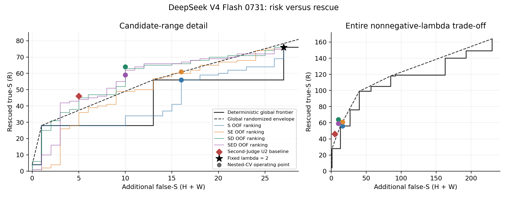

# 025：λ改判候选的风险可分性研究

## 结论先行

**当前廉价evidence特征没有证明超出score-only与global λ的稳定增量，停止这套证据gate路线，不追加v2/v3。** 这不是“任何证据语义都无用”的证明，而是对本轮固定特征和低容量模型的负结论。

**R与H/W并非完全不可分：024 DeepSeek的score＋第二Judge（SD）出现明确的患者外正向信号。** 它在新增false-S=10时救回64条S；同风险下完整global λ最多救回28条，随机混合包络可救回49条，SD仍多15条，条件患者区间[+2.70,+23.29]。025为024D主队列登记的其余可评估门槛均满足，去掉任一患者后仍领先。但Qwen未复现此优势，历史跨模型验证不可用。可保留为**值得有限继续开发的第二Judge风险信号**，不能当已验证正式方法，025不自动启动后续工作。

原登记的完整继续门槛没有winner。必须说明登记本身的可评估性限制：SD/SED需要历史“同一消融”复现，但019/020并无跨模型D。代码将该条件记false，含义是未满足/不能评估，不是观察到历史SD失败。报告不以这项不可检验条件抹去024的真实正信号，也不事后放宽门槛或补造D数据。

## 1. 设计：让保守程度相同再比较

候选固定为U0≠Supported且U2=Supported。R为医生GT=S；H为U0原本正确的non-S；W为U0原本已错的non-S。新增false-S=H+W，净正确增益=R−H；两者不能混淆。所有非候选保持U0。

数据仅来自019/020/024冻结输出：019为6患者650条；020 R0、R1及024 DeepSeek/Qwen均为同10患者879条的不同输出。总计仅16名不同患者、1529条不同claim，不把重复轮次或模型当新患者。024所有S评分均有效，025主分析统一879条，不依赖那条无效的普通B。

固定StandardScaler＋L2 logistic（C=0.1），没有超参数/复杂模型搜索。S=7维原score/margin；E=6维正文覆盖/数字/否定上下文等＋3维冻结rerank统计；D=5维另一Judge评分/是否S/一致性。019没有rerank明细，其3维为同组常数0；不是从病例或GT推测补齐。

外层按患者LOPO，内层只在训练患者LOPO，用其OOF结果确定保留≥80%训练R的最严格阈值，再应用完全未参与训练/标准化/阈值选择的测试患者。020只用R0训练，排除患者的R0/R1都不能进入训练；R1只评价。另有019六人→020/024十人的患者完全不交叉迁移。

主比较覆盖每个模型自己的全部非负global λ精确断点，直到全S（λ=16已覆盖全部状态），并含原登记锚点。随机混合上包络只表示不同global操作点混合后的**期望**风险/收益，是强描述性参考，不是新方法或新λ选择。GT仅用于训练和评价；global包络用评价GT构造，故是事后oracle式参考，不能直接部署。

## 2. 024 DeepSeek：同风险的核心结果

| 方法 | 保留R | 放过H+W | R保留率 | global同风险R | 混合包络R | 多救回R [95%区间] |
|---|---|---|---|---|---|---|
| S | 56 | 16 | 73.7% | 56 | 60.78 | -4.78 [-11.07,+0.00] |
| SE | 61 | 16 | 80.3% | 56 | 60.78 | +0.22 [-9.12,+9.86] |
| SD | 64 | 10 | 84.2% | 28 | 49.00 | +15.00 [+2.70,+23.29] |
| SED | 59 | 10 | 77.6% | 28 | 49.00 | +10.00 [-2.00,+20.00] |
| peer_U2 | 46 | 5 | 60.5% | 28 | 37.33 | +8.67 [-10.00,+21.01] |

U2原本R=76、H=14、W=13。SE将risk从27降到16，看起来降低11个错误支持；但R也从76降到61，同风险global混合包络已能救回60.78条，额外只有0.22。**仅观察false-S下降会错误夸大evidence的价值。** 即便只看确定性global，SE多救回5条的患者区间也是[-2,+29]，并未排除无增量；补充区间见interpretation_001/operating_uncertainty.json。 同rescue=61时，混合global最低risk约16.14，SE仅少0.14。

SD保留64/76=84.2%的R，risk从27降到10；同rescue=64时global混合最低risk约18.02，SD少约8.02。其matched-risk增量去掉任一患者后10/10仍正。这里的增量来自第二Judge已有分类信号；加E后SED反而只剩59条R、同样10风险，未显示E附加价值。

图中圆点是训练患者内确定的正式操作点；彩色曲线是OOF排序的描述性阈值轨迹，不能在图上另挑winner。黑实线为确定性阶梯，虚线为随机混合包络；右图包含全global范围。

## 3. R与H/W有没有可分信号？

| 024 DeepSeek | 患者OOF AUROC [95%区间] | AUPRC |
|---|---|---|
| S | 0.574 [0.474,0.719] | 0.819 |
| SE | 0.651 [0.512,0.847] | 0.803 |
| SD | 0.751 [0.634,0.857] | 0.889 |
| SED | 0.740 [0.600,0.888] | 0.862 |

候选R占73.8%，AUPRC应与该比例比较；原global score-margin排序本身AUROC=0.698、AUPRC=0.850。学到的score-only并未优于这个原排序。因此“E提高了某个弱分类器的AUC”不等于超越简单global λ。

SE对S在同风险下多救回5条，条件患者区间[-4.00,+11.79]；SED对SD的OOF排序混合包络少4条，区间[-9.00,+6.50]。两者都没有通过事前E增量要求。E的局部AUROC高于0.5说明存在相关性，但尚未转化为稳定的、超出score/global基准的筛选价值。

不把系数/词汇覆盖/否定词计数当作医学证据充分性的证明；禁止author、患者ID作特征并不等于已消除一切间接代理信号。这里只有10名患者、103个候选和27个风险例。bootstrap重抽患者但不重训OOF模型，是给定交叉拟合输出的条件不确定性；不能夸大为训练稳定性的完整保证。

## 4. 全879条的性能代价

| 方法 | 正确/879 | PA | MCC | AC1 | S召回 | NS召回 | NA召回 | 总false-S |
|---|---|---|---|---|---|---|---|---|
| U0 | 620 | 70.53% | 0.4955 | 0.5991 | 73.97% | 70.65% | 56.69% | 19 |
| U2 | 682 | 77.59% | 0.5347 | 0.7065 | 86.03% | 57.61% | 55.41% | 46 |
| S | 664 | 75.54% | 0.5208 | 0.6757 | 82.86% | 59.78% | 55.41% | 35 |
| SE | 668 | 76.00% | 0.5254 | 0.6824 | 83.65% | 58.70% | 55.41% | 35 |
| SD | 678 | 77.13% | 0.5513 | 0.6971 | 84.13% | 64.13% | 56.69% | 29 |
| SED | 672 | 76.45% | 0.5419 | 0.6874 | 83.33% | 63.04% | 56.69% | 29 |
| peer_U2 | 664 | 75.54% | 0.5410 | 0.6731 | 81.27% | 68.48% | 56.69% | 24 |

SE比U2少14条正确、false-S少11：主要削掉W，并未等量恢复正确non-S。SD比U2少4条正确、false-S少17，MCC升约0.0165，属于有明确代价的风险—收益交换，不是所有性能指标都更高。

| 作者 | 方法 | 正确/N | PA | MCC | 总false-S |
|---|---|---|---|---|---|
| human | U0 | 395/610 | 64.75% | 0.4775 | 18 |
| human | U2 | 433/610 | 70.98% | 0.5047 | 44 |
| human | SE | 423/610 | 69.34% | 0.4954 | 34 |
| human | SD | 432/610 | 70.82% | 0.5247 | 27 |
| llm | U0 | 225/269 | 83.64% | 0.2133 | 1 |
| llm | U2 | 249/269 | 92.57% | 0.2924 | 2 |
| llm | SE | 245/269 | 91.08% | 0.3004 | 1 |
| llm | SD | 246/269 | 91.45% | 0.2707 | 2 |

完整human/LLM三类recall、AC1、混淆矩阵及逐患者指标都在full_metrics.csv、patients.csv；与U2的1000次患者配对区间在paired_vs_U2.json。不能因LLM极偏S而单看PA。

## 5. 跨轮次、跨患者与Qwen辅助验证

| 组别 | 方法 | R | H+W | 相对global混合多R | 95%区间 |
|---|---|---|---|---|---|
| 019 | S | 37 | 11 | -1.75 | [-5.14, 2.0] |
| 019 | SE | 38 | 10 | +0.17 | [-5.25, 7.0] |
| 020_R0 | S | 68 | 26 | -10.00 | [-21.21, -2.54] |
| 020_R0 | SE | 69 | 21 | +3.50 | [-10.34, 9.43] |
| 020_R1 | S | 80 | 26 | +0.00 | [-9.0, 7.75] |
| 020_R1 | SE | 78 | 24 | +0.00 | [-8.38, 8.9] |
| 024_Q | S | 22 | 3 | -1.00 | [-3.0, 0.0] |
| 024_Q | SE | 19 | 3 | -4.00 | [-7.0, -1.0] |

E增量不跨批次/轮次稳定：019近于持平；020 R0有小幅正点估计但区间跨0，R1回到持平；019训练后直接迁移024 DeepSeek的SE为R42/risk10，比global混合少7条，区间跨0。020 R0/R1与024同10患者，不能当独立重复确认。

Qwen的S/SE/SD/SED正式点均不优于其自身global风险—收益；如SD为R20/risk3，global已有R23/risk3。只有34个候选/9风险例，不能据此证明所有Qwen gate永远无效；个别低rescue曲线点也不能被事后提升为winner。

**新建双模型探索baseline：** 严格按用户给定peer-U2规则，D得到R46/risk5；同风险global确定性为R28、混合为37.33，因此不只是简单降低λ，但增量区间[-10.00,+21.01]且只保留60.5%R，未达到继续门槛。Q得到R18/risk2，而global已能R21/risk2，完全不能据“false-S更低”宣称增量。这不是024已有正式probe的复现，也不是上界。

## 6. 最终研究判断与停止

1. **有无患者外可分信号？** 有，但不均匀。024D的第二Judge信息最明确；原score本身也含信号。E有局部区分相关性，尚无稳定额外效用。
2. **E是否超出score-only和global λ？** 没有通过增量标准；包括控制第二Judge后的消融也不支持。停止当前E特征组合，不继续调C、换树或加规则救结果。
3. **是否值得发展正式方法？** 本轮E路线不值得；第二Judge条件化风险筛选值得保留作有限开发线索，但不是已验证正式方法。完整事前门槛无winner；SD历史条件不可检验，Qwen亦未重复优势。不能把SD的OOF正信号说成跨队列确认或把它归功于evidence。线上还需另一Judge评分，本轮复用历史结果的零费用不代表部署零额外成本。

025到此停止，不启动后续任务、reserved test或新API。固定λ=2、Judge、证据和历史结论不变。

## 7. 可复查材料

- [协议](protocol_001.md) · [冻结来源](preparation_001/source_manifest.json) · [样本及候选计数](preparation_001/summary.json)。
- 正式机器结果为analysis_003：[完整指标](analysis_003/full_metrics.csv)、[global全曲线](analysis_003/global_lambda_curves.csv)、[OOF曲线](analysis_003/gate_curves.csv)、[操作点与区间](analysis_003/summary.json)、[训练患者审计](analysis_003/fit_audit.json)。
- [Qwen辅助图](figures_002/024_Q_risk_rescue.png)；SVG同目录，可用于论文绘图。
- 初版遇JSON NumPy布尔序列化问题；自检又修正LOO布尔权重计数。analysis_001/002及原代码均保留。修正未改变训练/阈值、OOF预测、主要指标、风险曲线或bootstrap结果；13份不受影响内容逐字节一致。仅LOO计数及对应门槛变化。图的首稿保留，正式图用阶梯正确显示离散global前沿。
- 核验还用独立逐条循环重算LOO，用线性规划验证global随机混合最优包络，不只重跑同一公式。自检与独立审计不同；本任务待独立审计，见audit_handoff.md。
