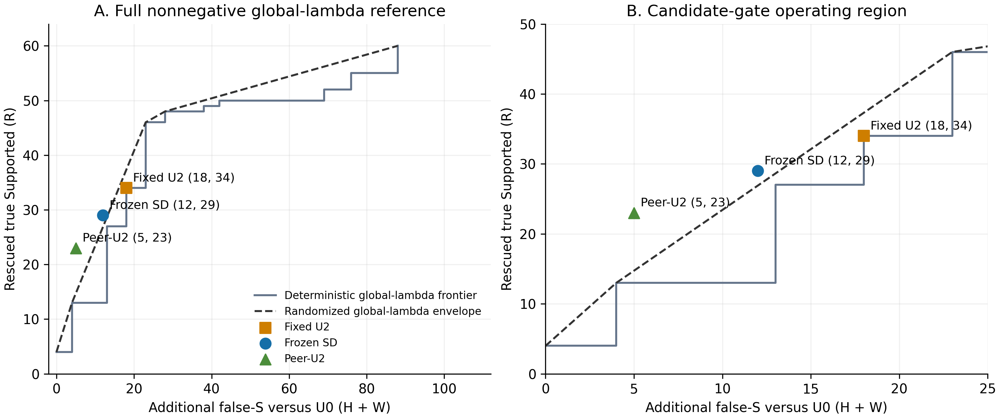

# 026：冻结SD候选筛选的跨患者组迁移

## 结论：有局部风险收益，但未通过预设迁移门槛，停止当前冻结版本

**SD保留了29/34（85.3%）的真实Supported救回，将λ新增false-S从18降到12；但优势对患者组成和global-λ参考的定义敏感，尚不足以冻结为正式候选方法。** 本次不改阈值、C、特征或λ，不训练v2，不自动进入reserved40。

最重要的区分是：在新增false-S不超过12的条件下，SD比**单个确定性global λ**多救回16条；但相对**完整global-λ随机混合期望包络**仅多2.11条，95%患者bootstrap区间为[−6.89,11.00]。去掉59840或93640后，混合增量转负，未达到至少5/6留一患者子集仍为正的事前要求。不能只报“+16”而省略这个限制，也不能把失败解释成完全没有选择信息。

执行、自检及交审材料已完成；**独立审计待开展**。

## 1. 这次验证了什么

025在024十名development患者上发现SD的OOF信号。026只用这十人的103个候选训练最终gate，然后冻结，再运行另一组019六名development患者的650条claim。两组患者不重叠；但019患者及旧结果早已暴露，025也分析过历史评分。因此这是**冻结模型的跨患者组、新调用迁移验证**，不是首次接触患者的最终独立测试。

- 验证患者：15057、27036、59250、59840、66218、93640；650条均有效，human407／LLM243。
- GT为S541、NS37、NA72；LLM中S228/243（93.83%），不能仅看LLM PA。
- 原019 claim、API-BGE C48原样复用；没有新BGE、检索或packing。
- 同期阿里云`deepseek-v4-flash-0731`：650次scoring＋650次普通structured B。
- DeepSeek的新U0≠S且U2=S共52条；**仅这52条**调用阿里云`qwen3.8-27b` scoring。候选清单生成不读GT。
- 共1352次请求，均一次HTTP200，核心有效1352；其中29次有非核心格式诊断，按024规则保留。0核心invalid、0缺失、0重试、0未知费用预留。所有比较分母均为650。
- 复用024 prompt／schema／标签、temperature=0、thinking=false、max_tokens=2048。返回模型标识全部与登记一致；服务别名标识并不构成不可变权重哈希。

完整[事前协议](protocol_001.md)、[模型及预算登记](preparation_001/registry.json)、[GT盲候选台账](candidate_freeze/candidates.json)。历史024–025报告和审计未修改。

### 唯一gate如何冻结

复用025的7个DeepSeek score特征＋5个Qwen信号（S概率分数、margin、U0是否S、U2是否S、两边U0是否一致），不加入evidence新特征、patient ID、作者或GT作为输入。分数是模型自报支持分数，不是校准后的概率。

StandardScaler＋L2 Logistic Regression：C=0.1、lbfgs、max_iter=2000、tol=1e−8。阈值通过**原十名训练患者内部LOPO**预测、按025保留至少80%训练R规则确定为 **0.686248968514202**；随后在103候选上拟合最终参数。026六名患者未参与标准化、拟合或阈值选择。正式推理只读[冻结JSON](gate_freeze/gate.json)，对应代码及输入哈希在gate manifest中，均早于首个026请求。

## 2. 主结果与风险代价

R＝救回的真S；H＝U0原本正确non-S被改错；W＝U0原本错误non-S又被改为S。**新增false-S为H+W，净正确变化为R−H。** W减少不一定增加正确数。

| 方法 | 正确/650 | PA | MCC | AC1 | R / H / W | 新增false-S | 总false-S |
|---|---:|---:|---:|---:|---:|---:|---:|
| 普通structured B | 529 | 81.38% | 0.4539 | 0.7772 | 不适用 | 不适用 | 26 |
| U0 | 534 | 82.15% | 0.4955 | 0.7855 | 0 / 0 / 0 | 0 | 21 |
| 固定U2 | 561 | 86.31% | 0.5156 | 0.8410 | 34 / 7 / 11 | 18 | 39 |
| **冻结SD** | **558** | **85.85%** | **0.5215** | **0.8344** | **29 / 5 / 7** | **12** | **33** |
| peer-U2 | 555 | 85.38% | 0.5336 | 0.8275 | 23 / 2 / 3 | 5 | 26 |

SD相对U0净增24条，PA +3.69个百分点，95%患者区间[1.04,5.55]；MCC +0.0260，区间[−0.0338,0.0650]。相对B净增29条（40错→对、11对→错），PA +4.46个百分点[1.77,6.67]，MCC +0.0676[0.0117,0.1082]。**这些整体方案收益不能全部归因于gate：U2本身已有561条正确。**

相对U2，SD放弃5条真S救回，阻止2个H和4个W，故**净少对3条**；PA −0.46个百分点，MCC仅+0.0059，两者区间均跨0。总false-S39→33（真实non-S分母109，35.78%→30.28%），仍高于U0的21/109（19.27%）。

| 方法 | S recall | NS recall | NA recall |
|---|---:|---:|---:|
| B | 89.28% | 51.35% | 37.50% |
| U0 | 88.91% | 64.86% | 40.28% |
| U2 | 95.19% | 48.65% | 38.89% |
| SD | 94.27% | 51.35% | 40.28% |
| peer-U2 | 93.16% | 59.46% | 40.28% |

SD总混淆矩阵为`[[510,28,3],[15,19,3],[18,25,29]]`，行GT、列预测，均按S/NS/NA。全部方法及作者矩阵见[metrics.json](analysis_001/metrics.json)。

## 3. 是否超过简单降低global λ

参考曲线使用**同一650条、同一次DeepSeek新评分**，枚举非负λ的全部精确切换状态直到全S；没有重新选择部署λ。两个比较同时保留：

1. 确定性：在风险不超过gate的条件下，任一单个global λ最多能救回多少R。
2. 混合期望：允许与case身份无关地随机混合global λ，在相同**期望**风险下形成更严格的参考包络。这是使用评价GT构造的事后参考，不是经过部署验证的替代方法，也不保证每次随机实现恰好相同错误数。

| 方法 | 自身R / risk | 确定性global可达R | 超出确定性 | 混合global期望R | 超出混合 | 混合增量95%区间 |
|---|---:|---:|---:|---:|---:|---:|
| SD | 29 / 12 | 13 | +16 | 26.89 | +2.11 | [−6.89,11.00] |
| peer-U2 | 23 / 5 | 13 | +10 | 14.74 | +8.26 | [−3.53,21.50] |

反向匹配：保留29个R时，确定性global最少需要18个新增false-S，SD少6个；混合global期望需要13.21，SD仅少1.21。离散score造成阶梯，因而只比较单个λ会留下较大空档。

完整包络不限制λ≤2：本次SD风险12处的参考为(R13,risk4)与(R46,risk23)两状态的混合，权重11/19、8/19；后者切换点约13.3047，涉及既定score floor。**这是按事前“完整非负global”定义保留的强参考，不意味着建议使用这个大λ。** 线性规划独立核验了包络数值。

peer-U2在本队列风险控制更强，但只保留23/34＝67.6%的R，低于80%要求；不能在SD未过门槛后事后换它作为026新winner。它保留了双Judge可能有选择信息的线索，尚不足以支持自动开展新方法。

## 4. 作者及患者稳定性

| 作者 | 方法 | 正确/N | PA | MCC | AC1 | R / H / W | 总false-S |
|---|---|---:|---:|---:|---:|---:|---:|
| human | B | 315/407 | 77.40% | 0.4753 | 0.7154 | — | 19 |
| human | U0 | 321/407 | 78.87% | 0.5173 | 0.7334 | 0/0/0 | 16 |
| human | U2 | 335/407 | 82.31% | 0.5285 | 0.7836 | 18/4/9 | 29 |
| human | SD | 332/407 | 81.57% | 0.5338 | 0.7720 | 13/2/5 | 23 |
| human | peer-U2 | 332/407 | 81.57% | 0.5461 | 0.7709 | 12/1/2 | 19 |
| LLM | B | 214/243 | 88.07% | 0.2954 | 0.8700 | — | 7 |
| LLM | U0 | 213/243 | 87.65% | 0.3613 | 0.8643 | 0/0/0 | 5 |
| LLM | U2 | 226/243 | 93.00% | 0.3438 | 0.9261 | 16/3/2 | 10 |
| LLM | SD | 226/243 | 93.00% | 0.3438 | 0.9261 | 16/3/2 | 10 |
| LLM | peer-U2 | 223/243 | 91.77% | 0.3994 | 0.9117 | 11/1/1 | 7 |

**SD在LLM的21个候选全部放行，标签与U2完全相同；风险降低全部发生在human。** human只保留13/18＝72.2%的R，NS recall由U2的51.85%回升至55.56%，NA由40.30%回到41.79%；但仍低于U0的NS62.96%。LLM相对U0的NS recall从70%降到40%，MCC下降；Always-S本身就有93.83% PA，不能把SD的93.00%解读为均衡改善。作者内的混合增量：human +0.94R，LLM −2.20R（各自分母、各自参考，不能与all直接相加）。

| 患者 | N | U2 R / risk | SD R / risk | SD−U0正确数 | SD−U2正确数 | 去掉该患者后的SD混合增量 |
|---|---:|---:|---:|---:|---:|---:|
| 15057 | 97 | 0/0 | 0/0 | 0 | 0 | +2.95 |
| 27036 | 77 | 4/3 | 3/2 | +3 | −1 | +3.50 |
| 59250 | 48 | 4/3 | 3/2 | +2 | −1 | +2.00 |
| 59840 | 77 | 6/4 | 6/3 | +6 | 0 | −0.57 |
| 66218 | 101 | 7/6 | 4/4 | 0 | −2 | +4.00 |
| 93640 | 250 | 13/2 | 13/1 | +13 | +1 | −1.19 |

相对U0的正确数增益有四位患者贡献，但93640贡献13/24（54.2%）；相对U2，仅一位患者净正。去掉93640后连确定性global的matched-risk增量也为0。因而不能声称gate的额外收益稳定且不依赖主要患者。

## 5. 事前门槛与研究判断

| 事前要求 | 实际 | 结果 |
|---|---:|---|
| R保留≥80% | 85.3% | 达到 |
| risk≤U2的75% | 66.7% | 达到 |
| 同风险超出确定性global≥5R | +16R | 达到 |
| 超出完整混合包络≥3R | +2.11R | **未达到** |
| 至少5/6留一患者子集混合增量为正 | 4/6 | **未达到** |
| 两作者相对U0净正确均非负 | human+11、LLM+13 | 达到 |
| 明确支持还需混合增量95%下限>0 | −6.89 | **未达到** |

因此点估计／患者方向门槛及更强证据门槛均未通过。025的强OOF信号没有以相近稳定性迁移：本轮R保留尚好，但风险去除及跨患者增量减弱。训练候选R76/103（73.8%），迁移候选R34/52（65.4%），说明候选组成不同；这只是观察，不证明失败机制，更不能据此重新校准。

**最终判断：双Judge有一定风险可分信息，当前冻结SD未获得足以升级为正式候选方法的跨患者组支持；按协议停止。** 这不否定历史λ=2结果，也不等于证明所有双Judge筛选都无效。本任务没有新winner、没有改变固定λ=2、没有接触reserved40。

## 6. 费用、复查与交审

按发送前核实的阿里云北京忙时无缓存价格和实际usage估算：D输入/输出3/9元每百万token，Qwen3/12；[DeepSeek官方价格](https://help.aliyun.com/zh/model-studio/deepseek-v4-flash)／[Qwen官方价格](https://help.aliyun.com/zh/model-studio/qwen3-8-27b)。非实际账单。

| 调用 | 数量 | 费用估算（元） |
|---|---:|---:|
| DeepSeek普通B | 650 | 7.711185 |
| DeepSeek评分 | 650 | 8.159301 |
| 候选Qwen评分 | 52 | 0.912228 |
| **026合计** | **1352** | **16.782714 / 80** |

实际条件触发流程D-score＋Qwen为9.071529元；第二Judge增加约11.2%的评分调用费用，只调用8.0%的claim。成本可控，但不能用低成本补偿未通过的方法门槛；未验证本地部署、显存或速度。

执行自检：7项单元测试通过；冻结训练参数重建一致；请求白名单、同证据、时序、预算及历史文件不变检查通过；独立线性规划核验完整包络和留一患者比较；禁网重放15份机器结果逐字节一致。患者cluster bootstrap沿002、1000次，只评价冻结gate，不在026重训；6位患者的区间仅提供有限development不确定性证据。reason未随离线改判重写，不能作为新标签解释或医学gold。

入口：[机器结果](analysis_001/) · [自检](verification_001/checks.json) · [安全重放说明及交审](audit_handoff.md)。审计员应优先核验完整global包络、患者依赖与冻结时序；执行自检不代替独立审计。
