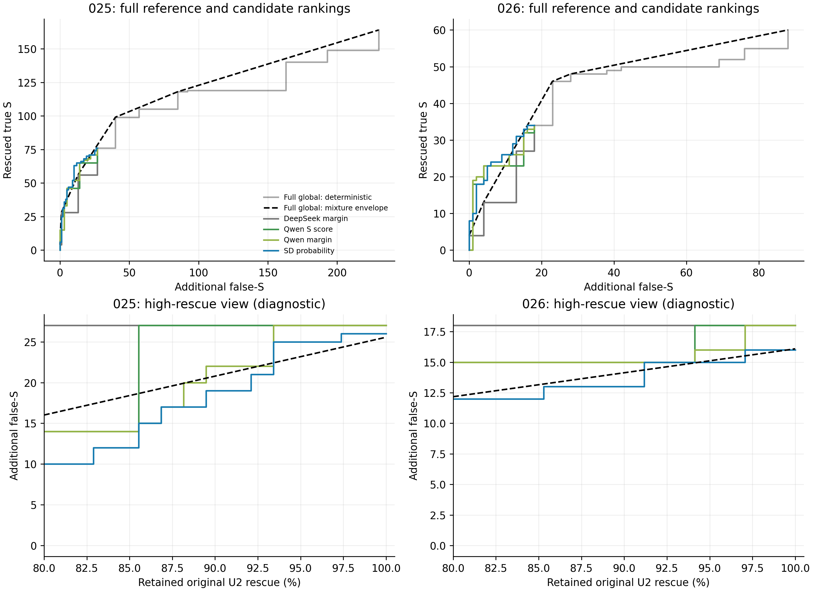
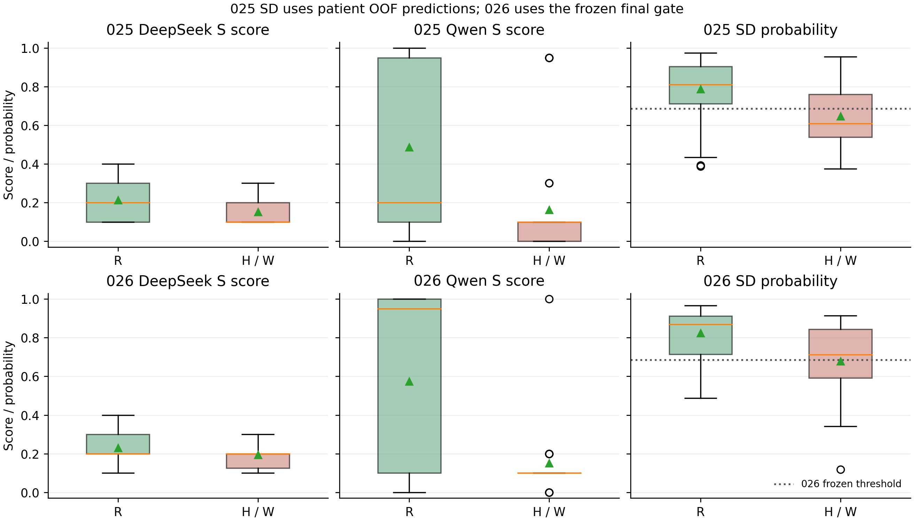

> 阅读镜像：已省略1行病例原文／标识；原始文件SHA见MIRROR_MANIFEST.json。

# 027：双Judge候选筛选的迁移瓶颈诊断

## 结论

**026的减弱不能主要解释为“固定阈值选错了”。第二Judge的信息仍然有用，SD排序也没有失效；真正没有复现的是高rescue区域相对完整global-λ包络的较大、稳定优势。候选组成变化、概率偏高和输入冲突同时存在，尚不能确定其中某一个是主要因果。**

本次不支持靠重新选阈值或换一个同分数融合器继续挽救当前Gate。若以后另行研究，应先证明**新的可观察信息能区分现有同分冲突**，而非默认继续优化同一组score就会获得稳定增量。现有有限样本也不足以证明score信息已全部耗尽。

027完成后停止，无新winner、无新阈值、无新训练、0 API、未使用reserved40。执行自检完成，**独立审计待开展**。025／026独立审计PASS及026方法门槛未过的历史结论均保持。

## 1. 为什么做、如何比较

这次诊断决定下一步是否还有理由投入Gate开发，而不是再产生一个开发集最高点。只复用两个已审材料集：

| 材料 | 全队列 | λ2候选 | R / H / W | 概率来源 |
|---|---:|---:|---:|---|
| 025的024 DeepSeek组 | 10患者879条 | 103 | 76 / 14 / 13 | 保存的患者OOF SD概率；每折模型不同 |
| 026迁移组 | 6患者650条 | 52 | 34 / 7 / 11 | 保存的唯一冻结Gate概率；6人均未训练，5人有候选 |

R为真S救回，H为原本正确non-S被改错，W为原本已错non-S又改成S。风险统一指**新增false-S=H+W**，不同于净正确R−H。两组是不同患者的已暴露development，不是reserved最终测试。

保留两条公平参照：

- **完整global λ**：同次DeepSeek评分的全部非负λ切换状态，直到全S；包括λ>2及score floor产生的状态，未缩窄参考。
- **候选局部比较**：严格限定同一U0≠S、U2=S集合，只改变接受排序。比较D-S、D-margin、Q-S、Q-margin、SD概率；枚举同分一起处理的全部阈值，不按GT拆tie。

80%–100%是事前登记的高rescue区；80/85/90/95/100%为曲线摘要锚点。它们需要GT确定达到的rescue，**仅是事后诊断，不是可用的新阈值**。患者bootstrap1000次固定已有分数、不重训。025最终Gate在原训练集上的概率另存，只作训练内描述，不替代OOF成绩。

## 2. 排序仍有价值，但不能只看AUC

| 排序 | 025 AUROC / AP | 026 AUROC / AP | 026患者内成对AUROC |
|---|---:|---:|---:|
| DeepSeek S | 0.697 / 0.846 | 0.599 / 0.733 | 0.543 |
| DeepSeek margin | 0.698 / 0.850 | 0.599 / 0.733 | 0.543 |
| Qwen S | 0.756 / 0.880 | 0.765 / 0.834 | 0.750 |
| Qwen margin | 0.747 / 0.885 | 0.734 / 0.839 | 0.728 |
| SD | 0.751 / 0.889 | 0.730 / 0.848 | 0.728 |

AP要与R基率比较：025为73.8%，026为65.4%。026中Q-S相对D-margin的配对AUC差95%患者区间[0.071,0.304]，SD相对D-margin为[0.042,0.244]。因此第二Judge提供的排序信息仍在，且不只是不同患者基率造成的池化表象。不过区间只有6个患者cluster，属于给定这些分数的描述性不确定性。

026的SD AUC区间[0.591,0.848]与025的[0.634,0.857]重叠，不能声称整体排序发生了显著崩塌。Q-S的AUC略高于SD，差异反向写作SD−Q-S为−0.034、区间[−0.116,0.040]，不足以证明简单Q排序稳定优于融合。

### 高rescue区才揭示当前限制

下表是026达到给定rescue下限所需的最小新增false-S；括号为**实际保留R**。不同排序的tie会使实际rescue超过要求，故不能把它们称为完全同rescue操作点；随机混合局部参考另存于机器结果。

| 原λ rescue保留下限 | D-margin | Q-S | Q-margin | SD |
|---|---:|---:|---:|---:|
| 80%，至少28R | 18（34） | 15（32） | 15（31） | 12（28） |
| 85%，至少29R | 18（34） | 15（32） | 15（31） | 12（29） |
| 90%，至少31R | 18（34） | 15（32） | 15（31） | 13（31） |
| 95%，至少33R | 18（34） | 18（34） | 16（33） | 15（33） |
| 100%，34R | 18（34） | 18（34） | 18（34） | 16（34） |

SD在局部高rescue区仍优于单靠DeepSeek排序，也没有被原始Q排序支配。但**相对完整global随机混合包络，整个≥80%区域最多只多救回2.368条，10个不同阈值状态中没有一个达到+3R**；原固定点为+2.105条。即使允许事后挑点，也不能仅通过改变同一排序的阈值恢复026要求的幅度。

025的统一OOF概率阈值曲线在同一区域最大为+14R，026明显变窄。025正式SD的+15R来自**各外层折不同的训练内阈值**，不属于单一全局概率阈值曲线；两者不能混淆或回写历史结果。全部阈值位置、PA/MCC/AC1和RHW见[curves.csv](analysis_002/curves.csv)，没有选取任何新部署点。

上图完整global到全S；下图只放大展示范围，参考仍来自完整包络。虚线是用评价GT构造的随机混合**期望**边界，不是新的部署策略。

## 3. 025→026发生了什么

### 候选组成与概率尺度共同变化

| 候选层面 | 025 | 026 |
|---|---:|---:|
| 总R比例 | 76/103＝73.8% | 34/52＝65.4% |
| human R比例 | 52/78＝66.7% | 18/31＝58.1% |
| LLM R比例 | 24/25＝96.0% | 16/21＝76.2% |
| W占所有风险 | 13/27＝48.1% | 11/18＝61.1% |
| SD平均概率 | OOF 0.750 | 冻结迁移0.773 |
| SD风险例平均概率 | OOF 0.646 | 冻结迁移0.678 |
| SD Brier误差 | OOF 0.164 | 冻结迁移0.205 |

R基率下降，但SD平均概率上升，存在**过于乐观的概率尺度表现**。不过025是不同折的OOF函数、026是最终函数，不能把全部差异精确归因于校准漂移。相同最终函数在025训练候选上的平均概率0.738、风险均值0.571、AUC0.820，仅为训练内描述，不是泛化比较基线。

这也不只是human/LLM混合比例变化。若保持025各作者R比例，只换成026作者权重，预计总体R比例反而是78.5%；实际为65.4%。两个作者各自的R比例都下降，提示候选难度／组成也变了，但不说明变化的原因。D的S分数两组都仅有10/20/30/40四档，026 D-margin排序AUC由0.698降到0.599，粗分档导致高rescue时必须一次放入较大tie组。

### 阈值并非落在狭窄尖点

原阈值仍为0.686248968514202。026的接受集合在阈值区间**(0.6122669951, 0.7126479206]**完全相同，仍为R29/risk12。其R保留85.3%已超过80%目标；问题是达到该召回时仍放过太多风险，且更换阈值不能获得所需完整包络增量。

所以更恰当的判断是：**概率偏移是可见症状，但“只需换工作点”缺乏证据；高rescue排序前沿、候选组成及有限信息同时构成约束。** 不能仅凭这些分布变化作因果归因。

### 作者与患者差异不能省略

026 human的SD AUC0.699、Q-S0.754；LLM为0.750、0.744。LLM有21候选，原SD全部放行（R16、风险5），不等于其排序完全无信息，而是固定工作点没有过滤。025 LLM只有1个风险例，无法支持可靠的LLM迁移规律。

026相对U0的增益由多个患者贡献，但93640贡献13/24净正确；去掉93640后，026既有matched-risk确定性增量为0、混合增量−1.19；去掉59840后混合增量−0.57。027保留这个审计结果，没有靠池化AUC抹去患者依赖。[ranking.csv](analysis_002/ranking.csv)保留每患者排序，有单一R类别者明确AUROC不可计算；[composition.csv](analysis_002/composition.csv)保留全部六患者，包括无候选的15057。

## 4. Logistic是否明显遗漏了Qwen已有信息

有局部“Qwen警报被覆盖”的现象，但不支持简单归因为融合没用好：

- 026中，**Q-U2仍为non-S却被SD放行**的15条包含7R、3H、5W。统一服从该警报会减少8个false-S，也会丢7个真救回。
- 025相同现象为18R、4H、1W：这种“忽略警报”的经验在开发材料上更有利，迁移后代价变大。不能把全部差异归因于某一系数，因为患者和case都不同。
- Q-U2为S的026候选中，SD另挡掉1R和1W；原peer-U2实际为R23/risk5，仍只有67.6% rescue保留。它的低风险优势不代表满足高rescue目标。
- 最终Gate对`peer_s`、`peer_margin`、`peer_u0_s`、`peer_u2_s`都有正系数，确实使用Q信息。`same_u0`也为正；在这些D-U0为non-S的候选上，它可以提高“双方同为non-S”时的Gate概率。这是训练所得关联，不应解释为医学合理性。相关特征多重相关，单独系数不是因果重要度。

**原始Q排序并未在高rescue区超过SD；Q-S相对SD的AUC差异也不稳。** 因而目前不能据若干错例宣布“换融合方式即可”。线性计算分解保存于[linear_contributions.csv](interpretation_001/linear_contributions.csv)，不改任何系数。

## 5. 相同输入能否区分不同GT：存在真实限制，但不是全部信息已耗尽

以**精确12维S+D特征**分组，不四舍五入，不用claim、patient或author拆组：

| 候选集 | 不同输入组 | 混合R与风险的组 | 涉及claim | 任意同输入同动作的Gate至少犯的候选二分类错误 |
|---|---:|---:|---:|---:|
| 025 | 46 | 6 | 37/103 | 10 |
| 026 | 27 | 7 | 22/52 | 9 |
| 两组合并，仅描述 | 56 | 13 | 73/155 | 22 |

026有18对原6个score完全相同但R/risk相反的case，其中15对跨患者。放宽到每个原score差≤5分，有39对相反case、33对跨患者；≤10分为114/93对。近似只是邻近描述，**不构成数学上限**，没有通过传递关系把它们连成大组。

精确冲突意味着：在这52条上，任意仅依赖同一特征向量的确定性Gate，至少有9个候选二分类错误，不能靠更复杂分类器将其全部消除。当前Gate有17个这类错误。但9/17不能被说成“53%的临床错误由score决定”；这是限定输入与固定样本的数学约束，不是临床机制分解。

另一方面，使用GT挑选各输入组的**理想化组级参考**，保留至少28R只需3风险、保留31R需6风险、全部34R需10风险。当前排序并未达到该事后参考，说明不能证明现有信息已完全用尽；然而这个参考相当于知道每组GT构成，不证明可从十个训练患者学到并迁移。动态规划结果已用独立整数规划核验。

## 6. 全部关键错误深读说明了什么

固定阅读31例：全部12个放过H/W、5个挡掉R、6个正确拒绝风险，以及8个患者×作者分层哈希选取的正确救回。读取各自完整claim/reference与两模型完整输出，保存53处逐字引文偏移。它是目的性诊断样本，不估计总体医学机制占比。

| 对照例 | 可回查的文本区别 | 对score-only的含义 |
|---|---|---|
| C06（W，挡下）／C16（R，误挡） | 前者问final angiography无残余狭窄，后者问IVC放置无并发症；两份C48都只有相关治疗／程序记录，双方要求更明确结果 | **D/Q输入完全相同**，无法用同特征Gate给两者不同动作；不据此重判医生GT |
| C14（H，放过）／C29（R，保留） | 前者从Heparin药名跳到drip属性；后者从头痛病史/可能migraine接受可能病因 | 二者也是完全同输入；Q-S100既出现正确救回，也出现错误支持 |
| C03、C20（R，误挡） | at discharge、remainder的时间范围与片段覆盖存在疑问；两个Judge都以缺明确时间句或早期数值反驳 | 低Q支持不是单向风险信号，时间范围没有保留在score里 |
| C05（H，放过）与C25（R，保留） | stent型号/尺寸未在C48核实；另一例服药数量30/40/20并存但GT=S | 数值/细节质疑可出现在不同GT中，不能用理由关键词直接当gold gate |
| C17–C19（H，放过） | neuro/pulmonary/renal “focus”被两个输出解释为sole/primary；原文是多系统管理 | 三例来自同一患者同句型，不能当跨患者重复证据；限定词关系不会由12维分数表达 |

12个放过风险中，11个Q原始argmax仍为non-S，8个连Q-U2也为non-S；只有C14的Q原始S为100。DeepSeek因候选定义原始U0均non-S，**这不是“双模型共同高置信Supported错误”为主的现象**。不过5个误挡R的Q原始argmax也全为non-S，不能据此建立新的简单否决规则。

所有31例的医学裁决维持unknown／不重标。尤其完整原EHR与C48不是同一覆盖范围，GT=S而C48缺明确句不能证明医生标错；理由也不是模型内部机制证明。[逐例说明](semantic_001/case_notes.md)及[带偏移账本](semantic_001/case_ledger.json)为审计入口。

## 7. 对六个最终问题的回答

1. **输入仍有可利用风险信息吗？** 有。Q与SD相对D的排序增量仍可见；但不足以证明同输入能支持所需的稳定高rescue收益。
2. **主要是阈值还是排序迁移？** 更像高rescue排序／风险前沿变弱，并伴随组成与概率尺度变化。不是一个窄阈值点选错；不声称已辨认唯一主要原因。
3. **Logistic明显遗漏Q信息吗？** 有局部覆盖Q警报的错误，也有必要的真S救回。Q单独排序不支配SD，现有证据不足以证明融合形式是主要瓶颈。
4. **继续优化同一Gate有依据吗？** 目前不足以支持通过改阈值、调正则或换融合器继续救当前版本；026停止结论保持。
5. **若未来继续，优先什么？** 相比改工作点或融合方式，更有依据先检验新的、可验证的语义信息能否区分现有精确同输入冲突。但这是条件性研究方向，不是本任务批准的新实验，也不是承诺新信息必然有效。
6. **是否有新winner？** 没有。027仅缩小了合理解释范围；任务到此停止，不自动下一任务／reserved test。

## 复查与交审

正式机器版本为**analysis_002**，正式图为**figures_002**。analysis_001为从同一冻结参数重建概率的初算；正式版逐值使用026保存概率，两者只涉及浮点末位，排序及case选择不变。图首稿保留，正式版将“达到某rescue所需风险”的阶梯方向修正为左侧跳变，不改变数值。

PA/MCC/AC1沿002；所有阈值对应全879／650队列结果保留，非候选始终U0。当前固定SD全队列成绩仍是026的558/650、PA85.85%、MCC0.5215、AC1为0.8344、总false-S33，没有因027诊断而更新。完整global曲线已逐点对齐025／026正式结果。

[协议](protocol_001.md) · [正式输入指纹](analysis_002/manifest.json) · [执行自检](verification_001/checks.json) · [audit_handoff](audit_handoff.md)。自检不是独立审计；全程0 API、0新拟合、费用0元。
