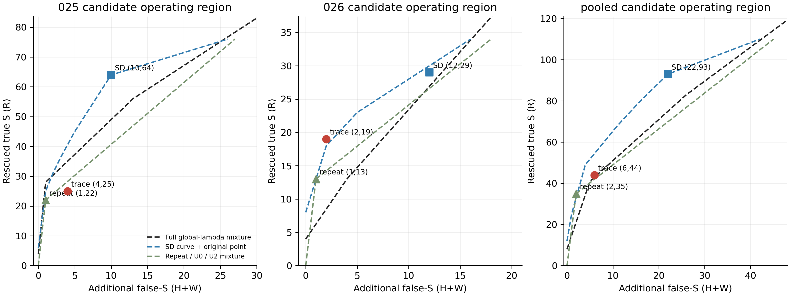

# 028：λ候选的可追溯主张—证据核查

## 结论：局部关系区分存在，整体代价过大，停止当前语义核查版本

**本轮未形成值得继续的development可行性证据。** 新核查能阻止一些错误支持，也能区分部分原score完全相同的case，但相对SD挡掉了太多原本正确的Supported救回；相对普通追加核验的增量也不稳定。

全部155候选、两臂各155次已真实完成，未因结果重跑。新核查保留 **44/110＝40.0%** 的原λ真S救回，远低于预设两队列各80%。相对SD：阻止19条原错误支持，挡掉51条原真救回，恢复2条原漏救回，又新增3条错误支持；合并全队列**净少对40条**。

完成执行、评价及执行者自检，**待独立审计**。不加检查项、不换模型、不调整放行规则、不自动029或reserved40。

## 1. 本实验与历史负结果的区别及限制

已阅读004、013、015、016正式完成报告、025–027及当前审计。004的固定事件检查、013的字面contract均不能保证净收益；015候选理由仲裁失败，016的独立review仅比普通repeat多1条，未复现原信号。028因此保留同期普通追加判断，不把“多问一次”当作语义表示贡献。

新臂让同一阿里云`deepseek-v4-flash-0731`按当前claim动态输出：**主张要求→证据事实→关系→可定位引文**。关系为supported／contradicted／unaddressed／uncertain，不输出新S概率，不设计固定事件清单，也不训练新Gate。与013不同，原claim及reference没有重写或加证据，输出要逐项引用真实C48。

唯一固定规则是：模型声明要求覆盖完整、所有要求均为supported，且每项claim引用与所有证据引用都能定位，才保留λ改判为S；否则退回原DeepSeek U0。普通repeat用原structured prompt，新verdict=S则放行，否则同样退U0。**两者都是候选放行流程，不使用新NS/NA标签改写原U0；拒绝错误S不一定使三分类判对。**

两臂输入只含原claim和同一C48，没有旧D/Q答案、GT、027错误类型或人工结论。temperature0、thinking=false、max_tokens4096、n1；实际输出平均trace317.4、repeat335.2 tokens，不能声称新臂只是获得更多输出计算量，也不能据单次调用证明内部推理机制。SD属于既有非同期输出，trace／repeat在本轮交错运行。

## 2. 数据完整性与指标含义

| 范围 | 患者/完整valid claims | λ2候选 | 候选GT组成R/H/W |
|---|---:|---:|---:|
| 025的024D材料 | 10 / 879 | 103 | 76 / 14 / 13 |
| 026材料 | 6 / 650 | 52 | 34 / 7 / 11 |
| 合并描述 | 16 / 1529 | 155 | 110 / 21 / 24 |

全部155进入正式评价；无core invalid、无缺失、无重试。310个HTTP200原样保存。非候选1374条始终U0，主指标使用完整1529条，025／026和human／LLM分别保留。全部患者已是development，不能称独立最终验证。

- **R**：U0非S、最终改S且GT=S，即真正救回。
- **H**：U0原本正确的non-S被改为错误S。
- **W**：U0本就判错的non-S又被改为S。
- **新增false-S＝H+W**；相对U0的净正确＝R−H。降低W不自动增加正确数。
- **rescue retention**：保留了原U2可救回R的多少比例。
- **PA**：与医生三分类标签完全一致的比例；**MCC**：综合三类混淆的相关系数；**AC1**：校正偶然一致性的指标。三者越高通常越好，但不能相互替代或掩盖少数类代价。
- **matched-risk**：把新增错误支持控制在相同预算下比较救回数。随机混合包络是事后GT构造的期望参考，不是已验证部署策略。

所有标签及PA/MCC/AC1沿002；区间为1000次患者cluster bootstrap，固定已有模型和本次输出，无重新训练。

## 3. 主结果：大幅减少错误支持，同时丢失更多真救回

| 队列/方法 | R / H / W | 新增false-S | R保留率 | 完整队列正确数 | PA | MCC | AC1 |
|---|---:|---:|---:|---:|---:|---:|---:|
| 025 U2 | 76/14/13 | 27 | 100% | 682/879 | 77.59% | 0.5347 | 0.7065 |
| 025 SD | 64/6/4 | 10 | 84.2% | 678/879 | 77.13% | 0.5513 | 0.6971 |
| 025 repeat | 22/1/0 | 1 | 28.9% | 641/879 | 72.92% | 0.5174 | 0.6345 |
| **025 trace** | **25/2/2** | **4** | **32.9%** | **643/879** | **73.15%** | **0.5159** | **0.6383** |
| 026 U2 | 34/7/11 | 18 | 100% | 561/650 | 86.31% | 0.5156 | 0.8410 |
| 026 SD | 29/5/7 | 12 | 85.3% | 558/650 | 85.85% | 0.5215 | 0.8344 |
| 026 repeat | 13/1/0 | 1 | 38.2% | 546/650 | 84.00% | 0.5199 | 0.8094 |
| **026 trace** | **19/0/2** | **2** | **55.9%** | **553/650** | **85.08%** | **0.5387** | **0.8230** |

合并：SD1236/1529、repeat1187/1529、trace1196/1529；trace PA78.22%、MCC0.5312、AC1为0.7208。trace相对SD PA −2.62个百分点，95%区间[−4.49,−1.10]；相对repeat净+9条、PA +0.59个百分点[−0.45,1.42]、MCC +0.0046[−0.0112,0.0167]。这不足以称稳定额外收益。

### 用户关心的四种变化

| trace相对 | 阻止原错误支持 | 挡掉原真R | 恢复原漏R | 原正确拒绝风险被新放行 |
|---|---:|---:|---:|---:|
| SD：025 | 8 | 40 | 1 | 2 |
| SD：026 | 11 | 11 | 1 | 1 |
| **SD：合并** | **19** | **51** | **2** | **3** |
| repeat：合并 | 1 | 16 | 25 | 5 |

相对SD，真正三分类错→对12、对→错52，净−40；相对repeat为26/17，净+9。**19个错误支持被阻止不等于增加19个正确答案**，因为其中原U0可能仍是错误的NS/NA。

## 4. 相同风险下是否超出既有方法

SD参考含保存概率的完整阈值曲线及原正式操作点；repeat没有新分数，参考为U0全拒／repeat固定点／U2全放及其混合；global保留全队列、全部非负λ精确状态直到全S，未限制到候选或λ≤2。合并global使用共同λ，两队列结果仍分别报告。

| trace固定点 | trace R/risk | 较SD混合包络多R | 较repeat混合多R | 较完整global混合多R |
|---|---:|---:|---:|---:|
| 025 | 25/4 | −15.50 | −3.23 | −10.00 |
| 026 | 19/2 | +1.00 | +4.76 | +10.50 |
| 合并 | 44/6 | −10.43 | +2.02 | +1.00 |

合并三项95%患者区间依次为[−39.00,12.02]、[−15.12,16.25]、[−21.07,30.02]，均跨0。026相对global的局部+10.5区间为[−2.00,24.00]，也不能单独支持跨患者稳定性。

只比较确定性阶梯时，合并trace较SD多R为−6、较repeat+9、较global+3；随机混合参考揭示了部分优势只是工作点更保守后的风险交换。没有根据这些曲线改λ或选择新工作点。

图仅放大候选工作区域，三条包络均由完整登记状态计算。不能将026的局部收益覆盖025反方向结果。

## 5. 类别、作者与患者

合并类别recall及总false-S：

| 方法 | S recall | NS recall | NA recall | 总false-S |
|---|---:|---:|---:|---:|
| U0 | 80.87% | 68.99% | 51.53% | 40 |
| U2 | 90.26% | 55.04% | 50.22% | 85 |
| SD | 88.81% | 60.47% | 51.53% | 62 |
| repeat | 83.86% | 67.44% | 51.53% | 42 |
| trace | 84.63% | 68.22% | 51.09% | 46 |

trace以S recall损失换回NS识别，NA还略降；总false-S由SD62降46，但正确数更低。合并GT分母S1171、NS129、NA229；false-S总数包括U0既有错误40条，不能与新增risk6混同。

| 作者 | 方法 | 正确/N | PA | MCC | AC1 | S/NS/NA recall | 总false-S |
|---|---|---:|---:|---:|---:|---:|---:|
| human | SD | 764/1017 | 75.12% | 0.5401 | 0.6630 | 84.71/62.07/52.49% | 50 |
| human | repeat | 735/1017 | 72.27% | 0.5228 | 0.6186 | 79.41/68.10/52.49% | 35 |
| human | trace | 740/1017 | 72.76% | 0.5248 | 0.6265 | 80.29/68.10/52.04% | 39 |
| LLM | SD | 472/512 | 92.19% | 0.2796 | 0.9175 | 94.50/46.15/25.00% | 12 |
| LLM | repeat | 452/512 | 88.28% | 0.2945 | 0.8731 | 90.02/61.54/25.00% | 7 |
| LLM | trace | 456/512 | 89.06% | 0.3190 | 0.8819 | 90.63/69.23/25.00% | 7 |

两作者相对SD均丢正确数：human−24、LLM−16。LLM MCC更高不能抵消PA和S recall下降。025 human较repeat净0、LLM+2；026 human+5、LLM+2。分队列各作者混淆矩阵及完整指标在[metrics.json](analysis_001/metrics.json)。

逐患者trace−SD净正确：15057 0、27036 −2、27823 −4、28399 −4、31135 −5、47940 −7、50524 −4、59250 −1、59840 −1、66218 +4、80084 −7、80606 −1、9030 −4、93640 −5、97212 +1、97885 0。仅2/16正、12负、2平（其中15057无候选）。trace−repeat为9人正、4负、3平；三项matched-risk同时为正的留一患者子集为0/16，未达13/16要求。[逐患者表](analysis_001/patients.csv)

## 6. 原score输入冲突是否得到有效解决

027精确12维冲突组不重新筛选：025共6组37条，026共7组22条。

| 冲突子集 | SD候选二分类错误 | repeat错误 | trace错误 | trace正确分开跨患者R-risk对 |
|---|---:|---:|---:|---:|
| 025 | 12 | 20 | 24 | 6 |
| 026 | 10 | 9 | 6 | 8 |
| 合并 | 22 | 29 | 30 | 14 |

这里“候选二分类错误”是该放行的R被挡、或该拒绝的H/W被放行，不是完整三分类错误数。新表示在11/13组内出现不同关系计数模式，在6/13组内产生不同放行动作；但合并错误数比SD多8、比repeat多1，不能因表示被分开就称成功。

14对正确区分确实保留，全部是相对SD新增的区分；但repeat有19对，新核查还反向错分11对（均在025）。这些pair有共享claim和患者，不是14个独立临床发现。

## 7. 可追溯性及文本核查

155条trace均核心可解析；233个要求项中supported109、contradicted8、unaddressed72、uncertain44。**90条仅1项、53条2项、11条3项、1条4项**，未普遍实现较细的事实拆解。单项也可能适合简单atomic claim，但模型自报complete不是拆解完备性证明。

359条引用中344条能在指定编号定位（95.8%），145/155条的必要引用及结构全部合格（93.5%，未达95%门槛）。15处失败包括错编号、用note ID替代局部编号、拼接省略或引用条目外的住院头；原回执未修复。4个真R只因引用验证被挡，其余引用问题没有改变最终拒绝。即使仅作诊断地不计这4次引用误伤，R保留也仅48/110＝43.6%，不能挽救主结论。

11例定向深读覆盖既有两对同分冲突及两臂不同动作的GT转移，保存[逐例账本](semantic_001/case_ledger.json)：

- **K03/K04：能正确区分一对。** Heparin药名不自证drip，trace拒绝；may have been migraines可支持“可能病因”，trace接受。两者原score完全相同。普通repeat也拒绝drip，但不接受possible migraine。
- **K01/K02：另一对未解决。** 最终造影无残余狭窄（GT NA）与IVC无并发症（GT S）都被记unaddressed，后者仍误挡；“程序发生”和“无并发症”甚至仍合并在一行。
- **K07：已有证据利用改善。** C48明确有“also started on vanco/zosyn”，新核查接受曾经治疗；repeat却被后来的停止用药牵引。不是检索到了新证据。
- **K06/K10：引用正确，关系仍错。** 从dry dressing推到特定POD的dry incision；从无手指骨折推到trigger finger不需手术。两例都生成新错误支持，不能据可定位引文认证医学推断。
- **K08：仍有加严主张的风险。** focus被写作primary focus；即使标签与GT更一致，也不能证明语义保真成功。
- **K05/K09：仍会误伤。** 前者supported关系因首引用编号错误被拒；后者C48缺8-20条目，严格日期核查挡掉医生GT S。不能把这种拒绝直接当更医学正确。

额外来源诊断仅查四条历史**发布reference**，不是完整EHR：Heparin例可定位SQ／Prophylaxis，比C48药名片段更具体；migraine相关句C48原本已有；造影／IVC例未定位到明确结果句，仍为unknown。额外材料未进入任何028 API，也未重新标GT。[来源检查](semantic_001/evidence_source_checks.json)

## 8. 最终判断、费用和交审

预设门槛中，引用/结构≥95%、两队列R保留≥80%、相对三类混合参考≥5R且区间为正、两队列/患者方向、作者保护、冲突净误差改善均未同时满足。**失败并不只是格式问题，也不是预算中断。** 025方向明显负、026虽有局部选择价值但保留率低，不能晋级为论文方法候选或冻结确认。

本轮说明：把claim–evidence关系写成可检查表格，能暴露部分支持边界，但没有稳定解决这些边界；更多可读信息不自动带来更好的候选放行。不能断言所有语义表示都无效，也不据此继续当前版本v2/v3。

| 新增调用 | 请求数 | usage费用估算 |
|---|---:|---:|
| 普通repeat | 155 | ¥1.868667 |
| trace | 155 | ¥1.929360 |
| **028合计** | **310** | **¥3.798027 / 80** |

费用按发送前核实的[阿里云0731快照北京忙时无缓存价](https://help.aliyun.com/zh/model-studio/deepseek-v4-flash)（输入3／输出9元每百万token）计算，非账单；没有未知预留或失败重试。未重跑既有D/Q、未新BGE、未改变长期API路由。

执行自检包括8项单元测试、请求/引用独立核验、Decimal费用、逐类RHW守恒、LP独立核对全部工作点及留一患者混合比较、完整离线重放。自检不等于独立审计。[事前协议](protocol_001.md) · [正式机器结果](analysis_001/) · [交审](audit_handoff.md)。
