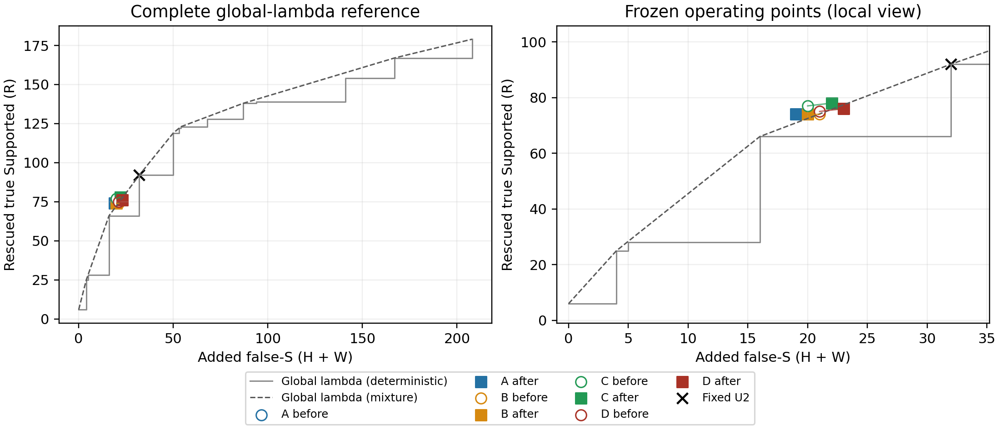

# 031：固定信息组合的训练扩充与患者隔离确认

## 结论先行

**本轮没有确认“扩大训练覆盖后，repeat/trace Gate能获得实质增量”。停止当前固定新增信息Gate路线，不追加特征、分类器或阈值搜索。** 执行及执行者自检完成，待独立审计；不自动进入reserved40或032。

1. **扩大训练没有明显改善实际确认表现。** 训练从原16人扩至28人、候选155增至246；在同一12人1148条确认队列上，A/B正确数不变，C/D各仅增加1条，且各多2条false-S。不能将029/030的规模趋势当作本轮已复现的收益。
2. **trace未证明独立增量。** 扩充后C相对A多救回4条真Supported，但多3条false-S，总正确仅+2、MCC下降；在C的实际风险水平下，相对A完整阈值随机混合参照少3.50R。加入repeat后，D相对B的同风险差为−5.14R。
3. **现有结果不支持保留repeat的额外成本。** 扩充后D相对C少救回2条真Supported、增加1条false-S、总正确−2，并多124次确认调用、约1.51元。B相对A也未提供收益。这不是预设非劣性试验，不能升级为“所有场景删除repeat都已证明无损”。
4. **没有新方案达到值得最终冻结的实质确认增量。** A可保留为简单、较低成本的风险控制参照；它相对完整global-λ混合参照仅+3.13R，95%患者区间跨0，不能宣布强泛化方法。C的少量PA优势不足以抵消风险及不确定性；B/D无继续保留依据。本轮不选新阈值，不把确认患者并回训练再评价同组。

## 1. 为什么做，以及如何保证确认隔离

029在患者OOF中看到联合信息增量，030又发现训练规模和组成敏感。031固定学习配方，只增加训练材料，在另一组development患者上同时比较八套模型，直接检验这条线索能否成立。历史负结果和独立审计不回写。

|材料|患者数|完整有效claim|λ候选|训练用途|
|---|---:|---:|---:|---|
|原029材料|16|1529|155（R110/risk45）|所有before/after共享|
|训练扩充组|12|998|91（R67/risk24）|仅after|
|确认组|12|1148|124（R92/H14/W18）|八模型预测冻结后才连接GT|

003其余24名development按`SHA256("031/patient-split/v1:" + patient_id)`升序，一次分前12/后12；无GT、历史成绩或候选数筛选。名单及来源见[planning_001](planning_001/split.json)。原16中15057没有候选，仍保留其患者身份与完整队列；实际参与候选拟合的患者为扩充前15、扩充后27人。确认12人完整保留，不排除无候选患者或失败病例。

**所有40人均曾参与项目开发；这里是已暴露development上的训练隔离确认，不是全新外部测试。** 八套模型及1148条盲预测于04:42:59.478733 UTC保存，随后04:42:59.600687才连接确认GT，见[inference manifest](inference_001/manifest.json)和[GT连接记录](analysis_001/GT_connection.json)。本地日志与哈希可回查执行顺序，不是外部可信时间戳。

## 2. 固定实现与覆盖

A为原DeepSeek+Qwen的12维score；B=A+repeat；C=A+trace；D=A+repeat+trace。逐字复用029特征定义、StandardScaler、L2 Logistic（C=0.1等原参数）、患者内LOPO预测确定≥80%训练R保留的阈值，再用全部允许训练候选重拟合。80%是训练目标，不是测试保证或临床安全线。

主score及候选Qwen沿024配置：阿里云`deepseek-v4-flash-0731`、`qwen3.8-27b`，max_tokens=2048；repeat/trace均为028的DeepSeek0731、max_tokens=4096。各角色原prompt、schema、temperature=0、关闭thinking条件保持，返回model均符合登记。没有用Qwen代替repeat/trace。原16不重跑；新增2146条主评分后，仅215候选补齐三角色共645次成功回答。

C48复用745条经原打包实现核对一致的009/016缓存；其余1401条按009/020原API-BGE检索、重排及打包构造。没有本地BGE替换、人工补证据、重切claim。扩充/确认按固定hash打散调度，调用时段有重叠，[按小时台账](execution_diagnostics_001/attempts_by_hour.csv)保留；旧新材料服务时间、证据生成时间等差异仍存在，不能解释为纯“增加人数”的因果效应。

全部2146主score和645候选回答核心有效；repeat有8条、trace有43条非核心格式/引用诊断异常，按原解析和029特征规则保留，未重生成答案。确认1148/1148、八方案均无缺失回退，扩充91候选全部进入共同训练集合。协议中的缺失回退没有在本轮触发，不能声称已实测所有失败路径。

## 3. 实际训练工作点：完整八套结果

**R**：U0原未判Supported、成功救回真实Supported。**H**：U0本来正确的non-S被改错。**W**：U0本来已错的non-S又被推为Supported。新增错误支持（risk）=H+W；净正确增加=R−H，W增加false-S但不再次减少正确数。PA是正确比例；MCC衡量三类整体关联；AC1是机会校正一致性，均调用002实现。

|方案|正确/1148|PA|MCC|AC1|R/H/W|新增false-S|R保留率|总false-S|
|---|---:|---:|---:|---:|---:|---:|---:|---:|
|U0|869|75.70%|0.4770|0.6909|0/0/0|0|0%|25|
|固定U2|947|82.49%|0.5210|0.7863|92/14/18|32|100%|57|
|before A|936|81.53%|0.5250|0.7721|74/7/12|19|80.4%|44|
|before B|935|81.45%|0.5207|0.7712|74/8/13|21|80.4%|46|
|before C|937|81.62%|0.5234|0.7735|77/9/11|20|83.7%|45|
|before D|935|81.45%|0.5197|0.7713|75/9/12|21|81.5%|46|
|after A|936|81.53%|0.5250|0.7721|74/7/12|19|80.4%|44|
|after B|935|81.45%|0.5217|0.7711|74/8/12|20|80.4%|45|
|after C|938|81.71%|0.5227|0.7748|78/9/13|22|84.8%|47|
|after D|936|81.53%|0.5191|0.7726|76/9/14|23|82.6%|48|

before/after是训练材料变化，绝不是从确认曲线选择的模型。阈值A/B/C/D分别从0.614777/0.581977/0.626381/0.638529变为0.645915/0.643504/0.646148/0.660265；这些变化由固定训练内规则产生。

U2仍有最高PA；A减少13条false-S但丢失18条真Supported救回，净正确比U2少11。Gate有风险—收益权衡，不能只凭MCC略高宣布全面胜出。C/D扩充后的+1正确均伴随更多false-S、MCC略降；两个PA差的95%患者区间分别约[−0.216,+0.355]、[−0.195,+0.386]个百分点，不能支持明显扩充收益。

## 4. 同风险比较：是否真的增加了可用信息

“同风险增量”是在目标Gate**实际训练工作点**的新增false-S水平下，比较它救回的R与参考方法整条阈值曲线可达到的R。确定性参照只选一个阈值；随机混合参照允许在两个阈值之间混合，数值是GT知情的期望上界，不是可部署成绩。全global-λ包含全部非负切换点直到全Supported，没有缩短范围。

|目标工作点 vs 参考曲线|同风险差：确定性|同风险差：随机混合|95%患者区间（混合）|主要比较97.5%区间|
|---|---:|---:|---|---|
|after C vs after A|+1R|−3.50R|[−12.00,+1.86]|[−13.84,+2.19]|
|after D vs after B|−1R|−5.14R|[−12.73,−1.91]|[−14.18,−1.17]|
|after B vs after A|−1R|−4.50R|[−12.72,−0.20]|辅助比较|
|after D vs after C|−4R|−5.20R|[−12.28,−2.00]|辅助比较|
|after A vs global λ|+8R|+3.13R|[−4.44,+10.55]|辅助比较|
|after B vs global λ|+8R|+1.50R|[−7.68,+9.24]|辅助比较|
|after C vs global λ|+12R|+2.25R|[−7.28,+9.15]|辅助比较|
|after D vs global λ|+10R|−1.38R|[−10.00,+4.28]|辅助比较|

两主要比较用共用1000次患者cluster bootstrap，并给Bonferroni两比较97.5%区间；模型固定、不重新训练。其余区间均为辅助描述，没有全面多重检验保证。C区间跨0不等于已经证明无效或等效；D相对B的严格混合参照差在修正区间下仍为负，但这也不是对所有trace实现的机制证明。

扩充前C−A、D−B的同风险混合差为−0.75/−2.41R，扩充后变为−3.50/−5.14R；差分为−2.75/−2.73R，95%区间分别[−9.77,+3.50]、[−10.81,+6.70]，没有确认信息增量随扩充改善。这里各目标工作点risk不同，不能当固定共同risk的因果效应。

图中空心圆为before，实心方块为after；相同点会重叠。右图仅放大显示，计算参照仍为左图完整范围。[SVG](figures_002/risk_rescue.svg)可编辑；全概率曲线、同rescue风险差和全部before比较在[机器结果](analysis_001/matched.json)与[curves.csv](analysis_001/curves.csv)，不据曲线重选阈值。

## 5. 类别、作者与患者方向

确认GT为S915、NS109、NA124。召回率是该真实类别被正确识别的比例。

|方案|S召回|NS召回|NA召回|
|---|---:|---:|---:|
|U0|80.44%|69.72%|45.97%|
|U2|90.49%|56.88%|45.97%|
|before A|88.52%|63.30%|45.97%|
|before B|88.52%|62.39%|45.97%|
|before C|88.85%|61.47%|45.97%|
|before D|88.63%|61.47%|45.97%|
|after A|88.52%|63.30%|45.97%|
|after B|88.52%|62.39%|45.97%|
|after C|88.96%|61.47%|45.97%|
|after D|88.74%|61.47%|45.97%|

本组14个H均为NS，18个W均为原被判NS的真实NA。因此NA召回不变，并不表示没有NA风险：部分原本已错的NA被进一步推为错误Supported。非候选及拒绝候选一直维持U0，没有用repeat/trace的新NS/NA标签重新分类。

|作者/方案|正确/N|PA|MCC|AC1|总false-S|
|---|---:|---:|---:|---:|---:|
|human U0|455/680|66.91%|0.4508|0.5445|18|
|human U2|511/680|75.15%|0.4950|0.6718|45|
|human after A|502/680|73.82%|0.4992|0.6497|33|
|human after B|501/680|73.68%|0.4951|0.6479|34|
|human after C|502/680|73.82%|0.4934|0.6505|36|
|human after D|501/680|73.68%|0.4904|0.6485|37|
|LLM U0|414/468|88.46%|0.3955|0.8734|7|
|LLM U2|436/468|93.16%|0.4560|0.9271|12|
|LLM after A|434/468|92.74%|0.4494|0.9223|11|
|LLM after B|434/468|92.74%|0.4494|0.9223|11|
|LLM after C|436/468|93.16%|0.4649|0.9270|11|
|LLM after D|435/468|92.95%|0.4570|0.9246|11|

C−A的+2正确全来自LLM；human正确数持平、MCC下降、false-S+3。LLM中S439/468=93.80%，Always-S仅靠类别占比就有93.80%PA，而NA仅9条、各方案NA召回均为0；不能用LLM PA包装全面改善。全部before作者分层、三类召回和混淆矩阵也保存在[metrics.json](analysis_001/metrics.json)。

患者净正确方向：after C−A为6正/4负/2平，D−B为4正/3负/5平；D−C为0正/2负/10平。扩充本身C/D均为2正/1负/9平，只有很小变化。删去任一确认患者后，C−A同风险混合差12/12仍负（−4.50至−2.00R），D−B亦12/12负（−6.10至−3.36R）；不是去掉某一个患者就能恢复的正向结果。A对global混合差留一患者均正，但bootstrap仍跨0，保留这一有限信号，不升级为强确认。

逐条修错/误伤更能说明代价：C−A挡掉1条原false-S，同时丢失5条原真rescue；恢复9条rescue，却新增4条false-S（净修错9、误伤7）。D−B没有挡掉原false-S，丢失5条rescue、恢复7条，并新增3条false-S（修错7、误伤6）。见[逐条台账](analysis_001/transitions.csv)、[逐患者结果](analysis_001/patients.csv)。模型解释不当作医学gold或内部机制证明。

## 6. 成本、异常与可复查边界

本任务合计**37.70924338/80元**，为登记价格结合usage的估算及未知预留，不是账单。包括BGE约1.14660238元；总4513次HTTP尝试、4484个成功回执。4个account_2鉴权失败、14个BGE限流及11个未保存回执的在途请求均保留，保守预留合计约0.73094568元。没有成功HTTP200重跑。

下表模拟在本确认队列单独运行各方案所需Judge，不因八方案共用缓存而宣称免费；BGE另计。正常逻辑请求不含重试，实际尝试含本次8个确认主评分未知请求。

|方案|角色|正常逻辑请求|本次实际尝试|Judge估算及预留|
|---|---|---:|---:|---:|
|A|全量score＋候选Qwen|1272|1280|17.015244元|
|B|A＋候选repeat|1396|1404|18.524376元|
|C|A＋候选trace|1396|1404|18.576174元|
|D|A＋候选repeat＋trace|1520|1528|20.085306元|

因此C比D少124次repeat、节省1.509132元；但C自身未证明相对A的同风险增量，也没有据此创造更经济的新winner。扩充组及全角色usage、每次请求费用见[costs_001](costs_001/costs.json)与[账本](costs_001/ledger.csv)。费用预检先保存粗预算，再于发送前区分中央预期、压力情景和上界，最终预算登记保留两版，未改样本或80元上限。

执行异常均只作实现修复：用户明确授权跳过401失效account_2，BGE转下一启用account_3；401不当作额度耗尽，未声称号池耗尽。TPM限流后增加请求间隔；Windows进度文件原子替换失败后增加写入重试、保留11次未知预留。原writer未改，修复前现场、无收费合成复现和独立包装器在[IO修订](io_amendment_001/manifest.json)。没有更换科学条件或根据确认成绩修答案。

仅在`research-verifact-029`补齐duckdb/绘图依赖，核心学习库版本保持029，主环境不改。自检25733项通过，核对176个保存模型状态、内层阈值和患者隔离、C48打包、全部确认动作、002指标、同风险LP及费用；不是独立审计，也没有在自检中重训全部模型。绘图001保留首次渲染，002仅删除重叠文字标记，数值不变。

## 7. 交付与停止

冻结协议、输入/代码哈希、全部请求回执、八套模型、完整确认预测、配对统计与图表均已保存；[audit_handoff.md](audit_handoff.md)给出只读离线核验入口和审计重点。

**031的研究结论是：增加这12名训练患者，没有把029/030的新增信息信号转化为实质确认优势。** A可保留作简单参照；当前repeat/trace学习方案不再追加开发救结果。这个结论不证明任何更多训练材料或不同语义信息都永远无用，但本项目目前没有足够证据为它们继续投入。本轮至此停止，最终测试和任何新任务均不自动启动。
