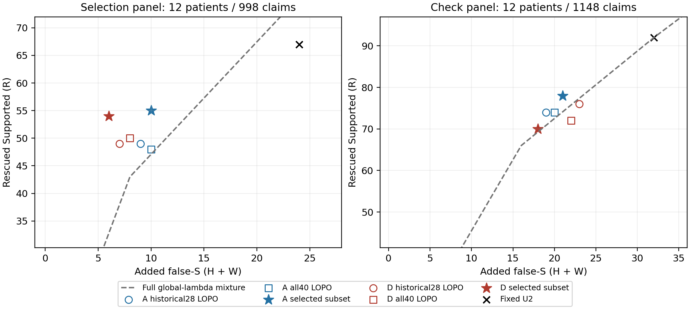
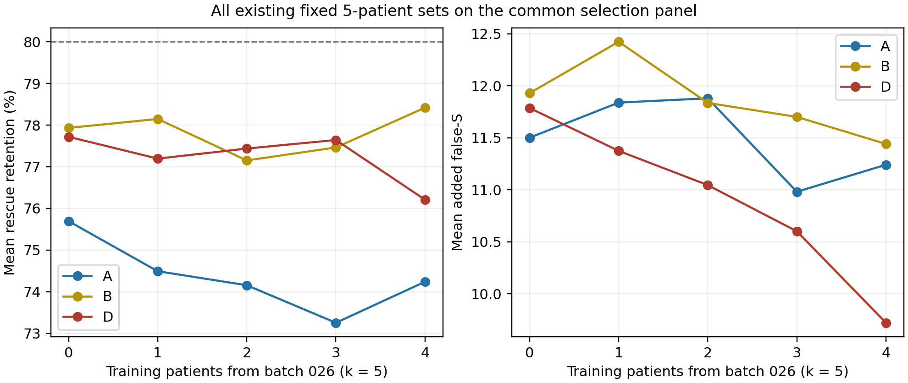

# 033：Gate训练患者组成与定向subset研究

## 结论

**找到了开发面板上的高表现小subset，但没有找到稳定超越“全部development训练”的同风险subset。建议未来若保留Gate对照，采用固定A评分Gate＋全部40名development训练；不把本轮选优名单升级为最终最优。** 这是减少选择偏差、保留覆盖的保守训练策略，不是证明全40人的PA最高，也不是Gate已经通过最终测试。

- **A的搜索第一名为3人：31135、59840、9030。** 在不参与本轮subset选择的12人核查上，比全训练患者留一结果多对4条、MCC略升，但多1条false-S；相同风险下反而少1.20R，未证明更强的风险区分。这一小幅实际工作点收益应保留，不能抹为完全无效。
- **D的搜索第一名为5人：27036、27823、59250、59840、93640。** 搜索面板相对原16人A的同风险增量+16R，核查时相对全训练D仅+0.40R、区间跨0，rescue保留降至76.1%；不能据搜索高点推荐它替换全训练方案。
- 23个定向邻近集合、36个新增最终拟合没有超过这两个历史第一名。此次只做一轮add/drop/swap，不继续救结果。
- A有47个不同的3/5/8/11人集合在搜索面板给出相同动作。“3人最佳”包含最小规模平分规则的影响；D的5人高点也未稳定迁移。**没有可辩护的唯一最佳人数或可通用的患者好坏名单。**

执行、报告及执行者自检完成，**待独立审计**。0新增API、0费用，不使用reserved40，不自动提交/推送或继续新实验。

## 1. 本轮整理了什么，怎样避免把030误读成最佳名单

030的141轮是141套多模型患者留出安排；每轮由15个患者外模型加无候选患者组成1529条评价。它们不是141个固定训练名单。实际保存的是**1452个固定患者集合×A/B/D＝4356个最终模型**。

本轮完整整理：6345行原单患者评价，去掉同模型/同测试患者的重复后5325个不同配对；每个固定集合的患者ID、人数、候选R/H/W、阈值、PA/MCC/AC1、false-S、rescue保留，以及原实际held覆盖。再用保存模型为原16人中所有未参与其训练的患者补算预测，0新拟合；这部分标为033新增的离线覆盖，未冒充030原有测试。

因为不同固定集合原来面对的测试患者不同，不能拿原始PA直接跨集合排榜。共同排名面板使用031的扩充12人，所有历史模型都未用这12人训练，统一998条/91候选（R67、H6、W18）。另一组031确认12人1148条/124候选，在subset和全部邻居冻结后才由程序连接GT核查。**这些患者早已用于031/032，因此只是已暴露development的本轮选择隔离核查，不是新独立测试。**

全40人数据为3675条、370候选。只用既有数值特征和医生标签，不重新读临床正文、检索、生成repeat/trace或调用API。原C48、λ=2、029特征与学习规则不变。A/D分别保持固定信息输入，B用于完整历史整理；本轮不搜索新特征或分类器。

完整入口：[141轮结果](historical_001/all141_sweeps.csv)、[1452个训练集合](historical_001/training_sets.csv)、[原实际held记录](historical_001/original_observed_units.csv)、[原患者补充覆盖](historical_001/original_complement_metrics.csv)、[共同面板排名](historical_001/fixed_set_common_panel_ranking.csv)、[逐模型逐患者](historical_001/patient_metrics.csv)。

## 2. 事前确定的排名与有限搜索

所有模型仍按训练患者内部LOPO确定保留至少80%训练R的最严格阈值，然后用允许训练患者重拟合。没有从测试曲线重新挑阈值。R是真Supported救回；H为原来正确的non-S被推错；W为原本已错的non-S又被推成Supported。**新增false-S＝H+W，净正确增加＝R−H**，两者不等价。

排名先区分共同面板是否保留≥80% R，再比较最差的“全体／删去任一面板患者”的同风险增量，按可救回R数量归一；完整global-λ混合包络和原16人A曲线取更差值。随后用MCC、正确数、较少risk、较小人数、ID打破平分。这个排序是研发选择准则，不是临床安全标准。

每条A/D线在8/11/14人中各取一个种子。按历史同k患者入选关联，预先生成drop最低关联者、add最高关联未入选者、两者swap，以及反方向swap对照。24个操作去重后23个集合；每集合仅A/D两种固定方案，共46个评价，其中10个复用已有模型、36个新拟合。**邻居身份在新拟合前固定，没有第二轮greedy搜索。**

|线/训练人数|共同面板正确/998|MCC|R / 新增false-S|R保留率|最差归一同风险分数|
|---|---:|---:|---:|---:|---:|
|A：3|813|0.5278|55 / 10|82.1%|−0.38|
|A：5|813|0.5278|55 / 10|82.1%|−0.38|
|A：8|813|0.5278|55 / 10|82.1%|−0.38|
|A：11|813|0.5278|55 / 10|82.1%|−0.38|
|A：14|807|0.5208|49 / 9|73.1%|−9.68|
|D：3|818|0.5389|58 / 9|86.6%|+3.33|
|D：5|814|0.5372|54 / 6|80.6%|+15.24|
|D：8|816|0.5387|56 / 7|83.6%|+6.67|
|D：11|816|0.5387|56 / 7|83.6%|+8.33|
|D：14|814|0.5359|54 / 7|80.6%|+5.00|

每行是该人数内按事前规则排第一的集合，不是该人数的均值。分数单位为每100个可救回R的最差混合增量；越大越好，含两参考和留一患者压力。D的5人第一名没有最高PA，体现本轮并未只选一次正确数最高的结果。A的47个动作等价集合分布为3人5个、5人30个、8人11个、11人1个，不能把最小ID/人数平分结果当人数机制。

定向修改没有改进种子：A的12个操作中8个排名分数下降、4个持平；D的12个全部下降，连按正向关联add/drop也未改善。历史第一名与定向搜索后的最终第一名因此相同。[种子与名单](search_001/seeds.json)、[事前邻居计划](search_001/directed_plan.json)、[修改前后差异](supplement_001/directed_changes.csv)、[动作等价集合](supplement_001/identical_search_actions.json)均保留。

## 3. 冻结后12人核查：高点有没有保留下来

下表是完整1148条，不只评价124个候选。“全40 LOPO”指每名测试患者都从全development中移除后训练，即各用其余39人，不是用全40训练后在自己身上测试。它可以用其他11名核查患者训练，不能称整批12人均未进入训练。历史28人与小subset则没有这12人进入训练；两类比较分别保留。

PA是正确比例，MCC是三类整体相关性，AC1是机会校正一致性；全部调用002实现。

|配置|正确/1148|PA|MCC|AC1|R/H/W|新增false-S|总false-S|R保留|
|---|---:|---:|---:|---:|---:|---:|---:|---:|
|U0|869|75.70%|0.4770|0.6909|0/0/0|0|25|0%|
|U2|947|82.49%|0.5210|0.7863|92/14/18|32|57|100%|
|A历史16|936|81.53%|0.5250|0.7721|74/7/12|19|44|80.4%|
|A历史28|936|81.53%|0.5250|0.7721|74/7/12|19|44|80.4%|
|A全40 LOPO|936|81.53%|0.5240|0.7722|74/7/13|20|45|80.4%|
|A历史最佳＝定向最佳3人|940|81.88%|0.5285|0.7769|78/7/14|21|46|84.8%|
|D历史16|935|81.45%|0.5197|0.7713|75/9/12|21|46|81.5%|
|D历史28|936|81.53%|0.5191|0.7726|76/9/14|23|48|82.6%|
|D全40 LOPO|933|81.27%|0.5170|0.7690|72/8/14|22|47|78.3%|
|D历史最佳＝定向最佳5人|932|81.18%|0.5208|0.7674|70/7/11|18|43|76.1%|

历史最佳和定向最佳单独保存在机器结果中，表中因名单、预测完全相同而合并展示。

**A3有小幅工作点收益，不能故意忽略：** 相对A全40，+4正确、ΔPA +0.348个百分点，95%患者区间[+0.093,+0.574]；ΔMCC +0.00452，区间[+0.00100,+0.00910]。4名患者各多对1条，另外8人持平；全部收益来自human，false-S多1。这是有限的固定工作点优势，并非相同风险下更会挑选。

**D5主要变保守：** 相对D全40少4条false-S，但少救回2条R、只少1条H，所以净正确−1。相对原固定28人D少4条正确、少5条false-S，rescue保留从82.6%降至76.1%。搜索面板的强信号没有以同样幅度复现。

|核查同风险比较|相对确定性曲线多R|相对混合曲线多R|95%患者区间（混合）|两主比较97.5%区间|
|---|---:|---:|---|---|
|A3 vs A全40|+2|−1.20|[−10.40,+3.00]|[−12.93,+3.00]|
|D5 vs D全40|+1|+0.40|[−8.51,+3.31]|[−11.23,+4.00]|
|A3 vs A历史28|+1|−2.00|[−11.43,+2.00]|辅助|
|D5 vs D历史28|−1|−1.67|[−10.55,+2.00]|辅助|
|A3 vs 完整global λ|+12|+3.88|[−4.29,+8.55]|辅助|
|D5 vs 完整global λ|+4|+0.75|[−7.79,+9.10]|辅助|

随机混合曲线是在同样期望风险下混合不同阈值形成的GT知情参照，不是可直接部署的成绩。没有修改global范围、λ或概率阈值。核查A3相对A全40的同风险差，删去任一测试患者后仅1/12为正；D5为8/12为正，但增量范围仅−1.29至+2.00R。**不能将它们解释为稳定同风险优势；区间跨0也不等于等效。**

1000次配对患者bootstrap共用重抽安排，固定已有模型预测、不在每次重抽中重训；A/D两个主要同风险比较另给Bonferroni修正97.5%区间，其他指标为辅助描述。既有开发暴露和1452集合选择的乐观性仍须披露。

左图是搜索面板，右图是选择隔离核查；轴范围仅放大关注区域，计算使用全部global断点直到全S。历史28/全40在其训练患者出现的面板上均按LOPO计算，图中全40参照是事后完整评价，不曾用于前面的搜索排名。不能把左右两批患者当同一分母相减。

## 4. 作者与类别：不能只看总体PA

|核查配置|human正确/680|human MCC|human总false-S|human R保留|LLM正确/468|LLM MCC|
|---|---:|---:|---:|---:|---:|---:|
|A全40|502|0.4980|34|76.5%|434|0.4494|
|A3|506|0.5044|35|82.4%|434|0.4494|
|D全40|499|0.4892|36|73.5%|434|0.4494|
|D5|498|0.4933|32|70.6%|434|0.4494|

这四种配置在LLM上完全相同；LLM真实S439/468、NA仅9条，不能用高PA夸大泛化。human的A3 S召回从81.72%升至82.56%，NS召回62.92%、NA召回49.57%不变；多出的false-S属于原本已错的W。D5的human S召回81.30%→80.88%，NS召回61.80%→62.92%，NA不变，是支持救回与non-S保护的交换。所有分层AC1、三类召回/混淆矩阵见[metrics.json](evaluation_001/metrics.json)。

A3相对A全40为4正/0负/8平；D5相对D全40为1正/2负/9平。小幅正向不是由单个患者独占，但也没有在多数患者上出现大幅改善。[逐条修错误伤](evaluation_001/transitions.csv)、[患者方向](supplement_001/patient_directions.json)均可回查。

## 5. 为什么026来源更多时D看起来更好

030原合并OOF的5人训练中，从025/026人数4/1变为1/4，D的新增false-S均值24.10→17.55，rescue保留80.23%→77.05%；对A同风险均值−1.60→+5.67R，但025子组仍反向。不能将那个合并正向直接当某个固定名单已通过跨组验证。

在本轮共同搜索面板上，去重的固定5人集合也重复了“D更保守”趋势：

|025/026训练人数|不同固定集合数|训练R比例均值|D平均R保留|D平均新增false-S|对A16同风险多R均值|
|---|---:|---:|---:|---:|---:|
|4/1|265|72.0%|77.2%|11.37|−0.78|
|3/2|272|70.5%|77.4%|11.04|−0.16|
|1/4|50|67.0%|76.2%|9.72|+0.61|

**有额外选择信息的迹象，但相当部分改善伴随更低rescue；不是“多放026就全面更好”。** 两来源仅是既有development患者批次，不是医院域。人数相同，候选量和R/risk分布仍不同，不能归因于来源本身。

原026候选52条中risk18（34.6%），025候选103条中risk27（26.2%）；训练目标分布、score和追加核查信息同时变化。D受到这些变化的影响比A明显，但本轮没有将阈值、概率尺度或来源单独做因果干预。阈值数字更高也不自动等于动作更保守，因为模型概率尺度随训练材料改变。

## 6. 哪些患者常与好结果同时出现

入选关联按相同k比较，每个k等权，in/out至少各3个集合才进入汇总；原实际held数据另按held×k分层。它们是观察性关联，不是医学标签或可通用的训练患者黑名单。高分集合入选频率保留90%分位全部平分集合，避免用ID任意挑前几名造成假规律。

|患者|原组|候选R/risk|D中同k关联方向|必须保留的限制|
|---|---|---|---|
|93640|026|13/2|4/4规模正向|A中却4/4负向|
|59840|026|6/4|4/4正向|A中方向混合|
|59250|026|4/3|4/4正向|只有7候选|
|27036|026|4/3|4/4正向|A中多数负向|
|9030|025|8/0|D和A均4/4负向|却出现在A搜索第一名中|
|27823|025|10/1|D中4/4负向|却出现在D搜索第一名中|
|50524|025|11/1|D方向混合、均值负|A中4/4正向|
|80606|025|1/0|D多数负向|仅1候选，不能据此认定患者有害|

对应归一同风险关联的D均值，93640约+1.25、59840+1.05、59250+0.52、27036+0.39；9030约−1.44。单位为每100个可救回R的入选−未入选差，不是新增正确条数或因果效应。A与D方向差异、以及“平均负关联患者反而在最佳组合内”，说明共同入选与交互背景不可忽略。

原030实际held数据也不支持通用好坏标签。例如D中59840的入选关联，在025测试患者上的平均正确数差约−0.11，在026约+0.36；93640分别约−0.05/+0.04。9030在新共同面板的同风险关联为负，但原两个held组的正确数关联均略正。这些是不同指标/不同测试组的条件均值，不是因果矛盾，却说明规律不能脱离评价对象直接迁移。

适合保留的经验是**训练覆盖需同时包含R及不同risk结构、足够候选和score范围，而不是只收纯S或最多病例的患者**。但这是对现有材料的谨慎解释，不是已验证的自动选人规则：A3训练30候选为R23/H0/W7，完全没有H；D5为R37/H2/W11，H也很少；全40则R269/H41/W60。小集合的固定点收益不足以证明它已覆盖后续误伤风险。没有证据支持直接删除某类患者或按“risk越多越好”排序。

全部原16患者及全40画像、既有score/margin与作者比例、同k关联、原held调整后方向、高分入选频率见[patient_profiles](association_001/patient_profiles.csv)、[all40 profiles](supplement_001/all40_patient_profiles.csv)、[分层关联](association_001/common_panel_inclusion_by_size.csv)、[原held关联](supplement_001/original_inclusion_group_summary.csv)、[高分入选频率](supplement_001/top_decile_membership.csv)。未新增临床错误诊断。

## 7. 全40人跨患者结果与选择乐观性

每个测试患者都从指定训练集合中移除；非候选患者也进入完整分母。下表不是全训练模型在训练本人上的成绩，但原16和搜索12参与过subset选择，所以**小subset的全40汇总仍有选择乐观性，只作探索描述**；核查12人结果才是本轮判断新增名单泛化的主要依据。

|配置|正确/3675|PA|MCC|总false-S|R/H/W|R保留|
|---|---:|---:|---:|---:|---:|---:|
|U2|3012|81.96%|0.5275|183|269/41/60|100%|
|A历史16|2977|81.01%|0.5337|132|214/21/29|79.6%|
|A历史28|2978|81.03%|0.5341|132|215/21/29|79.9%|
|A全40 LOPO|2978|81.03%|0.5317|137|218/24/31|81.0%|
|A3（历史＝定向最佳）|2991|81.39%|0.5343|145|232/25/38|86.2%|
|D历史16|2980|81.09%|0.5383|124|214/18/24|79.6%|
|D历史28|2980|81.09%|0.5358|130|216/20/28|80.3%|
|D全40 LOPO|2978|81.03%|0.5332|135|215/21/32|79.9%|
|D5（历史＝定向最佳）|2979|81.06%|0.5376|125|213/18/25|79.2%|

这些差异表明训练组成确实能改变保守程度和工作点；它们没有推翻030“更大训练通常降低波动”的观察。030比较的是预定多模型OOF平均，033比较的是从大量模型中选择固定集合后的新面板，两者的问题、选择条件和测试材料不同。不能反过来说033证明训练越少越好。

## 8. 推荐的最终训练配置与名单

**推荐：A评分Gate，训练策略保留全部003 development40人，λ和029学习规则不变。** 已保存真正用全部允许候选训练的最终模型及scaler、系数、训练内阈值0.608679899116368；该模型本身没有被拿来在自己的训练患者上报泛化成绩。15057没有λ候选，仍保留在40人策略中，实际拟合有39名患者的370行候选。

这不是说全40比A3的PA更高——实际核查恰好相反。推荐理由是A3没有同风险优势，存在大量动作等价名单、仅30训练候选且没有H；D5也没有稳定保留搜索优势。当前证据不足以为排除大部分development患者提供稳健依据。A3作为小幅固定工作点收益的探索备选保留，但不将它命名为“最佳训练人数3”或最终确认winner。

完整推荐名单（按数值展示，不表示优先级）：

`4954, 9030, 15057, 16076, 21706, 26858, 27036, 27823, 28399, 29426, 31135, 45115, 45979, 47874, 47940, 50524, 55106, 55204, 55750, 59250, 59840, 65399, 66218, 67117, 71743, 72844, 80084, 80606, 84454, 85689, 87982, 89909, 91315, 93147, 93640, 93788, 97212, 97683, 97885, 98790`

[推荐模型与理由](recommendation_001/recommendation.json) · [患者CSV](recommendation_001/training_patients.csv) · [最终模型](recommendation_001/gate_A_all40.json)。未来是否实际采用Gate仍要看其风险—收益任务定位；本轮没有自动开展reserved验证，也不把这个训练策略建议当作Gate已证明有效。

## 9. 计算、自检与停止

完整复用4356个030最终模型，没有重跑原141轮训练。定向搜索新增36个最终模型；为历史配置、全40、所选subset作必要患者留一及最终拟合后，**本轮总计178个新最终模型，另有4828个训练内拟合状态**，均使用原配方；内层次数不隐藏，也不把它们称作新的方法搜索。上限预定350个最终模型，未触及。

执行者48422项只读检查通过：全部历史搜索概率重放、6345条原held正确数、5006个新模型内外状态、scaler/阈值/患者排除、完整预测、002指标、同风险LP及031固定28人锚点一致。4项事前测试通过。**这是执行者自检，不是独立审计，也未在自检中重新拟合全部模型。** 输入、代码、环境及阶段指纹保留，主环境及历史结果不改。

旧033 reserved准备的删除被自动审批拒绝，因此采用可恢复的`withdrawn_reserved_preparation_20260920`改名归档，退出033编号；其材料没有进入本轮输入。新的正式目录为`033_gate_training_subset`，0 API，未使用reserved患者，不提交/推送。

本轮完成后停止，不继续swap/greedy、不改特征或分类器。现有15名历史候选训练患者是定向搜索的范围；没有穷举全部40人的任意组合，所以结论是**本次有证据支持的范围内未找到稳定更优subset**，不是证明任何更大搜索空间都不可能存在。后续实验由用户另行布置。
