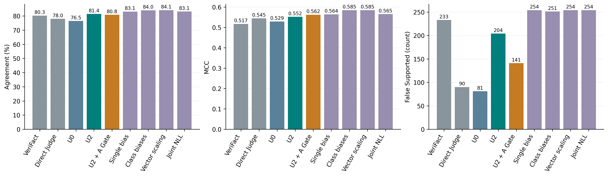
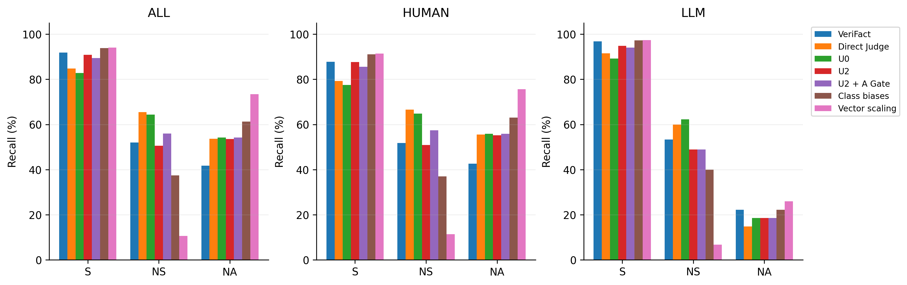

> 阅读镜像：已省略1行病例原文／标识；原始文件SHA见MIRROR_MANIFEST.json。

# 036：标准对照、reserved40最终验证与论文实验收尾

## 一、先回答研究结论

本轮冻结后评价全部40名reserved患者、3573条valid atomic claims；共同有效主分析为3571条，覆盖40名患者。没有用reserved重新拟合、选择患者、改prompt或调λ。所有方法在GT连接前封存预测。

1. **U2相对同次评分U0净增+177条正确**（PA 76.48%→81.43%，MCC 0.5293→0.5520）；PA和MCC的总体提升均有患者配对区间支持。它救回真S 219条、误伤原正确non-S 42条，并把原本已错的non-S 81条转为错误S。总false-S 81→204。收益与风险必须同时报告。
2. **A Gate相对U2净正确-22、总false-S -63**。保留178/219真S救回（81.28%），阻止H 19、W 44条，同时挡掉R 41条。它以部分正确数换取更少错误支持，只能作为风险折中点，不能称无损增益。80%只是训练内目标，不是最终测试保证或临床安全线。
3. **温度不改变任何U2标签**。NLL 1.1361→0.5598，Brier 0.2908→0.2918，ECE10 0.1028→0.0790，即NLL下降、Brier上升、ECE10下降。这些量各有定义，不能用NLL改善代替“全面校准成功”。
4. **U2有效，但不是总体成绩最好的后处理。** 多类常数偏置Std_M为2999/3571、PA 83.98%、MCC 0.5850，较U2多91正确、也多47条false-S。Vector scaling为3004/3571、PA 84.12%、MCC 0.5850，但NS召回仅10.55%，不能把最高总分称为全面更优。论文主结果应呈现“固定边界的组件增量＋标准监督对照＋类别/风险代价”，不能以“新λ2方法优于经典校准或已全面超过原VeriFact”为主张。
5. **可以结束本轮实验开发并进入写作**。必要标准对照、最终队列和预设重复已执行；复杂Gate/特征路线不再追加。当前剩余事项是独立审计与论文陈述核对，不是以reserved结果为依据追加优化。执行者自检与独立审计分开，036尚未独立审计。

## 二、主结果：一次评分共享所有后处理

PA为正确比例；MCC考虑类别混淆与不平衡；AC1为一致性指标。false-S是真实NS/NA被报Supported的数量。类别召回是该真实类别被识别正确的比例。

|方法|correct/N|PA%|MCC|AC1|false-S|S recall%|NS recall%|NA recall%|
|---|---:|---:|---:|---:|---:|---:|---:|---:|
|O|2866/3571|80.26|0.5173|0.7532|233|91.89|52.00|41.71|
|B|2784/3571|77.96|0.5447|0.7144|90|84.74|65.45|53.69|
|Score_verdict|2707/3571|75.81|0.5192|0.6844|81|82.62|66.55|49.92|
|U0|2731/3571|76.48|0.5293|0.6933|81|82.77|64.36|54.19|
|U2|2908/3571|81.43|0.5520|0.7666|204|90.92|50.55|53.53|
|U2_T|2908/3571|81.43|0.5520|0.7666|204|90.92|50.55|53.53|
|Gate_A|2886/3571|80.82|0.5621|0.7560|141|89.39|56.00|54.19|
|Std_T|2731/3571|76.48|0.5293|0.6933|81|82.77|64.36|54.19|
|Std_G|2967/3571|83.09|0.5642|0.7906|254|94.01|41.82|53.53|
|Std_M|2999/3571|83.98|0.5850|0.8017|251|93.90|37.45|61.25|
|Std_V|3004/3571|84.12|0.5850|0.8044|254|94.08|10.55|73.40|
|Joint_NLL|2969/3571|83.14|0.5653|0.7913|254|94.08|41.82|53.53|
|Task_T|2908/3571|81.43|0.5520|0.7666|204|90.92|50.55|53.53|
|Robust_T|2908/3571|81.43|0.5520|0.7666|204|90.92|50.55|53.53|
|MCC_T|2963/3571|82.97|0.5629|0.7890|252|93.78|42.55|53.53|
|U4|2969/3571|83.14|0.5653|0.7913|254|94.08|41.82|53.53|

原VeriFact O使用作者发布系统结果。B是同期普通structured判断；Score_verdict是同次评分回答自带的原verdict；U0是同次label_scores的argmax，三者不能混同。U2_T、Task_T和Robust_T若标签相同，是固定参数/定义的结果，不能作为三次独立复现。U4是预先登记的Joint标签核对参照。

### 主要配对比较

- U2−U0：ΔPA +4.96百分点，95%患者区间[+3.96,+5.96]；ΔMCC +0.0227，区间[+0.0078,+0.0370]。
- U2−B：ΔPA +3.47百分点，95%患者区间[+2.32,+4.73]；ΔMCC +0.0073，区间[-0.0163,+0.0306]。
- U2−O：ΔPA +1.18百分点，95%患者区间[-0.50,+2.95]；ΔMCC +0.0347，区间[-0.0019,+0.0690]。
- Gate_A−U2：ΔPA -0.62百分点，95%患者区间[-1.02,-0.18]；ΔMCC +0.0101，区间[+0.0002,+0.0206]。
- U2_T−U2：ΔPA +0.00百分点，95%患者区间[+0.00,+0.00]；ΔMCC +0.0000，区间[+0.0000,+0.0000]。

1000次患者cluster bootstrap，固定预测重抽患者，seed0..999；不能把claim当独立患者。以上是预设主比较，标准方法比较及两作者区间全部保存，存在多重比较，不从未校正的漂亮区间挑结论。区间跨0不等于等效。

**最强的确认结论是U0→U2的组件增量。** 相对同期B，PA提升得到支持，但MCC区间跨0，且false-S多114条；相对原VeriFact，PA/MCC虽点值更高，两个区间都跨0，因此尚不能宣布显著超越原系统。原系统还包含不同检索、模型与运行时间条件。

标准对照相对U2：Std_M的ΔPA +2.55百分点[+1.76,+3.30]、ΔMCC +0.0330[+0.0157,+0.0487]；Std_V的ΔPA +2.69百分点[+1.52,+3.70]、ΔMCC +0.0330[+0.0088,+0.0552]。这些预设辅助比较显示它们确有竞争力；相应false-S增加47/50条，不能省略。全部配对数值集中在`paired_statistics.csv`。

### 作者与类别

共同有效队列的类别背景如下。Always-S是“所有陈述都报Supported”的退化诊断，其PA就是S占比，MCC按002约定为0；不是新拟合方法或可取的临床策略。

|子组|N|GT S|GT NS|GT NA|Always-S的PA%|Always-S的false-S|
|---|---:|---:|---:|---:|---:|---:|
|all|3571|2687|275|609|75.25|884|
|human|2290|1478|230|582|64.54|812|
|llm|1281|1209|45|27|94.38|72|

Human：

|方法|correct/N|PA%|MCC|AC1|false-S|S recall%|NS recall%|NA recall%|
|---|---:|---:|---:|---:|---:|---:|---:|---:|
|O|1665/2290|72.71|0.4886|0.6321|197|87.82|51.74|42.61|
|B|1647/2290|71.92|0.5345|0.6088|69|79.23|66.52|55.50|
|U0|1619/2290|70.70|0.5228|0.5901|61|77.47|64.78|55.84|
|U2|1734/2290|75.72|0.5407|0.6719|168|87.69|50.87|55.15|
|Gate_A|1722/2290|75.20|0.5540|0.6604|107|85.59|57.39|55.84|
|Std_M|1799/2290|78.56|0.5696|0.7149|207|91.14|36.96|63.06|
|Std_V|1817/2290|79.34|0.5786|0.7281|210|91.41|11.30|75.60|

LLM：

|方法|correct/N|PA%|MCC|AC1|false-S|S recall%|NS recall%|NA recall%|
|---|---:|---:|---:|---:|---:|---:|---:|---:|
|O|1201/1281|93.75|0.4268|0.9340|36|96.86|53.33|22.22|
|B|1137/1281|88.76|0.3505|0.8776|21|91.48|60.00|14.81|
|U0|1112/1281|86.81|0.3285|0.8549|20|89.25|62.22|18.52|
|U2|1174/1281|91.65|0.3417|0.9109|36|94.87|48.89|18.52|
|Gate_A|1164/1281|90.87|0.3295|0.9021|34|94.04|48.89|18.52|
|Std_M|1200/1281|93.68|0.3673|0.9335|44|97.27|40.00|22.22|
|Std_V|1187/1281|92.66|0.2641|0.9228|44|97.35|6.67|25.93|

LLM类别偏Supported时PA很容易受多数类驱动，因此同时保留MCC、NS/NA召回和完整混淆矩阵。所有类别support、precision、recall及矩阵见`analysis_001/R0/metrics.json`，不能只摘取Supported召回。

U2较U0在human/LLM分别净增115/62正确，两作者PA区间均正；human MCC差+0.0179的区间为[+0.0032,+0.0309]，LLM MCC差+0.0132的区间为[−0.0664,+0.0822]，后者没有明确确认。Gate的63条false-S减少中，61条来自human；LLM只减少2条false-S，却损失10条正确，LLM PA差的区间也为负。因此不支持把同一个Gate当成两作者通用的默认性能提升模块，也不据此再拟合作者专属Gate。

Vector scaling将NS召回从U2的50.55%降至10.55%，换来NA召回53.53%→73.40%；多类偏置的对应值为NS 37.45%、NA 61.25%。这说明连PA/MCC同时较高也可能掩盖少数类别严重损失。U2可以作为保留较多NS识别的固定折中点，但没有预设临床效用权重，不能把它称为已经证明的“最优平衡”。

Std_V相对Std_M仅多5条正确、MCC几乎相同，背后却是NS正确数103→29、NA正确数373→447（各差74，互相抵消），S正确数2523→2528。这是不同类别之间的取舍，不是所有类别一起进步；每类precision/F1与完整混淆矩阵见`class_performance.csv`、`confusion_matrices.csv`。

## 三、错误转移与患者异质性

R/H/W仅定义在原U2候选：R是真S救回；H是U0本来正确的non-S被λ改错；W是U0已错的non-S又变S。**净正确=R−H；新增false-S=H+W。**二者不能混用。

U2候选342条，其中R=219、H=42、W=81。Gate通过后R=178、H=23、W=37。Gate少报的错误S不全转化成正确：阻止W只是退回原本错误的NS/NA；阻止H才恢复正确，误挡R会损失正确。

|GT|原U0|类型|U2改为S|Gate保留S|Gate挡回|
|---|---|---|---:|---:|---:|
|Supported|Not Supported|R|214|178|36|
|Supported|Not Addressed|R|5|0|5|
|Not Supported|Not Supported|H|38|23|15|
|Not Supported|Not Addressed|W|1|0|1|
|Not Addressed|Not Supported|W|80|37|43|
|Not Addressed|Not Addressed|H|4|0|4|

这里“挡回”在R行是误伤，在H行是修错，在W行只表示减少错误支持；原U0已报S的错误不属于候选，Gate不会处理。两作者同样的细分表见`error_transfer_by_class.csv`。

|比较|正/负/持平患者|净正确|去掉任一患者后的净正确范围|
|---|---:|---:|---:|
|U2−U0|35/1/4|+177|[+162,+178]|
|U2−B|33/3/4|+124|[+110,+128]|
|U2−O|22/15/3|+42|[+26,+52]|
|Gate_A−U2|5/19/16|-22|[-24,-18]|
|U2_T−U2|0/0/40|+0|[+0,+0]|

“去掉任一患者”只是集中性诊断，没有重新训练、改阈值或删患者报告。逐条fix/harm、错误S增减及ID已完整写入`transitions.csv`；本轮不把模型reason当因果机制，不新标医学gold。

## 四、概率输出：温度、边界与自由度分开

NLL是真实类负对数概率；Brier是三类平方误差之和；ECE10是10个等宽桶的最大类置信度差。均越低越好，但衡量不同方面。模型声明score经floor/log/softmax得到这些概率，不是原生token概率。

|方法|NLL↓|Brier↓|ECE10↓|
|---|---:|---:|---:|
|U0|1.2727|0.3530|0.1585|
|U2|1.1361|0.2908|0.1028|
|U2_T|0.5598|0.2918|0.0790|
|Std_T|0.6346|0.3366|0.1007|
|Std_G|1.1302|0.2884|0.0985|
|Std_M|1.0755|0.2628|0.1003|
|Std_V|0.4413|0.2324|0.0221|
|Joint_NLL|0.5086|0.2650|0.0466|
|Task_T|0.5598|0.2918|0.0790|
|Robust_T|0.5598|0.2918|0.0790|
|MCC_T|0.5564|0.2899|0.0864|
|U4|1.1205|0.2951|0.1312|

U2_T的ΔNLL为−0.5762，95%患者区间[−0.6971,−0.4711]，改善明确；ΔBrier为+0.0010，区间[−0.0078,+0.0098]，不能认定改善，也不能认定已经确证恶化或等效。ECE10是点值下降，不据分箱曲线宣称全面校准。Std_V的概率指标更低，但它同时改变分类标签和类别取舍，不能视为“保持U2标签的更好温度”。

Std_T只有置信度尺度，分类标签与U0一致。U2_T只改变已移边界后的置信度。Std_G、Std_M可改变边界；Std_V同时有尺度和偏置自由度。Joint_NLL在development命中λ=4上界，开发七个数据视图、最终R0及R1均与U4逐条标签完全一致（不是仅正确数相同，见`final_label_equivalence.csv`），温度部分继续改变概率；不继续扩大λ范围，不把命中上界解释为找到了理论最优。各标准方法还保留原正则和约束，不能将全部差异简单归因于参数数量。

可靠性图和分箱人数见Figure4及机器表；`probability_breakdown.csv`按U2正确/错误、真实类score为0分解。没有人工复核效用或临床安全实验，不能据NLL变化推导这些应用收益。原评分reason未随U2/Gate标签重写，是应用解释一致性的限制。没有新增passage-level evidence gold，标签改对也不等于已逐条验证C48支持充分或引用正确；判定性能结论不能直接扩展为证据忠实性已验证。

## 五、预设重复

重复患者为28016, 82301, 48177, 29894，共444条，按ID哈希在任何正式结果前确定。6人方案保守估算超过150元，按已登记的预算规则选4人。以下是同一444条的独立调用，不是新增444条独立测试样本。

|方法|同ID N|R0正确|R1正确|标签变化|
|---|---:|---:|---:|---:|
|B|444|342|349|19|
|U0|444|339|342|21|
|U2|444|363|369|26|
|U2_T|444|363|369|26|
|Gate_A|444|360|363|28|
|Std_M|444|372|373|28|
|Std_V|444|374|376|18|
|Joint_NLL|444|369|370|24|

同一重复子集U2−U0净正确：R0 +24，R1 +27；Gate−U2：R0 -3，R1 -6。两轮分别保存所有指标、区间和患者方向。4名患者的重复仅诊断运行波动，不能保证所有40名的多轮稳定性。

## 六、development对照与历史证据如何串联

新增标准方法复用035相同评分、同四折、同患者隔离；不使用reserved做标准方法拟合。Main40 development OOF结果如下，其他原R0/R1及跨Judge视图都保存：

|方法|正确/3675|PA%|MCC|false-S|NLL|Brier|
|---|---:|---:|---:|---:|---:|---:|
|U0|2784|75.76|0.4906|82|1.3520|0.3629|
|U2|3012|81.96|0.5275|183|1.1806|0.2881|
|U2_T|3012|81.96|0.5275|183|0.5790|0.2985|
|Joint_NLL|3079|83.78|0.5367|237|0.5166|0.2656|
|Task_T|3012|81.96|0.5275|183|0.5790|0.2985|
|Robust_T|3012|81.96|0.5275|183|0.5790|0.2985|
|MCC_T|3072|83.59|0.5348|232|0.5648|0.2909|
|Std_T|2784|75.76|0.4906|82|0.6651|0.3505|
|Std_G|3079|83.78|0.5374|235|1.1720|0.2847|
|Std_M|3102|84.41|0.5516|236|1.1172|0.2603|
|Std_V|3081|83.84|0.5354|237|0.4345|0.2266|
|U4|3079|83.78|0.5367|237|1.1377|0.2853|

多类常数偏置与Vector scaling有竞争力，故在reserved完整保留，未为突出U2而删对照。它们使用医生标签拟合；固定U2来自先前开发阶段决定，不能写成完全未接触标签的先验常数。

研究链条可写为：早期检索/证据重组与复杂解释并未稳定改善→发现评分判定存在Supported边界取舍→固定简单修正跨开发患者、重复和服务条件检查→对额外信息Gate做开发与迁移，保留风险控制但拒绝复杂路线的过度结论→补足标准后处理→冻结后reserved最终评价。019最初保护门槛失败、λ2为事后开发信号；020以冻结方式继续确认；023说明局部平台但不证明全局最优。025的Gate OOF信号、026的迁移减弱与031追加信息未确认，均保留为方法边界，而非删掉的失败。

**写作定位需要随证据收束。** 036不支持把论文写成“固定λ2是一种优于标准校准的新最强算法”。更可辩护的是临床核验中决策边界、置信度和风险控制的实证研究：简单偏置确有可重复组件收益，学习的标准偏置/尺度有更高总分，同时暴露false-S和少数类别代价。这个定位不要求继续开发新方法，也不将标准方法本身的通用思想宣称首创。

**035勘误：**“跨Judge所有方法标签不变”不适用于探索性MCC_T。既有勘误记录DS→Q 45/879标签变化、净+7；Q→DS 36/879变化、净+1。U2_T/Task_T/Robust_T/Joint_NLL对应迁移没有标签变化。原报告和独立审计保留，036采用修正后的表述。

## 七、覆盖、费用、复现与审计

冻结N=3573，主分析共同有效N=3571；逐方法missing ID与全冻结分母missing-as-error PA见`coverage.csv`。所有40人完整进入计划，不静默删除失败；Qwen缺失候选按事前规则退回U0；主评分缺失则显式标为不可构造U0。HTTP200不为答案或非核心格式重跑。

API累计估算及未知预留 **¥105.576735/150**，其中未知预留¥0.000000；全部尝试12646，收到HTTP200 12646。按公开峰值无缓存usage估算，未逐笔核销供应商账单。BGE硅基流动、Judge阿里云；原始回执、请求、usage、异常都保留，没有重试。单独运行R0的BGE+评分约46.75元，加入342次Qwen后约52.76元（多6.01元，约12.9%）；Gate费用增加不大，但22条净正确损失和作者差异使其不适合作默认准确率模块。需要更低false-S时可把该固定结果作为风险折中参考，本轮不证明临床成本收益。

正式费用入口为`accounting_002`：初版001的费用一直正确，但rerank token列未读取供应商meta而显示0，002已逐条回执修正为36,731,639个输入tokens；原001、回执和所有预测/指标保留不变。推理费用按本队列摊销，不包括既往研发/监督材料采集、自由文本切分或本地硬件成本。不同后处理共享一次评分，不能把方法数当调用次数。

环境为`research-verifact-029`，统一`scripts/run_research.ps1`；无主环境或历史文件修改。执行者自检覆盖冻结参数、原始回执、全部预测、002指标、配对bootstrap和R/H/W恒等关系，独立审计仍待进行。完整入口见任务README、`methods_and_settings.md`与`audit_handoff.md`。

## 图表与写作入口

- [Figure1](figures_002/figure1_performance_risk.svg)：总体PA/MCC/false-S，包含有竞争力的标准方法。
- [Figure2](figures_002/figure2_class_recall.svg)：总体/human/LLM三类别召回，包含Vector scaling的NS代价。
- [Figure3](figures_002/figure3_patient_deltas.svg)：U2和Gate逐患者正确数变化。
- [Figure4](figures_002/figure4_reliability.svg)：U2、U2_T与Vector scaling的三类可靠性。
- [Figure5](figures_002/figure5_risk_rescue.svg)：固定U2候选上的R与新增false-S工作点。
- `paper_tables.md`：总体、作者、概率、配对统计和重复的论文表格源。
- `paper_handoff.md`：研究主张、证据对应和建议章节结构。

完成后停止；reserved已消费，不能重新作为开发选择集。后续只做独立审计和写作，不自动037或任何优化。
