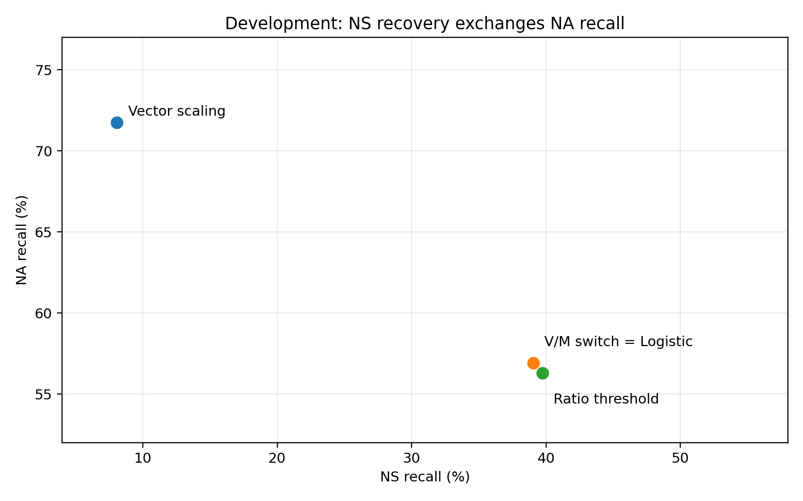

# 037：固定Supported集合的NS/NA决策研究

## 核心结论

**可以缓解Vector scaling的低NS召回，但没有得到全面占优的新模型。最简单的V/M切换已经完成主要恢复；单阈值和小型Logistic没有稳定额外增量。**

本任务仅使用40名development、3675条的四折患者外预测。037在036结果之后提出，是探索性扩展；未读取或重新评价036的reserved逐例数据，没有新增API。以下数值不是新的reserved测试成绩。

## 1. 方法和评价对象

先逐折在另外30名患者上拟合原022的Std_V和Std_M，保持其正则、边界和优化器。新增方法只允许Std_V原NA变NS，保持原S与原NS。
V/M固定切换：V=NA且M=NS时改NS，否则保持V。NS/NA单阈值：在V原NA中按q_NS/(q_NS+q_NA)排序。Logistic：四个已有score特征拟合NS/NA，不读文本、不调用第二Judge。
阈值在严格内层患者预测上确定：NS检出数达到同批V/M切换的水平后，最大化完整训练侧正确数。Logistic元特征还有一层患者交叉拟合，排除通过校准器间接看到验证标签。
原V误拒的真实S没有重标为NA，仍保留在全部系统评价中。没有筛选患者、添加特征或根据外层结果改配置。设置详见tasks/037_ns_na_decision/protocol.md。

## 2. Development患者外主结果

| 方法 | 正确/N | PA | MCC | false-S | NS召回 | NA召回 | NS精确率 |
|---|---:|---:|---:|---:|---:|---:|---:|
| U0 | 2784/3675 | 75.76% | 0.4906 | 82 | 68.69% | 48.87% | 22.32% |
| U2 | 3012/3675 | 81.96% | 0.5275 | 183 | 55.89% | 48.25% | 30.24% |
| Std_M：多类偏置 | 3102/3675 | 84.41% | 0.5516 | 236 | 39.06% | 57.11% | 37.42% |
| Std_V：Vector scaling | 3081/3675 | 83.84% | 0.5354 | 237 | 8.08% | 71.75% | 37.50% |
| V/M固定切换 | 3101/3675 | 84.38% | 0.5506 | 237 | 39.06% | 56.91% | 37.42% |
| NS/NA单阈值 | 3100/3675 | 84.35% | 0.5502 | 237 | 39.73% | 56.29% | 36.65% |
| 四维Logistic修复 | 3101/3675 | 84.38% | 0.5506 | 237 | 39.06% | 56.91% | 37.42% |

最简单的V/M切换较Std_V多判对20条；PA增加0.544个百分点，95%患者区间[-0.135,+1.204]；MCC差+0.0152，区间[-0.0028,+0.0323]。两区间跨0，不宣称已确认总体性能提升。
NS召回由8.08%升至39.06%，差值95%区间[+23.91,+39.30]个百分点；NA召回从71.75%降至56.91%。这是明确的类别交换，不是无损修复。
三种修复的Supported预测集合逐条不变，false-S都为237。它们不会处理原V已经错放为S的样本。

## 3. 到底救回和误伤了什么

| 修复 | NA→NS总数 | 救回真实NS | 误伤真实NA | 真实S仍错 | 净正确变化 |
|---|---:|---:|---:|---:|---:|
| V/M固定切换 | 246 | 92 | 72 | 82 | +20 |
| NS/NA单阈值 | 258 | 94 | 75 | 89 | +19 |
| 四维Logistic修复 | 246 | 92 | 72 | 82 | +20 |

净正确变化=救回NS−误伤NA；真实S原来被V报NA，改NS后仍错。不能把所有修改都计作NS有效恢复。
固定切换与Logistic在main40的3675条以及old_R1的879条上逐条标签完全一致，不只是汇总指标一样。单阈值较切换多识别2条NS，但多损失3条NA，净少1正确。没有证据支持额外保留这个Logistic模型。

## 4. 与标准M的关系及概率输出

固定切换的标签表现几乎就是Std_M：main40比M少1正确、NS检出相同、false-S多1。它不是明显超过M的新分类器。其差别是基础三类概率仍保留Std_V，而不是改为M的概率。
Std_V及三种修复均保留基础概率NLL=0.4345、Brier=0.2266。这由概率未修改直接保证，不是三次校准成功。
修复标签可能不再等于概率argmax；V的最大类概率不能冒充新标签的可信度。不额外声称人工复核或临床安全收益。

## 5. Human/LLM分层

### human

| 方法 | 正确/N | PA | MCC | false-S | NS召回 | NA召回 | NS精确率 |
|---|---:|---:|---:|---:|---:|---:|---:|
| U0 | 1600/2308 | 69.32% | 0.4851 | 66 | 68.24% | 50.32% | 23.84% |
| U2 | 1747/2308 | 75.69% | 0.5148 | 154 | 55.29% | 49.68% | 30.39% |
| Std_M：多类偏置 | 1810/2308 | 78.42% | 0.5354 | 199 | 39.22% | 58.53% | 36.50% |
| Std_V：Vector scaling | 1802/2308 | 78.08% | 0.5256 | 200 | 8.63% | 73.65% | 37.93% |
| V/M固定切换 | 1809/2308 | 78.38% | 0.5343 | 200 | 39.22% | 58.32% | 36.50% |
| NS/NA单阈值 | 1807/2308 | 78.29% | 0.5330 | 200 | 39.61% | 57.67% | 35.56% |
| 四维Logistic修复 | 1809/2308 | 78.38% | 0.5343 | 200 | 39.22% | 58.32% | 36.50% |

### llm

| 方法 | 正确/N | PA | MCC | false-S | NS召回 | NA召回 | NS精确率 |
|---|---:|---:|---:|---:|---:|---:|---:|
| U0 | 1184/1367 | 86.61% | 0.3220 | 16 | 71.43% | 18.18% | 16.30% |
| U2 | 1265/1367 | 92.54% | 0.3671 | 29 | 59.52% | 18.18% | 29.41% |
| Std_M：多类偏置 | 1292/1367 | 94.51% | 0.3737 | 37 | 38.10% | 27.27% | 44.44% |
| Std_V：Vector scaling | 1279/1367 | 93.56% | 0.2696 | 37 | 4.76% | 31.82% | 33.33% |
| V/M固定切换 | 1292/1367 | 94.51% | 0.3737 | 37 | 38.10% | 27.27% | 44.44% |
| NS/NA单阈值 | 1293/1367 | 94.59% | 0.3818 | 37 | 40.48% | 27.27% | 44.74% |
| 四维Logistic修复 | 1292/1367 | 94.51% | 0.3737 | 37 | 38.10% | 27.27% | 44.44% |

## 6. 旧R1评分敏感性

把同一套main40各外层训练模型应用于旧R1对应留出患者，879条；不重新拟合，也不是新患者或新API重复。它诊断不同历史评分条件下的规则变化。

| 方法 | 正确/N | PA | MCC | false-S | NS召回 | NA召回 | NS精确率 |
|---|---:|---:|---:|---:|---:|---:|---:|
| U0 | 630/879 | 71.67% | 0.5007 | 17 | 56.52% | 65.61% | 23.42% |
| U2 | 708/879 | 80.55% | 0.5711 | 52 | 47.83% | 63.69% | 41.90% |
| Std_M：多类偏置 | 721/879 | 82.03% | 0.5853 | 67 | 26.09% | 75.16% | 55.81% |
| Std_V：Vector scaling | 718/879 | 81.68% | 0.5608 | 87 | 21.74% | 69.43% | 54.05% |
| V/M固定切换 | 720/879 | 81.91% | 0.5662 | 87 | 26.09% | 68.15% | 55.81% |
| NS/NA单阈值 | 715/879 | 81.34% | 0.5524 | 87 | 29.35% | 63.06% | 46.55% |
| 四维Logistic修复 | 720/879 | 81.91% | 0.5662 | 87 | 26.09% | 68.15% | 55.81% |

旧R1固定切换较V多2正确；单阈值反而比V少3。Logistic仍与固定切换完全同标签。此辅助结果不支持继续追求阈值或分类器复杂化。

## 7. 排序信息与能力上限

main40保留S集合后，全部可触及真实NS只占60.61%。即使第二步完美，也不能救回V已判S的NS；237条false-S全部遗留。
按外层折和原始score分组，V的NA区域有38种score单元，其中28种同时出现真实NS与NA。相同score经本方案任何确定性变换仍相同，说明仅靠这些评分不能把每个个体区分开。
仅在V原NA且真实NS/NA的504条上，原NS/NA概率比的AUC为0.7062，小Logistic为0.6544。这个条件化排序诊断不支持认为Logistic增加了更好的区分信息，不能把它推广为全队列AUC。
同NS检出数下的GT知情阈值混合包络仅作描述，不用于选正式阈值，也不是可部署分数。所有曲线、同分冲突和原ID保存在run_001/main40/。

## 8. 结论与停止

建议保留V/M固定切换作为一个极简探索性扩展：保留V的概率表达和S判定，以M提供的NS/NA分歧恢复NS。它完成了原问题中的“不要让NS几乎消失”，但付出NA召回代价，未消除错误支持，也未优于M形成新的总体分类优势。
不推荐继续训练更大的NS/NA分类器，不追加第二Judge、NLI或作者专属分支。037只能补充论文的类别决策与概率表达分离分析；不能把它回填成036事前冻结的最终方法。
10项合成测试和执行者科学核验通过；核验包括各级患者隔离、阈值重选、参数逐条重放、原基线复现和患者配对区间。独立审计待进行。

0 API、0费用；未重跑或改写001—036；未使用reserved做新预测；未提交/推送，不自动038。

## 图表和复现

运行和核验见tasks/037_ns_na_decision/README.md；原始机读表、患者结果、候选阈值和嵌套模型在run_001。
