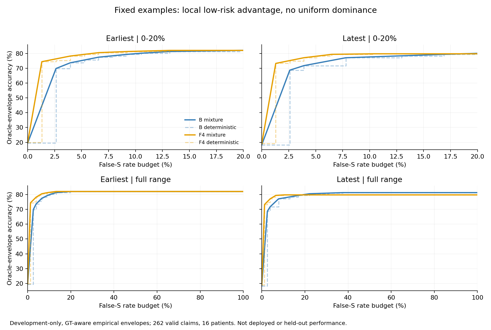

> 阅读镜像：已省略1行病例原文／标识；原始文件SHA见MIRROR_MANIFEST.json。

# 077：固定示例是否增加了可用的判别信息

2026-09-24。**F4没有显示全面的类别排序改善，但出现了跨去重口径保留的低错误支持风险信号。结论是“有限继续”，不是升级系统：保留F4作为低风险工作点候选，值得一次简单、患者隔离的离线适配验证；不继续修改示例，不重开054–064的无标签新环境适应路线。**

本轮0 API、0费用、0拟合，没有选择部署阈值。077是已有development输出的事后诊断，不是可部署方法或最终确认。B为无示例，F4为原固定四例。所有比较均为F4减B。

## 1. 077相对076和054–064新增了什么

076核对了raw、Frozen PriorG与无效回退，但raw和PriorG都只代表固定判定点。本轮检查整个分数排序及有限判定规则族的同风险表现，回答“换掉旧判定点后，有没有值得验证的增量信息”。

054–064问的是：新环境没有或只有少量标签时，能否推断类别比例/模型行为变化并自动适应。077没有解决这个问题。它只研究同一批病例、同一证据下，**B与F4哪个输出更适合构造某种工作点**；后续若验证，也只能使用已有训练患者标签、在排除这些患者的评价侧检验，不得把评价患者的标签用于选阈值。

本次发现不能改写此前适应路线的失败，也不支持“重新校准必然兑现066的空间”。

## 2. 数据和分母

复用076已从原生请求/回执核对的B/F4输出，独立校验076工件指纹。071/072同96条不重复算新病例；重复ID分别取最早、最晚的一对回答，各得到264条不同命题，其中**262条两臂共同核心有效、16名患者**用于分数分析。两种取法各排除2条无效涉及病例，具体ID见[排除清单](excluded.json)。不补造分数，不把fallback计入排序。

最早口径S/NS/NA=186/37/39；最晚185/38/39。差别来自两种取法的共同有效病例不同。阶段结果仍分别保留，不把全部阶段合并成独立测试。human/LLM、患者留一、任务块留出均为描述性敏感性；所有患者与任务已暴露。

## 3. 整体类别排序：没有全面改善

AUC在这里的直观意义是：抽一条真实S与一条真实NS，S那条得到更高S/NS相对分数的概率。同分计一半。分别检查三个类别对；对每类分数乘同一个固定权重，只会整体平移该类别对的log比值，不改变此排序。因此不会因为简单更换PriorG类别偏置就制造AUC改善。

| 类别对 | 最早：B→F4 AUC | 差值 | 最晚：B→F4 AUC | 差值 |
|---|---:|---:|---:|---:|
| S–NS | 0.8948→0.9066 | +0.0118 | 0.9009→0.9140 | +0.0132 |
| S–NA | 0.9554→0.9427 | −0.0127 | 0.9556→0.9363 | −0.0193 |
| NS–NA | 0.7145→0.7273 | +0.0128 | 0.7105→0.7034 | −0.0071 |
| 三组等权平均 | 0.8549→0.8589 | +0.0040 | 0.8557→0.8513 | −0.0044 |

各组差值的1000次患者bootstrap 95%区间均跨0。平均AUC差区间为最早[−0.0477,+0.0488]、最晚[−0.0531,+0.0356]。这不是整体排序变强的证据，也不等于所有局部排序都没变。

只比较同患者内部病例时，S–NS差仍为+0.0190/+0.0184，S–NA为−0.0155/−0.0197；因此正负交换不只是患者组成造成。NS–NA内部差为−0.0045/−0.0395，更不支持已经学好NS/NA边界。

S–NS的整体微弱阳性又明显依赖075：去掉075后变成−0.0031/−0.0008；去掉患者80606后为−0.0099/−0.0077。**不能宣称F4已获得可泛化的全面推理能力改善。**

## 4. 同风险表现：出现值得保留的局部正信号

风险定义为`错误判S数量 / 真NS与真NA总数`，不是错误S占全部预测S的比例。本轮固定PriorG的NS/NA相对权重，仅遍历S整体偏置的全部切换状态，每个状态仍输出完整三分类标签，NS/NA错分继续计错。三分类PA/MCC/AC1全部调用项目公共评价入口。

以下曲线用评价GT寻找某个风险预算下的最好表现，**属于经验oracle式诊断，不是部署成绩**。随机混合上包络允许两个完整规则按固定概率混合，用期望风险公平比较不同的分数台阶；不允许按每例GT选正确答案。

| 风险上限 | 最早：B→F4经验最优正确率 | 差值 | 最晚：B→F4经验最优正确率 | 差值 |
|---|---:|---:|---:|---:|
| 5% | 75.19%→79.16% | +3.97个百分点 | 73.27%→78.07% | +4.80个百分点 |
| 10% | 79.85%→81.45% | +1.60个百分点 | 77.66%→79.73% | +2.08个百分点 |
| 20% | 82.06%→82.06% | 0 | 80.08%→79.77% | −0.31个百分点 |
| 30% | 82.06%→82.06% | 0 | 80.92%→79.77% | −1.15个百分点 |

预先固定的**0–20%风险预算区间平均正确率差**为最早**+3.75个百分点**、最晚**+4.06个百分点**。这是一段曲线的面积除以区间宽度，不是某个新系统多对3.75%/4.06%的实测成绩。95%患者区间分别为**[−1.61,+9.57]、[−1.63,+10.11]个百分点**，收益仍不确定。

确定性状态包络的对应平均差为+5.42/+6.28个百分点；保留随机混合参照后增量减小，但仍为正，因此不能完全解释成台阶粗细造成的优势。用原始NS/NA相对权重重做，平均差仍为+4.07/+4.34个百分点；也不是只在旧PriorG某个NS/NA偏置下才出现。

完整0–100%曲线、每个切换状态及所有预算结果见[机器结果](results.json)、[状态表](curve_states.json)。0–20%是本任务选定的诊断范围，不是临床安全标准。

## 5. 这个局部信号有多集中

| 敏感性 | 最早口径低风险平均差 | 最晚口径低风险平均差 |
|---|---:|---:|
| 全部 | +3.75个百分点 | +4.06个百分点 |
| 去掉任意一名患者 | 全16次为正；+1.09至+5.26 | 全16次为正；+1.32至+5.76 |
| 去掉071/072块 | +3.49 | +3.49 |
| 去掉073块 | +5.44 | +5.87 |
| 去掉074块 | +4.61 | +5.32 |
| 去掉075块 | +1.53 | +1.39 |
| human单独计算 | +3.11 | +3.75 |
| LLM单独计算 | −1.16 | +2.48 |

所以低风险正信号并非完全由某一名患者或某一任务制造，**但075和患者80606影响很大**。逐阶段结果也不一致：073确认接近0，074为负，075明显为正。human方向较一致；LLM方向随取法变化，并且LLM只有8条NS、1条NA，无法据此声称在LLM主队列稳定获益。子组曲线分别用各自GT构造最优点，不能将其加权当成全组同一可部署规则。

这解释了为什么075“最终更差”仍可能含低风险可用信息，也解释了区间为何很宽：高分错误与大量真S同分，只靠阈值无法分开它们；患者重采样一旦移除这类错误，极低风险边界会大幅跳动。该病例只是已有医生GT下的分数现象，没有新增医学裁决。[曲线独立数值核对与饱和检查](frontier_verification.json)

## 6. 为什么有局部正信号，却不能说F4全面更好

AUC概括整个排序范围；低风险曲线只强调最不愿放过错误S的区域，两者可以方向不同。当前结果与“局部高置信度错误减少，但其他区域及类别出现损失”一致，不能简化成统一尺度平移，也不能简化成整体推理增强。

在本轮预先限定的单个S偏置规则族中，放开风险约束后的最大正确数为：最早B/F4均215/262；最晚B213、F4 209。F4没有更高的整体正确数上限。事后辅助查看同一已计算状态的最大MCC，最早B/F4为0.6086/0.6206，最晚0.5732/0.5961；这些最大值未必对应最大正确数的点，也不能被选成新部署成绩。它们只补充说明类别权衡不同，而非所有指标同时胜出。

**整体排序未增强，不足以直接宣判没有适配价值；局部oracle曲线更好，也不足以直接宣判适配一定成功。**是否能用训练患者选到可迁移的工作点，还没有在077验证。

## 7. 研究决策：有限继续，目标收窄

按事前结束规则，本轮既不是“没有任何增量”，也不是“已经获得新方法”。低风险平均差在两种去重规则、两种NS/NA固定边界和全部单患者/任务块留出中保持正向，幅度足以保留一次低成本验证价值；区间跨0不自动否定这个信号。同时必须保留其集中性、LLM不确定性和整体排序无改善。

具体决定：

1. **F4仅保留为低错误支持风险候选。**若继续，下一项应只做一次简单、患者隔离、两臂具有同等适配机会的离线验证，目标是检验这里的低风险优势能否由训练侧选择的规则兑现。没有必要新增API，也不再改例子。
2. **不启动通用PriorG自适应研究。**这不会解决未知新环境同时改变标签比例与模型行为的问题；054–064的限制原样保留。
3. **不把F4作为已证实的整体性能升级。**现行默认B+Frozen PriorG不变，动态例子、混合和批注路线不因077重启。077未检验这些方案的分数曲线。
4. **论文继续推进，不等待本候选必然成功。**077提供“固定后处理可能掩盖局部排序价值”的诊断实例；当前仍不能把它写成可部署算法贡献。

这是对076“停止当前示例微调”的补充而非回写：继续微调示例仍不推荐；新证据允许考虑固定F4的窄范围工作点验证。用户如另行交办才启动后续，本次不自动078。

## 8. 自检、复现和交付

- [计算前口径](../../tasks/077_static_example_discrimination/README.md)、[冻结输入/代码指纹](analysis_freeze.json)、[分析代码](../../tasks/077_static_example_discrimination/analyze077.py)。
- 原始分析3516项检查通过；另用乘法解码核对所有合并曲线状态、穷举核对确定性预算最优值、线性规划独立核对混合包络，共1082项检查通过。是执行者自检，不是独立审计。
- [数值附录](numeric_appendix.md)、[分层与留出](sensitivity.json)、[病例选择](cohort_selection.jsonl)、[论文表述](paper_paragraph.md)、[收尾核验](closure_checks.json)。
- 0新增API/费用、0拟合、未选择部署参数；历史076及更早工件保持原样，未使用reserved、未改.gitignore、未提交推送。
