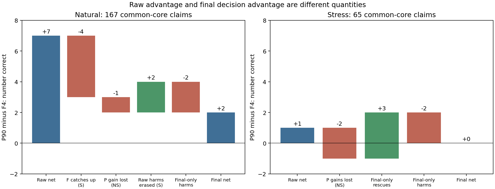

> 阅读镜像：已省略16行病例原文／标识；原始文件SHA见MIRROR_MANIFEST.json。

# 091 综合研究主报告

本轮完成A完整中文稿、B原生—分数—最终决策诊断、C单一窄操作的可行性研究。起始main为`70be6428fb0d1851ed9414a54cee2b30928e144e`；085正式完成状态已核实。新增收费API为**0次，¥0/20**。默认仍为C48→V4 T-S thinking-high→Frozen PriorG、无示例B；G不是Gate。

## 1. 当前最可靠的研究贡献是什么

最可靠贡献是**在临床三分类核验中，分开识别证据信息、原生判断、分数排序和最终边界的作用，并量化类别风险与成本**。它有明确的历史确认性证据和开发期解释证据，但不是新的通用最强算法。

036的早期非thinking共享评分U0→U2，在40名reserved患者3571条共同有效命题上净+177正确，false-S却+123；标准多类偏置和向量缩放更高总分但存在类别代价。078的当前组合在384条已暴露development中有MCC与风险方向收益，而小G在该队列没有独立标签增量。这两者承担不同证据角色，不能把前者写成当前T-S＋PriorG的最终验证。

完整稿已按研究问题组织为引言、相关工作、任务与框架、设计、结果、讨论、局限、结论及附录，不以任务编号作流水账：[manuscript_zh.md](manuscript_zh.md)。主文保留原作者同ID结果及StdM/V；[evidence_map.md](evidence_map.md)逐条对应问题、方法、证据、源码和不能主张的内容。旧稿与历史结果均未回写。

## 2. P90的raw收益为何缩小

### 统一口径后，差值确实存在

本轮重新从090公开分数和预测重放映射，确认自然四臂共同core有效167条：F4/P90 raw正确120/127，PriorG后135/137。这里raw与U0恰好逐例相同，不代表两种定义普遍等价。完整176条、原生raw共同174条继续单列；压力面板也不并入自然PA。

|自然167共同core|F4正确|P90正确|P−F净值|F4 false-S|P90 false-S|
|---|---:|---:|---:|---:|---:|
|raw/U0|120|127|+7|6|5|
|U2|131|135|+4|7|8|
|prior-only|135|138|+3|7|9|
|PriorG|135|137|+2|7|10|

原作者同167条132正确/MCC0.4316/false-S10；B＋PriorG为138/MCC0.5270/false-S9。全部配置的PA、MCC、AC1、Macro-F1、类P/R/F1及矩阵见[B完整表](B_tables.md)和[B机器结果](B_diagnosis.json)。不能把P在本子集的prior-only点值改名为本轮选出的新方案。

### 不只是“G把好答案改坏”

P相对F的raw是9救回、2伤害；最终共同core为4救回、2伤害。逐路径分解如下：

|路径|数量及GT|对raw优势的影响|
|---|---|---:|
|P raw已对，F raw错；后处理让F也对|4个S|−4|
|P raw已对，后处理后双方均错|1个NS|−1|
|原P raw伤害被后处理修复|2个S|+2|
|raw正确性无差，但最终P新增伤害|1个S、1个NA|−2|
|最终仍保留的raw救回|1个NS、3个NA|已含于起始差值|

所以**7−4−1+2−2=2**。另一种等价核查是F自身后处理15救回/0伤害，P为12救回/2伤害，后处理的净增量比F少5。S/NS/NA的配对净正确由raw的+2/+2/+3变成最终−1/+1/+2。自然完整176条的最终P−F是4救回/3伤害，另外1个伤害涉及无效/fallback；不能把它算成双方有效分数边界变化。

压力共同core65条F/P raw38/39、最终31/31。原生4救回/3伤害，其中2个NS救回在最终都错；再有仅最终层3救回/2伤害，最终净0。完整66条的P−F净+1来自另一条invalid/fallback相关病例。**这使压力“+1”的机制证据比只看主表更弱，但原主结果保持不变。**

### 分数排序、组合与小G的作用

自然S–NS/S–NA/NS–NA类对log-ratio AUC的P−F分别−0.0079/−0.0324/−0.0385，三个患者95%区间均跨0；压力仅有NS–NA，其差+0.0223、区间跨0。患者内结果有正有负。不能断言所有排序变差，但未见一致排序改善。固定类偏置只给类对log-ratio加常数，并不改变这些AUC；最终类别变好不能被称为新增排序信息。

具体分数组合揭示类别风险：F4的(15,80,5)在4条上均被改S，其中3真S、1真NA；P90的(10,85,5)在3条上均被改S，其中2真S、1真NA。相同分数并不能分清真实风险，不适合从个别组合现场调一个“安全阈值”。P还有(10,20,70)由prior-only的NA被小G变S的一条真实NA。这与078的prior-only=PriorG并不矛盾：标签冗余是队列观察，不是全输入恒等定理。

目标claim和C48没有变化，变化的是示例reference。因此只能把P的上游信号归于本次示例输入干预下的输出变化，不能称目标新增证据或引用已证明充分。原生正确数增加也没有被类对排序一致改善支持，不能凭reason推导模型学会了具体医学推理。

### 患者、运行批次及稳定性

自然raw患者6胜/1负/15平，去掉任一患者净+5至+8；最终2胜/1负/19平，去掉任一患者净0至+3。两个患者分别贡献raw净+2，但不是全部+7来源。四个按B请求实际时间排序的面板内区块raw净0/+4/+1/+2，最终+1/+1/−1/+1；分块与患者/病例组成混杂，不能当独立批次重复或服务漂移检验。

082预设24条/22人重复，GT S21/NA3/NS0：F4最终0翻转但raw2翻转，B最终3翻转。086 V36的F4 raw4翻转、最终8翻转；E110同体历史桥接raw2翻转、最终6翻转。不能从某一个小子集的稳定推断所有病例稳定。

在预声明的078/082/086缓存范围中，090 B有30条同body，F4有30条、两轮core共同29条，来自7位患者。按最早时间的唯一回执选择，重复引用同一回执不算新重复。自然B16条raw/最终翻转1/0，F4 15条0/1；压力各14条分别5/6与2/3。自然和压力分报，不合并成PA。**P90没有历史同体重复**，故不能确定其raw优势是否稳定；也不能用这项缺失证明方法无效。完整表见[B_repeat_by_panel.json](B_repeat_by_panel.json)。

## 3. C是否提供值得继续的新信息

已完成唯一原型、GT盲盘点和7项有关分数/来源/动作的单测，未进行分类实测。原型给出“当前C48是否含相同字面数值—单位”这一可观察量，但不验证对象、时间、否定或单位换算；存在不等于充分。它不同于再问一遍LLM、抽理由或新训练Gate，但与028来源核查的局限相关，不把操作名称当创新。

排除近期正式ID后只有17条适用命题、8患者，字面缺口4条仅3患者。最多4次暂缓机会、实际可能更少，不满足先写下的材料下限。C模块没有连接其医生GT，因此既不知道错误支持比例，也不把4缺口当4救回。停止由材料与识别边界决定，不是API花光或结果不好重试。

结论是**暂不继续这个窄版本的收费开发**，而非证明选择性核验普遍无效。[C_feasibility.md](C_feasibility.md)已交付与旧路线的差异、可执行函数、输入契约、同k margin控制、风险/覆盖与NS/NA指标以及重启最低条件。新的开发命题仍不是新患者；完整EHR GT、有限包充分性及复核动作不能合并为一个标签。

## 4. 论文现在能够与不能主张什么

可以主张早期固定边界的收益—代价被保留患者结果确认；当前配置有开发消融与强对照支持的局部组合价值；示例、模型和压缩效应需要分别看raw、分数和最终类别；P90原生收益缩小有可复查的逐类决策路径，且成本节省是真实usage观察。

不能主张当前T-S＋PriorG已经最终外测；C48、G和prior分别构成三个已证实创新；P90语义无损或全面改善排序；R1是原VeriFact精确完整复现；C已减少错误支持；自检等于独立审计。也不能用VERI-DPO另一划分的生成NS率与本项目PA/MCC直接比高低。新版相关工作已纠正v2标题和证据边界。

P90仍值得保存的价值是一个有自然raw信号、可追溯压缩和实测成本取舍的**冻结研究候选**。若以后有独立材料，可考虑一次原样确认；现有材料不足以要求继续调G、示例或路由，更不应因此拖住当前实证论文。默认B和全部历史参数保持。

## 5. 交付、核查与停止

完整稿、主报告、证据对应表、B完整数表/逐例路径/患者和重复分析、C原型与停止报告、独立计算路径自检、来源指纹及复现入口均交付。正文没有新API或新GT结果占位。图1已渲染检查，来源/分母与机器表相符。

全任务新增API **¥0/20**，没有创建实例、访问本地R1端点、下载权重、重新拟合或变更默认系统。036只引用汇总，不用reserved开发；私有C原文保留既有忽略目录，不改.gitignore。执行者自检结果见selfcheck.json；独立审计未执行。按约定完成提交推送后停止，不自动092或重启C。
