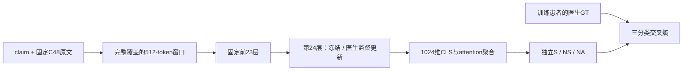

# 092 模型、监督与计算

输入是原始命题x与固定C48 reference E。医生标签只用于训练损失，不作为输入token；不使用旧Judge label_scores、reason、F4或PriorG。

1. 用固定DeBERTa tokenizer编码完整claim；每个512-token窗口预留完整claim及pair特殊token，其余位置装C48连续token。相邻证据窗口重叠32，最后补齐尾部，程序验证每个原证据token至少覆盖一次。
2. 每窗为`[CLS] evidence-window [SEP] claim [SEP]`，不生成医学解释或对原文字义做压缩。窗口可跨片段边界；这与032双粒度bag不同，但Frozen/Fine-tuned两臂完全相同，故032不是092的消融对照。
3. DeBERTa-v3-large NLI模型前23层固定；取完整1024维token状态作为计算缓存。最后第24层得到每窗CLS向量h_j。旧NLI pooler/classifier均不使用，entailment/neutral/contradiction不映射成医生标签。
4. 对各h_j作LayerNorm；以一个可训练线性标量求softmax attention：a_j=softmax(wᵀLN(h_j)+b)，v=Σa_jLN(h_j)。dropout0.1后线性输出三个logits，标签顺序S/NS/NA，训练普通交叉熵。
5. Frozen只训练聚合/分类头；Fine-tuned额外更新最后Transformer block，包括attention及feed-forward权重。共享相对位置embedding仍固定。两臂的原始文本、窗口、1024维信息、聚合头、患者和CE相同。

有限资源下选择顶部单层微调，不声称等价于完整encoder微调。前23层固定且关闭dropout使其可缓存；最后层在两臂也关闭dropout，头保持相同dropout。缓存保留float16完整维度，不做随机投影或标签驱动筛选。两臂使用同一拆分精度路径；与原整模型的浮点微差以虚构预检和cache manifest报告。

五折外层患者hash划分：每折20人只作预测；64人用于梯度、16人用于epoch选择。每臂最多5 epoch，按内部验证的MCC、PA、Macro-F1、较少false-S顺序选择。直接用该64人模型输出外层，不在80人上另训。OOF覆盖全部100人，但不代表一个已在所有100人上训练的部署checkpoint；部署时需明确选择哪一折，或另行授权全量训练。主评估不读取外层成绩改变lr、epoch上限、loss、输入或架构。

`preflight092.py`用虚构文本检验梯度与表示变化；每个最终fold还记录真实内部训练病例上的权重L2变化和表示变化。该证据证明监督实际到达encoder，不能单独证明医学语义改善；后者只能由完整患者外预测支持。

费用分为一次性本地C48补齐、前23层编码/缓存、5折训练、测试顶部层推理。缓存的顶部层推理时间不代表新病例端到端时延。infer092.py已在12条哈希固定的fold0病例上从原文实测：Frozen/Fine约0.351/0.333秒每条，不含C48检索或冷启动。完整进程含加载约25.3/19.4秒。云端RTX4090训练与本地RTX3060部署分开报告，详见final_costs.json；租金、电费及机会成本未知。API费用单列，不能把无API费写成零计算成本。
