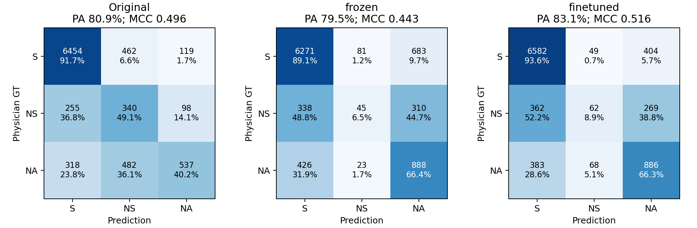

# 临床事实核验的任务适配与决策边界：基于患者记录的分类质量、错误支持和成本研究

匿名中文完整研究稿，2026-09-27。基于091完整稿新增任务适配文本核验器的患者分组交叉验证及唯一条件融合；原091稿保持不变。历史冻结确认、反复暴露开发材料和新增100患者OOF分别呈现，不合并证据等级。作者及投稿格式待投稿阶段确定，实验章节均对应已运行结果。

## 摘要

临床事实核验既受患者证据覆盖影响，也受模型表示和最终决策边界影响。本文在VeriFact-BHC上固定证据或模型输出，比较边界修正、示例与模型替换，并新增一个直接读取命题及检索EHR的任务适配文本核验器。该核验器采用完整宽度窗口表示与注意力聚合，以医生三分类标签监督DeBERTa顶部一层；相同输入、聚合头和训练预算的冻结编码器作为核心对照。在100名患者9065条有效原子命题的五折患者分组预测中，微调使正确数由7204增至7530，PA由79.47%增至83.07%，MCC由0.4433增至0.5156，错误支持由764降至745；收益主要来自真Supported恢复。相比原VeriFact的7331条正确和0.4959 MCC，微调的PA更高，但Not Supported召回仅8.95%，错误支持更多。已有生成式系统共同956条上，微调模型独立修对66条无示例系统错误、同时误伤79条；一次预登记融合取得795条正确，较原系统增加12条但错误支持增加23条，未形成综合升级。融合相对匹配的偏置对照增加9条正确、减少15条错误支持，提供有限文本增量信号。历史保留患者边界实验和示例压缩诊断同样显示，原生或总体指标改善可能伴随非支持类损失。结果支持任务监督更新文本表示的受控开发价值，同时要求将分类收益、错误支持、决策偏置和计算成本分别报告；本研究不提供新外部测试或临床安全性保证。

**关键词：** 临床事实核验；电子病历；任务适配；患者分组交叉验证；错误支持；决策融合

## 1 引言

利用电子病历核验临床文本，与判断一句话是否符合一般医学知识不同。某项治疗在临床上合理，不代表这位患者确实接受过该治疗；一个数值在记录中出现，也不代表它属于命题所指的对象和时间。VeriFact把患者文本拆解为命题并检索个人病历，通过模型判断与医生标注的一致性，为研究此类问题提供了基础[1,2]。

核验系统通常把检索、提示、模型输出和后处理连接成单一预测流程。这种呈现容易混淆三种改善：输入包含更多必要信息，模型更准确地判断现有信息，以及不改变输入而移动类别决策边界。相同的最终正确数，还可能对应完全不同的错误支持、NS/NA识别和调用成本。在Supported占比较高的数据中，这一问题尤其突出。

本研究不把常数偏置、温度缩放或原文抽取宣称为新通用算法。我们的目标是建立可核查的比较与解释：固定证据或共享同一次回答，明确改变的环节；同时报告总体质量和类别代价；当一个上游方案表现更好时，追踪其优势是否真正保留到最终决策。该问题也影响核验器作为训练信号的可靠性，以及何时应暂缓自动接受一项命题。另一个尚需受控检验的问题是：在固定检索包上，直接用医生标签更新文本encoder，能否提供既有生成式分数之外的信息，而不依赖新的示例或后处理搜索？

本文回答五个研究问题。RQ1：固定分数的边界修正能提高多少一致性，需要付出怎样的错误支持代价？RQ2：证据包、推理模式、评分接口、示例与模型更换分别具有哪些可识别贡献？RQ3：示例压缩的原生判定改善为何可能在最终决策中缩小？RQ4：在缺少有限证据充分性gold的条件下，一个窄范围、可观察的证据缺口能否支持有意义的选择性核验试验？RQ5：同输入和聚合头下，医生监督更新文本encoder是否改善患者外分类，并能否通过一次受控融合增加生成式系统的效用？

对应贡献是：保留患者上的固定边界收益—风险证据；开发阶段多个环节的受控消融及有竞争力的标准对照；逐病例解释原生和最终效应分歧的分析产物；以及有具体停止依据的选择性核验可行性研究。新增贡献是完整患者覆盖的冻结/微调文本核验对照、类别收益分解及带偏置对照的有限融合验证。它们共同构成有实际模型工作的实证论文，而非一个已经证明普遍优越的复合算法。

## 2 相关工作

### 2.1 命题核验与临床记录

FEVER同时考虑标签和证据，其Supported、Refuted、NotEnoughInfo任务为文本事实核验提供了重要基准[3]。患者病历则包含纵向时间、状态变化和记录缺失，标签规则不能直接照搬开放百科任务。本文使用VeriFact-BHC的原医生标签和有效原子命题，不以自由拆句或自行医学重标创造新的正确率；作者发布预测按本文相同ID重评，而不是用论文摘要中的最高分作对比[1,2]。

VERI-DPO的2026年7月3日v2已改题为“Coverage-Controlled Preference Mining from Noisy Claim Verification for Evidence-Grounded Generation”，核心是把噪声核验反馈组织为覆盖受控的摘要偏好，并用标准DPO训练生成器[4]。与初版相比，v2加入锁定的1000患者MIMIC-IV迁移、研究人员盲评及多种子消融。其72/8/20患者划分、生成任务和自动NS率端点都与本文不同，不能借其数字宣称本文核验器胜出；其“核验标签并非临床真值”的边界也适用于本研究。我们不运行DPO或摘要生成基线。

### 2.2 分数、校准与拒绝决策

温度缩放和向量缩放是既有校准方法[5]。正温度在固定偏置后不改变类别argmax，而类别偏置或逐类尺度可改变标签；因此概率损失、分类质量和错误支持应分别报告。本文模型给出的整数label_scores是自报相对分数，不是原生token概率，也不因经softmax变换就获得临床校准保证。

选择性分类通过拒绝部分输入交换覆盖与风险[6]。在临床核验中，暂缓接受是一个动作，不是第三类Not Addressed的改名。若仅把更多困难命题排除，再报告剩余准确率，可能掩盖复核负担及被排除的正确答案。因此需要同复核工作量的分数/margin对照，且不能默认人工复核全部正确。

### 2.3 证据充分性与提示压缩

Sufficient Context研究问题—上下文是否包含可回答所需信息，并将充分性信号与置信度结合用于选择性生成[7]；S2G-RAG进一步用结构化缺口控制下一轮检索[8]。SURE-RAG v2讨论集合层面的支持、反驳、不足与选择性输出，并报告受控充分性任务和自然幻觉检测之间的差异[9]。这些近邻说明，“先判断是否足够，再决定行动”不是本文首次提出；它们的监督和开放问答设置也不能直接替代患者完整EHR标签或本地C48充分性标注。

LLMLingua-2以蒸馏和token分类处理任务无关提示压缩[10]；RECOMP训练抽取式或生成式压缩器，以服务下游任务，并允许没有增量信息时不追加内容[11]。本文P90只一次性抽取四条固定示例中的原passage，Q90是独立普通相关性抽取。二者都不是这些已发表压缩器的实现，未运行的文献方法不列为实测基线，也不宣称优于它们。

### 2.4 临床自然语言推断与任务适配

MedNLI已经提供医生标注的临床自然语言推断数据，并研究迁移学习[12]。本文不主张首次用医生标签训练文本核验器。我们复用既有DeBERTaV3模型家族[13]及NLI checkpoint，研究完整记录标签监督有限检索包的分类效果；NLI原分类头不参与预测，entailment等标签不直接映射为本任务GT。MedNLI与其他外部数据集未作为本轮实测基线，其论文数字不与本研究交叉验证直接比胜负。注意力聚合、部分解冻及线性融合均为既有操作，方法价值来自严格控制输入与监督后的实测增量和限制。

## 3 任务与研究框架

### 3.1 三个判断对象与一个行动

给定患者病历集合H、待核验原子命题x，检索器产生有限证据E=R(x,H)。医生标签y依据数据集参考EHR；实际Judge仅接收x和E及可选固定示例D。标签集合为Y={S,NS,NA}。本文沿用项目绑定的标注契约：S为充分支持，NS为相关内容被涉及但未完全支持、部分支持或矛盾，NA为未涉及所需信息。我们不把NS重新收窄为“必须出现明确矛盾”，也不根据模型解释改医生标签。

必须区分：命题相对完整H的标签y；有限E是否足以作可靠核验；系统是否接受当前输出或请求复核。现有数据提供第一项GT，但没有本项目逐passage的充分性gold。即使输出与y一致，也不证明E充分；即使E字面缺少某信息，也不能据此重标完整H的标签。

核验流程写为

\[
(x,H)\xrightarrow{R}E,\quad J(x,E,D)=(r,s),\quad f(s)=\hat y,\quad a(x,E,r,s)\in\{\mathrm{accept},\mathrm{defer}\}.
\]

其中r是原生verdict，s是三类自报分数，f是冻结决策映射。本文主体比较r与ŷ；选择性原型只输出a，不修改y或把defer映射成NA。

### 3.2 原生标签、分数排序和边界

设z_c=log(max(s_c/100,10⁻⁶))。U0取分数最高类别，U2取argmax(z_c+2·1[c=S])。raw与U0有不同定义，即使某队列逐例相同也保留区别。历史平分规则按对应实现冻结，不能为后验成绩换规则。

当前T-S的prior-only为argmax(z_c+b_c)，其中

\[
b_c=\log\frac{\pi_{\mathrm{ref},c}}{\pi_{\mathrm{cal},c}},\quad
\pi_{\mathrm{ref}}=(1108,100,170)/1378,\quad
\pi_{\mathrm{cal}}=(48,47,48)/143.
\]

PriorG另加冻结S偏置g=0.1342909508820116。参数来自历史开发材料，本文不重新拟合。G是单一决策偏置，**不是双模型Gate**。参考比例和校准比例的修正是经验映射，不声称满足所有分布迁移下的先验校正假设。

在远离score floor的数值上，PriorG报S需要s_S/s_NS>0.08059且s_S/s_NA>0.13415（等号按实现处理）。因此一个raw为NS、但S有15分的回答可以最终变S。这是确定性边界效果，不表示模型重新查找了证据。

对于固定类对c,d，(z_c+b_c)−(z_d+b_d)仅增加常数b_c−b_d，故不会改变该类对跨病例log-ratio排序或其AUC。该性质不适用于任意混合竞争margin或所有概率排名。本文用类对AUC区分排序变化与工作点变化，不用它选择新阈值。

### 3.3 质量与错误支持的分解

定义false-S=Σ1[y≠S且ŷ=S]，同时报告其除以真实non-S数量与全部数量的比例。对U0→U2的非S到S改判，R表示真S救回，H表示原正确非S改错，W表示原错误非S进一步变S，则净正确=R−H，新增false-S=H+W。降低W不自动增加正确数。

跨输入方案的原生与最终差异则逐病例编码为四个正确性指示：F_raw、P_raw、F_final、P_final。该联合状态能够区分原生改善被保留、基线追平、两者都错、优势反转以及仅最终层改变。它描述可观察输出路径，不把reason或思维文本视为内部因果证据。

### 3.4 读取患者证据的独立任务适配核验器

给定命题x及固定C48文本E，将E按512-token模型上下文切为连续窗口，每窗保留完整x与pair特殊符号，证据重叠32 token。所有E token至少出现一次，不通过已知GT选择窗口。前23层固定，末层输出完整1024维CLS向量h_j。令u_j=LayerNorm(h_j)，a_j=softmax(wᵀu_j+b)，聚合v=Σ_j a_j u_j，再经dropout和线性头得到三类logits。模型只读取原文，不读取LLM label_scores、reason、医生标签token或PriorG。

Frozen只更新聚合和分类头；Fine-tuned还更新第24个Transformer block，共享相对位置embedding固定。两者窗口、头、损失、患者和预算相同；普通交叉熵监督的唯一主消融是顶部block是否更新。固定底层激活仅减少重复计算，不是标签驱动的选证或32维随机投影。该设计与早期032冻结NLI编码、随机投影和依赖旧分数的残差模型不同，但032因结构/输入不同不作为本轮核心消融。

仅在独立文本模型表现接近强基线、少数类较好或有明确互补错误时，测试一次生成式—判别式融合。令z_B为冻结B的PriorG log-score，t为文本logit，融合为z_B+α(t−mean(t))+b，α∈[0,4]；b的两个自由参数限于[−5,5]，第三个为负和。固定CE与0.01参数平方惩罚；匹配bias-only设α=0，用来区分文本增量和重新改变类别偏置。没有新增Gate或多个融合器搜索。

## 4 实验设计

### 4.1 数据与证据等级

VeriFact-BHC v1.1.0来自MIMIC-III，含100名患者的human/LLM BHC及13070条句子级和原子级命题[2]。本文正式三分类评价仅使用各任务预先确定的有效原子命题，不把两种粒度累加。项目患者划分为20名exploration、40名development、40名reserved，没有额外未使用的20名测试患者。

早期非thinking边界方案在冻结后于reserved40评价，正式3573条中共同有效3571条。该组随后已有事后分析。091仅引用正式汇总；新增任务适配实验依据用户明确授权使用全部100名患者标签做新的患者分组CV，不能将这些材料重新称为未接触测试集。后来的T-S、PriorG、F4、P90和模型替换均不继承该最终验证地位。

**表1　主要证据模块。** 各行不相加成样本总量；开发患者及部分命题重复出现。

|模块|患者/命题|用途|证据等级|
|---|---|---|---|
|早期固定边界与标准校准（036）|40/3571共同有效，3573冻结|U0/U2、Gate、温度、标准对照|冻结后的同来源保留患者评价，仅对应当时方案|
|当前组件消融（078）|24/384；桥接192|证据×模式×输出接口×后处理|已暴露development；含跨批缓存|
|适配与理由（079—083）|14人训练；22人评价，352及新增180|配置适配、选参、理由增量|患者分离的开发评价，反复暴露|
|固定F4扩覆盖（084）|21/180|同期B/F4|新命题覆盖，不是新患者|
|Judge替换（085）|同084；raw共同177|V4/R1、B/F4|受控模型替换；V4为084缓存|
|信息干预（087）|22/110|B/F4/CL4/X4|单轮开发机制对照|
|任务适配（092）|100/9065；B/F4共同24/956|冻结/微调文本核验与一次条件融合|全部患者已有研究暴露；患者分组OOF，不是新外部验证|
|压缩（089、090）|089自然110/压力44；090自然176/压力66|独立自然与NS/NA压力面板|已暴露development；不同面板分报|

090自然队列与084、086 E、087、089正式队列没有共同命题ID，但仍是同一22名已暴露患者；压力队列与部分旧任务有少量ID重叠。实际四例、PriorG参数来源及本次评价患者隔离，不等于与全部历史示例选择经历隔离。不能把这些任务称多次独立外部验证。

### 4.2 固定系统与干预

C48指两路检索交替取至多48候选并经BGE重排的冻结管线，不是Judge固定接收48段。最终最多16个完整片段、每note最多2个，记录头及正文预算约8000字符；保留原住院/时间标识，不为新实验裁剪claim或目标证据。

当前B为C48→DeepSeek V4 Flash 0731快照→thinking-high评分→Frozen PriorG，无示例。N-V/T-V分别为非thinking/thinking普通判定，N-S/T-S为对应评分接口。thinking输出上限8192，非thinking2048，因此模式比较也包含生成预算区别。所有模型别名与服务配置按原回执记录，不假设不同提供方的同名模型完全相同。

F4固定四条claim/reference/医生标签，順序S/NS/S/NA。CL4仅删示例reference；X4保留材料但错配reference。P90在构造阶段用固定Qwen形成有出处的信息组，程序抽取原passage，独立核对具体遗漏，最多补回一次；Q90独立普通相关抽取。两个短S例不变。P/Q原文来源可定位不等于医学充分，两者实际长度并非严格匹配。

085用用户部署的Valdemardi R1-Distill-Llama-70B AWQ/vLLM配置替换Judge，其余冻结084的180条B/F4输入。它属于相同基础模型家族，但不是原Casperhansen仓库checkpoint，也不是原VeriFact的完整Judge和辅助解析流水线逐字节复现；远端权重字节及安装版本未独立取证。

### 4.3 对照、有效性与统计

原作者VeriFact采用已绑定发布配置在相同ID上的预测。StdM/StdV为标准多类偏置及逐类缩放偏置，保留其竞争力，不人为选弱对照。078使用已有患者外参数，监督材料与PriorG不同，因此是同ID系统参照，不声称严格等监督预算。Gate A是历史第二Judge评分加轻量分类器，仅影响候选接受，和PriorG分开。

核心无效、原生raw无效和分数无效分别记录。当前系统完整分母沿各任务冻结fallback；原生指标只在自身共同有效集合计算。090原生共同有效自然174/压力65，四臂core共同有效自然167/压力65，完整分母176/66；没有把这三套数字混用。

报告PA、MCC、Gwet AC1、三类precision/recall/F1、Macro-F1、false-S、救回/伤害及患者分布。既有区间采用1000次患者cluster bootstrap，保留同患者全部命题。091类对AUC沿相同重抽样思想实现并交叉核对。区间条件于固定预测，不覆盖完整开发搜索与重新拟合的不确定性；探索性多比较不经校正的区间仅按其边界解释，跨0不等于等效。压力无GT S，固定三类Macro-F1仍含S类，不能和自然面板混为一个总体分数。

### 4.4 任务适配的全量患者分组评价

9065条有效atomic claim包含S7035、NS693、NA1337，human5624、LLM3441。原invalid30条排除，GT不改。7248条复用已有C48，1817条用冻结管线的本地BGE实现补齐；后者不声称与API逐字等价，两臂使用同一输入，并按来源分层。没有跨患者完全相同的claim/reference组合，单独claim有重复；325条时间元数据冲突保留，不按模型对错过滤。

五折外层各20名患者，内部64人训练、16人选epoch。训练5轮，AdamW头lr1e-3、末层lr2e-5，weight decay0.01，梯度裁剪1，有效batch8，head dropout0.1；seed92027+fold。按内部验证MCC、PA、Macro-F1及较少false-S顺序选epoch，直接输出外层，不再用80人重训。只测普通CE、顶部单层微调，不追加loss/骨干搜索。

原作者按全9065相同ID重算；B/F4共同956条采用冻结来源优先级和原fallback，935条双方核心有效及排除示例患者后的924条另表。历史共同集混合选样，不冒充自然总体；旧B/F4的校准和示例暴露不自动获得新五折隔离保证。新增文本训练与融合参数严格排除外层患者。融合训练特征取同折64名训练患者中的B缓存，不能用其他折OOF特征产生间接泄漏；训练特征为in-sample的局限明确保留。

全部云端权重哈希、输入和源码与本地核对；实际运行环境为RTX4090、Python3.12.3、torch2.8.0+cu128。初始冻结文件所记RTX3060环境仅对应本地准备。跨硬件数值桥接和部署检查不算第二次独立训练重复。

## 5 结果

### 5.1 固定边界确认了收益，也确认了代价

**表2　早期非thinking系统：40名保留患者3571条共同有效命题。** 真实non-S=884。B_early是当时普通structured判定，不是当前T-S无示例B。

|配置|MCC|PA|正确数|错误支持数|NS召回|NA召回|
|---|---:|---:|---:|---:|---:|---:|
|原VeriFact|0.5173|80.26%|2866|233|52.00%|41.71%|
|B_early|0.5447|77.96%|2784|90|65.45%|53.69%|
|U0|0.5293|76.48%|2731|81|64.36%|54.19%|
|U2|0.5520|81.43%|2908|204|50.55%|53.53%|
|U2＋Gate A|0.5621|80.82%|2886|141|56.00%|54.19%|
|StdM|0.5850|83.98%|2999|251|37.45%|61.25%|
|StdV|0.5850|84.12%|3004|254|10.55%|73.40%|

U2−U0的ΔPA为+4.96pp [3.96,5.96]，ΔMCC为+0.0227 [0.0078,0.0370]。R/H/W=219/42/81，所以净+177但false-S+123。35名患者改善、1名变差、4名持平。相对原VeriFact的PA/MCC差区间均跨0，因此最可靠的是共享同次评分的组件增量，不是全面超越原系统。

Gate减少63个错误支持却损失22个正确；其中阻止错误S也可能只退回另一个错误非S标签。StdM/V有更高PA/MCC，但StdV的NS召回降至10.55%，说明不能用两项总体指标掩盖类内代价。U2之后的正温度保持所有标签，NLL从1.1361降至0.5598，Brier却从0.2908升至0.2918；不称全面概率改善。预设4人444条重复中，U2−U0净正确+24与+27同向，Gate−U2为−3与−6；重复支持该子集的方向，不扩展成当前T-S或P90的稳定性证据。

### 5.2 当前组合的开发增量主要来自判定层配合

**表3　当前组件研究：24名已暴露开发患者384条，同ID。** 原作者和标准对照保持。

|配置|MCC|PA|正确数|错误支持数|
|---|---:|---:|---:|---:|
|原VeriFact|0.4840|80.73%|310|19|
|N-S raw|0.4406|73.96%|284|12|
|N-S＋U2|0.4708|80.73%|310|23|
|N-S＋U2＋患者外Gate A|0.4847|79.95%|307|17|
|N-S＋患者外StdM|0.4955|83.33%|320|27|
|N-S＋患者外StdV|0.4876|83.07%|319|27|
|T-S raw|0.5019|75.26%|289|6|
|T-S＋prior-only|0.5887|83.59%|321|10|
|T-S＋PriorG|0.5887|83.59%|321|10|

T-S＋PriorG较原作者净+11、false-S−9；ΔMCC+0.1047 [0.0251,0.1785]，ΔPA+2.86pp [−0.52,6.25]。相对StdM的MCC差区间仍跨0。N-S raw→T-S raw净+5且false-S−6；评分接口本身在非thinking净0、thinking净+1。T-S raw→PriorG净+32，而prior-only与PriorG在384条逐例同标签，小G没有额外分类贡献；这项实测冗余不能被包装为两个分别有效组件。

同192条证据桥接中，作者reference与C48接相同T-S＋PriorG均162正确，false-S为7与5，MCC差区间跨0；raw下C48还少正确5条。C48平均字符约8056对22474，其价值是紧凑与成本，未证明精度增量或非劣。本文不把系统级改进全部归因于检索。

### 5.3 适配和理由没有稳定增加最终效用

在共同112条、14名校准患者上分别为F4拟合S偏置后，22名评价患者352条的F4正确数从298降至295。直接优化最终分类的训练选择得到291正确；另一个事前候选虽有304正确，却未被训练规则选中并增加错误支持，不能事后换赢家。扩充标注与共享配置适配在新180条相对原F4净0而false-S增加7，也没有给出可靠迁移。

理由结构研究在相同监督预算下，将同一次原生回答中的论据抽取为特征。532条上细结构模型443正确，低于原F4＋PriorG的447；false-S由21增至51，NS召回仅5.6%。错配理由对照同为443正确。引用可定位、特征可抽取并不自动产生患者外效用；同时也不能把阴性扩大为任何理由表示都不含信息。相关材料与分队列数值置于附录A。

### 5.4 示例与模型更换的作用依赖判定层及类别

084的180条同期B/F4＋PriorG为155/161正确，MCC .5881/.6433，false-S 6/8；raw为137/142，说明F4信号不全由后处理制造，但患者区间宽、NS召回下降。087的110条B/F4/CL4/X4最终为95/96/92/93；CL4省38.22%费用却未证明保留性能。F4−X4的最终+3同时包括F4−B的+1和X4−B的−2，不能全算正向关系教学。

**表4　模型替换：同084的180条最终系统。** R1指实际Valdemardi AWQ；V4为冻结084回执。

|配置|MCC|PA|正确数|错误支持数/30|NS召回|NA召回|
|---|---:|---:|---:|---:|---:|---:|
|原VeriFact|0.5670|86.67%|156|8|63.64%|52.63%|
|V4-B＋PriorG|0.5881|86.11%|155|6|63.64%|68.42%|
|V4-F4＋PriorG|0.6433|89.44%|161|8|54.55%|73.68%|
|R1-B＋PriorG|0.4024|81.11%|146|10|72.73%|5.26%|
|R1-F4＋PriorG|0.5423|86.67%|156|11|63.64%|47.37%|

raw共同177条中，原作者/V4-B/V4-F4/R1-B/R1-F4正确154/134/139/138/152。R1-F4较V4-F4净+13主要来自S：该类救回23、伤害4，NS为1/2，NA为1/6；false-S由3增至11，MCC仅提高0.0033且区间跨0。R1内部F4效应明确，不能替代与当前最终系统的比较。最终R1-F4较V4-B仅净+1、MCC下降、false-S多5；不支持默认替换。

### 5.5 P90：原生收益为何从+7缩至+2

P90已真实形成压缩且完成同期四臂评价，区别于先前构造失败或输入完全相同的版本。完整自然176条B/F4/P/Q＋PriorG正确145/143/144/144，压力66条为34/31/32/32；主比较没有建立最终系统升级。自然原生共同有效174条P132/F125，ΔMCC+0.0879 [0.0118,0.1656]；但P−Q的raw MCC区间跨0。

为解释这项信号，我们固定四臂core共同有效167条，所有分数层使用同一ID。**表5仅用于层间诊断，不替换完整176条主结果。**

|配置与层|MCC|PA|正确数|错误支持数/36|
|---|---:|---:|---:|---:|
|原VeriFact|0.4316|79.04%|132|10|
|B raw|0.3637|68.86%|115|7|
|B PriorG|0.5270|82.63%|138|9|
|F4 raw/U0|0.3705|71.86%|120|6|
|F4 U2|0.4459|78.44%|131|7|
|F4 prior-only/PriorG|0.4838|80.84%|135|7|
|P90 raw/U0|0.4619|76.05%|127|5|
|P90 U2|0.4960|80.84%|135|8|
|P90 prior-only|0.5271|82.63%|138|9|
|P90 PriorG|0.5049|82.04%|137|10|

F4的后处理产生15个救回、0个伤害，P90产生12个救回、2个伤害。因此最终差为(127−120)+(12−2−15)=2。更具体地，P的9个raw救回中，4个真S被F4后处理追平，1个NS在P后处理后又错，保留优势的4个为NS1、NA3。原来2个raw伤害都是真S，并被P后处理修复；另外新增最终层伤害S1、NA1。故原生净+7变为7−4−1+2−2=2。按GT净值从S/NS/NA的+2/+2/+3变为−1/+1/+2。

**图1　输出路径分解。** 左为自然167条，右为压力65条共同core有效。柱表示配对正确数差及其改变，不是不同样本的总体PA。压力raw净+1经两项NS收益消失和最终层3救回/2伤害后变0；完整66条的P−F最终+1涉及额外无效/fallback病例，不能当双方有效分数机制收益。

结果不是一致的分数排序提升。自然S–NS、S–NA、NS–NA的log-ratio AUC，F4→P分别.7422→.7343、.9481→.9157、.5067→.4682，配对区间均跨0。患者内排序有正有负，未显示所有类别排序同步改善。当前证据支持“部分病例原生标签及其分数组合改变”，不足以推断更好证据理解或通用排序能力。

一个可复核的真实NA病例中，F4分数(S,NS,NA)=(5,5,90)，P=(10,20,70)。两者raw均NA，P在prior-only仍为NA，但小G使其成为S；该例解释P的prior-only与PriorG为何138→137。它也说明078上的小G冗余并非所有新输入上的恒等性质。我们没有据此删除G或选择P的新工作点。

自然raw优势分布于6胜/1负/15平的患者，去掉任一患者净值为+5至+8；最终仅2胜/1负/19平，去掉任一患者净值为0至+3。按该面板B请求时间的四个顺序块，raw净值0/+4/+1/+2，最终+1/+1/−1/+1。不存在单个患者或唯一时间块制造全部raw收益的证据；但时间块同时混有患者与病例组成，不能当随机运行批次或跨日复现。

### 5.6 重复性与成本边界

预设的082重复24条含S21、NA3、NS0：F4最终0翻转、raw2翻转；B最终3翻转。这不足以验证NS或P90。声明范围内的090历史同体桥接中，B30条、F4两轮core共同29条；自然子集B16条raw/最终翻转1/0、F4 15条为0/1，压力各14条分别为5/6与2/3。桥接按最早原回执选择，不看结果；其目的仅是描述时期间差异。P90没有同体重复，稳定性未确定，而非因此被判无效。

**表6　090平均调用成本与时延，242条部署臂观察。** 面板费用可合计，分类PA不合并。输出token含thinking。

|配置|平均输入token|平均输出token|成功推理原价/242次|平均请求秒|
|---|---:|---:|---:|---:|
|B|3194.2|1932.8|¥6.528513|21.14|
|F4|8832.2|1748.4|¥10.220094|18.69|
|P90|5747.2|1761.2|¥8.008437|18.97|
|Q90|5922.2|1751.1|¥8.113419|18.85|

P相对F输入减少34.93%、推理费减少21.64%，但平均时延没有下降，且仍比B昂贵。成本估计采用当时官方未优惠usage价格，不等同账单；C48缓存未发生新检索费用不代表部署检索免费。R1实际GPU单价与完整计费时长未知，不能将无按请求API账单解释成免费或直接比较经济优势。

### 5.7 选择性核验：可行性不足不冒充分类阴性

我们实现一个无需新LLM的窄操作：若命题包含预设数值—单位组合，而C48正文没有同组合且原最终标签为S，则暂缓接受；其余保持原输出。它直接观察源文本缺口，不使用GT、reason或拟合分数。字面存在不能排除主体、时间和否定错配，因此充分性始终未知。

在合法22名患者中排除近期正式命题后，GT盲盘点得到17条适用命题、8名患者，13条字面存在、4条缺口仅来自3人。未达到运行前设定的至少32条且出现/缺失两侧各8条的材料下限。该下限是可行性约束而非功效保证；即使4条全被系统接受，也最多提供4次复核机会。故本轮没有新Judge调用、没有C的false-S或救回成绩，没有扩大单位表或重选到阳性。

可重启比较已明确：同一批原B输出上，用上述操作实际暂缓数k，与全体拟接受S及数值适用子集内各自最低margin的k条、以及哈希k条控制比较；报告剩余自动false-S、覆盖、被暂缓正确数及类别组成。暂缓不计为分类救回，必要专家审阅也不默认完美。新命题仍属于已暴露患者；要声称充分性识别，另需独立源跨度/主体/时间标注。具体代码及停止记录见附录C。

### 5.8 任务适配改善了冻结模型，但没有消除类别代价

**表6　100名患者9065条全量OOF。** Original为相同ID发布预测；Frozen/Fine-tuned均为独立原文模型，无LLM分数或PriorG。

|配置|MCC|PA|正确/N|错误支持/non-S|AC1|Macro-F1|S假发现率|
|---|---:|---:|---:|---:|---:|---:|---:|
|Original|0.4959|80.87%|7331/9065|573/2030|0.7648|0.5918|8.15%|
|frozen|0.4433|79.47%|7204/9065|764/2030|0.7490|0.5167|10.86%|
|finetuned|0.5156|83.07%|7530/9065|745/2030|0.7954|0.5569|10.17%|

微调相对冻结603救回、277伤害，净+326；S/NS/NA净正确分别+311/+17/−2。五折PA与MCC均提高，患者84胜/8负/8平，患者净差中位数+3，最大+11；收益不是单个患者制造。固定预测患者bootstrap的PA差95%区间为[+2.86,+4.36]个百分点，MCC差[+0.0565,+0.0887]。这些区间不覆盖重训、选模或历史开发不确定性。

微调S/NS/NA召回为93.56%/8.95%/66.27%，冻结为89.14%/6.49%/66.42%，原作者为91.74%/49.06%/40.16%。相对原作者净+199正确包含S+128、NS−278、NA+349；错误支持增加172。微调的PA更高，MCC点值较高但差值区间[−0.0061,+0.0462]跨0，Macro-F1反而降低。这不能被表述为全面优于原VeriFact。

human部分微调较冻结净+198、false-S−29；LLM部分净+128、false-S+10，且LLM部分MCC0.2226低于原作者0.3057。NLL与Brier改善而ECE15由0.0207升至0.0646，不能称全面校准改善。类别和来源分层见附录D。

### 5.9 有限融合识别出文本信号，但未达到综合升级

**表7　已有B/F4共同956条，不与表6跨分母比胜负。**

|配置|MCC|PA|正确/N|错误支持/non-S|AC1|Macro-F1|S假发现率|
|---|---:|---:|---:|---:|---:|---:|---:|
|Original|0.4807|79.39%|759/956|68/231|0.7432|0.5952|9.37%|
|B|0.5706|81.90%|783/956|41/231|0.7711|0.6543|5.95%|
|F4|0.5722|82.95%|793/956|52/231|0.7871|0.6488|7.22%|
|frozen|0.4132|76.15%|728/956|83/231|0.7025|0.5032|11.64%|
|finetuned|0.4863|80.54%|770/956|83/231|0.7614|0.5228|10.96%|
|bias_only|0.5279|82.22%|786/956|79/231|0.7813|0.6243|10.46%|
|text_fusion|0.5675|83.16%|795/956|64/231|0.7910|0.6544|8.72%|

Fine-tuned相对B独立修对66条、误伤79条，满足事前允许的一次互补验证条件。五折融合α约0.645、1.538、0.321、0.618、0.205，均未靠评价集改参数。融合较B净+12包含S+22、NS−7、NA−3；错误支持多23条，MCC略降，PA与MCC差区间均跨0。融合仅比F4多2条正确而多12条错误支持，不能升级默认。

与匹配的bias-only相比，文本融合19救回/10伤害，净+9，false-S少15条；S净−6、NS+5、NA+10。MCC差+0.0396，固定预测患者区间[+0.0015,+0.0769]；PA差区间[−0.52,+2.30]个百分点跨0。该结果支持有限的文本条件增量，而非将所有收益归于重调S偏置；触发条件看过本轮OOF、融合训练特征为in-sample、历史缓存反复暴露，故仍是探索性证据，不作独立确认性声明。

本地原文在线编码的12条固定样本，Frozen/Fine平均约0.351/0.333秒，均与云端标签一致；不含C48检索、冷启动，不能以小样本时延差证明微调加速。完整核验器约4.34亿参数，52.51MB每折保存文件只是末层和头，需要原backbone。云端编码与十组模型记录阶段合计约81.6分钟，不是租赁账单；新增API为0，GPU租金未知。后续停在本次固定版本，不因NS短板追加类别平衡loss或新融合。

## 6 讨论

首先，系统整体表现与组件原因应分开。U2在共享评分上增加S接受，不可能据此解释某个完整系统较作者基线更少false-S；后者还包含证据、模型与提示差异。078的组合改善和085的模型替换进一步表明，较好的raw、较高PA及更强模型家族不能互相替代。

其次，上游收益被后处理缩小有多种原因。基线被追平是后处理成功恢复了同一批真实S，不是P必然被破坏；真正的非S正确被支持偏置覆盖则是风险增加。P90两种情况同时存在。仅说“PriorG不适配”掩盖了这一区别，也忽略了类对排序没有一致改善及压力结果不支持的事实。079—083的经验又表明，重新拟合并不保证更可靠。

再次，可追溯性是必要的工程属性，而不是充分性证明。原文抽取、唯一定位和数字匹配都能减少某类接口错误，却不能决定医生完整EHR标签。P90的原生和成本信号仍值得保存为一个冻结候选，但当前最有价值的后续证据应来自独立材料上的原样确认，而非继续在已暴露患者上微调文本或边界。

最后，临床风险目标不能只用更多复核或更少输出达成。C需要证明在相同复核工作量下优于简单margin，而不是仅展示拒绝更多S后false-S下降。本轮材料不足的结论阻止了一个证据等级过低的性能声明，并给出了可执行的最小重启条件；它不需要拖住已有实证论文收束。

任务适配提供了区别于再调分数的新受控证据：原文encoder确实由医生监督更新，并改善同结构冻结基线。然而收益主要落在S；少数类短板和融合风险说明“可训练”与“可升级”是不同结论。我们保留这一模型贡献，同时拒绝用总体PA掩盖NS召回损失，也不把有限融合的探索性区间当临床部署证明。

## 7 局限与可复现性

研究主要来自单一来源患者群体；开发40人反复暴露，示例和规则经历多轮研究选择，无法从患者bootstrap中消除开发偏倚。reserved40只确认早期冻结系统，不能为后来T-S＋PriorG、P90或R1提供未接触测试保证。只有四个固定示例且仅两个长槽被压缩，P/Q长度未严格匹配，没有跨医院或跨任务通用压缩结论。

原医生标签针对参考EHR，而实际输入是有限检索包；本文没有新医生充分性gold或模型内部推理标注。个别接口无效、历史fallback和跨批运行需要单列；解释文本不能被当作新的事实标注。模型API快照名有助于复现，却不能完全排除服务端运行差异。所有价格均为相应任务usage原价估算，R1租金未核实。

提供新分析代码、源SHA、公开标签/分数及指标、病例转移、重复清单和图表。临床原文、私有请求/回执及凭据不新增公开；合法访问环境可按指纹复查。关键混淆矩阵指标经独立计算路径复算，但这仍是执行者自检，不是独立外部审计。新分析不修改任何历史冻结结果或默认系统。

新增任务适配覆盖全部100名已暴露患者。外层患者隔离只保护该折参数训练和epoch选择，不能消除整个研究历史的选择偏倚；单种子、顶部单层、普通CE的结果不外推到所有微调策略。GT面向完整参考EHR，实际训练输入是有限C48，局部来源核查没有产生新充分性gold。云端训练由用户完成，权重、环境、源码和输出已本地核查，但未取得完整远端控制台日志，不能声称对云端每个步骤进行了独立审计。

## 8 结论

临床事实核验应沿证据、原生判定、分数边界和任务表示分别评价。历史保留患者实验证明固定边界收益伴随错误支持代价；示例压缩原生净收益被后处理缩小，选择性核验原型因材料不足未进入分类实测。新增患者分组OOF表明，在同输入与聚合头下，医生监督更新encoder顶部一层能够提高PA、MCC和Macro-F1，但主要恢复真S，尚未解决NS识别。一次带偏置对照的融合提供有限文本增量，却未超过现有系统的综合风险表现。可主张的是具有完整模型实现和全量OOF支撑的受控任务适配证据，而不是已确认的新默认系统、通用算法首创或独立外部泛化。

## 参考文献

1. Chung P, et al. Verifying Facts in Patient Care Documents Generated by Large Language Models Using Electronic Health Records. NEJM AI, 3(1), online 2025-12-24. [DOI](https://ai.nejm.org/doi/10.1056/AIdbp2500418)。正式文献信息由数据集官方引用核对；本文未重新获得出版商受限全文。相关[预印本](https://arxiv.org/abs/2501.16672)。
2. Chung P, et al. MIMIC-III-Ext-VeriFact-BHC, version 1.1.0. PhysioNet, 2026. [数据集与版本](https://physionet.org/content/mimic-iii-ext-verifact-bhc/1.1.0/)。
3. Thorne J, et al. FEVER: a Large-scale Dataset for Fact Extraction and VERification. NAACL, 2018. [论文](https://aclanthology.org/N18-1074/)。
4. Liu W, et al. Coverage-Controlled Preference Mining from Noisy Claim Verification for Evidence-Grounded Generation. arXiv:2603.10494v2, 2026-07-03. [指定v2](https://arxiv.org/html/2603.10494v2)。
5. Guo C, et al. On Calibration of Modern Neural Networks. ICML, 2017. [论文](https://proceedings.mlr.press/v70/guo17a.html)。
6. Geifman Y, El-Yaniv R. Selective Classification for Deep Neural Networks. NeurIPS, 2017. [论文](https://papers.neurips.cc/paper_files/paper/2017/hash/4a8423d5e91fda00bb7e46540e2b0cf1-Abstract.html)。
7. Joren H, et al. Sufficient Context: A New Lens on Retrieval Augmented Generation Systems. ICLR, 2025. [正文](https://arxiv.org/html/2411.06037)。
8. Li M, et al. S2G-RAG: Structured Sufficiency and Gap Judging for Iterative Retrieval-Augmented QA. ACL, 2026. [论文](https://aclanthology.org/2026.acl-long.1185/)。
9. Qiu J, Han Z, Huang C. SURE-RAG: Sufficiency and Uncertainty-Aware Evidence Verification for Selective Retrieval-Augmented Generation. arXiv:2605.03534v2, 2026-07-24. [预印本](https://arxiv.org/abs/2605.03534v2)。
10. Pan Z, et al. LLMLingua-2: Data Distillation for Efficient and Faithful Task-Agnostic Prompt Compression. Findings of ACL, 2024. [论文](https://aclanthology.org/2024.findings-acl.57/)。
11. Xu F, Shi W, Choi E. RECOMP: Improving Retrieval-Augmented LMs with Compression and Selective Augmentation. arXiv:2310.04408. [原论文](https://arxiv.org/abs/2310.04408)。

12. Romanov A, Shivade C. Lessons from Natural Language Inference in the Clinical Domain. EMNLP, 2018. [官方页面](https://aclanthology.org/D18-1187/)。
13. He P, Gao J, Chen W. DeBERTaV3: Improving DeBERTa using ELECTRA-Style Pre-Training with Gradient-Disentangled Embedding Sharing. arXiv:2111.09543. [原论文页面](https://arxiv.org/abs/2111.09543)。

## 附录A：适配研究脉络与不能继承的成绩

|研究操作|同队列主要结果|限制|
|---|---|---|
|079对称重新拟合G|352条F4旧/新298/295，false-S12/11|校准患者隔离，但不稳定提高最终效用|
|080直接最终分类适配|选中WMCC1为291；未选WNLL为304、false-S17|不能用评价最优候选替代训练所选方案|
|081原包/盲选包/GT教师|96条71/73/74；重复子集收益反向|教师−盲净+1来自完全同体，不是新增证据优势|
|082配置共享适配|532条F4旧/选中修正447/453，false-S21/33；新180净0、false-S+7|总体点值不代表类别风险改善|
|083细理由结构|532条R443，低于原F4的447；false-S51对21|NS召回5.6%，错配理由无净损失；不续训|
|086小V选全局组|V选N1；E110 F4/N1正确93/92|搜索有限、V排序不迁移，不否定全部固定组选法|
|088/089压缩构造|088无可测差异；089 P=F4|构造未测试与分类阴性必须区分|

## 附录B：数值、有效性与复算材料

[B完整诊断表](../091_integrated_evidence_decision_study/B_tables.md)列出两面板所有raw/U0/U2/prior-only/PriorG指标、类转移、患者与AUC；[机器数据](../091_integrated_evidence_decision_study/B_diagnosis.json)包含AC1、类precision/recall/F1和混淆矩阵。完整176/66主结果及174/65原生表沿[090正式报告](../090_demo_constructor_repair_validation/report.md)；该报告的两个原生fallback描述性标志更正保留，不影响数值。

[历史锚点复核](../091_integrated_evidence_decision_study/historical_anchor_checks.json)重算078主表并核对082/086保存重复；[090同体桥接](../091_integrated_evidence_decision_study/B_repeat090.json)与[面板拆分](../091_integrated_evidence_decision_study/B_repeat_by_panel.json)区分复现分母。[研究问题—方法—证据—限制](../091_integrated_evidence_decision_study/evidence_map.md)给出全部主文数值的源入口。不同任务正确数不得汇总为一个超大样本成绩。

## 附录C：选择性原型与数据边界

[C可行性报告](../091_integrated_evidence_decision_study/C_feasibility.md)提供唯一操作、和旧路线的差异、真实盲盘点、同复核量对照、复核指标及最小重启条件。17条源文本仅保存在合法本地私有目录；公开仅统计、ID/哈希及软件测试。无C新GT、无C新Judge成绩、无新收费调用。

## 附录D：任务适配模型的可核查产物

[完整报告](report.md)、[模型架构](architecture.md)、[全量与共同集指标](metrics.json)、[完整类别/矩阵/分层表](detailed_tables.md)、[患者配对区间](paired.json)、[融合及偏置对照](fusion_results.json)、[融合分层](fusion_supplement.json)、[病例分析](case_analysis.md)、[成本](final_costs.json)和[云端来源核对](cloud_training_manifest.json)均对应本轮实际运行。历史091正文链接保持指向其原工件，不覆盖原稿。公开权重SHA、ID与指标；临床原文、私有权重和激活不随论文公开。
