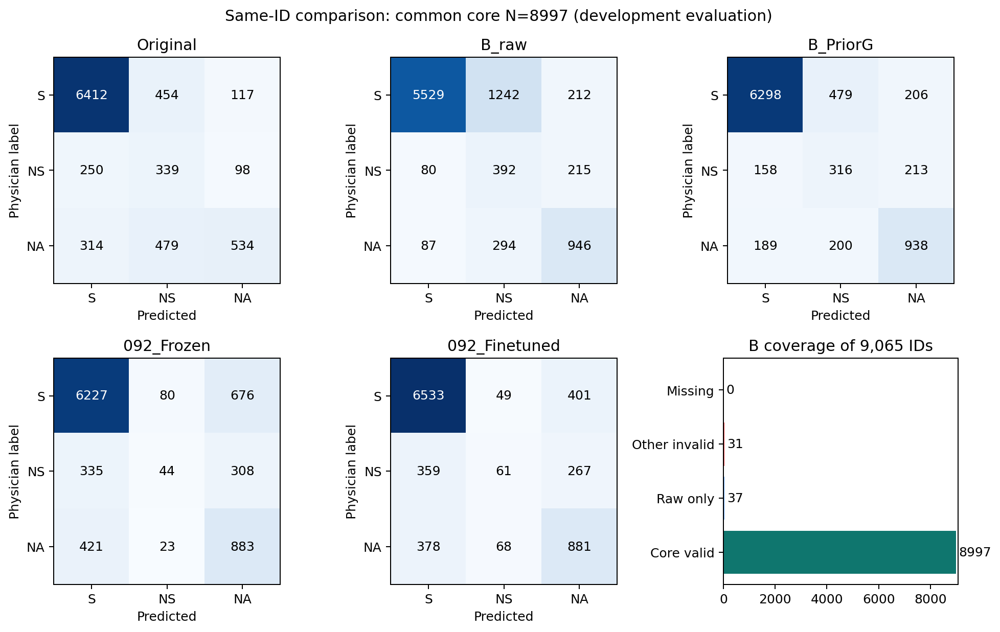
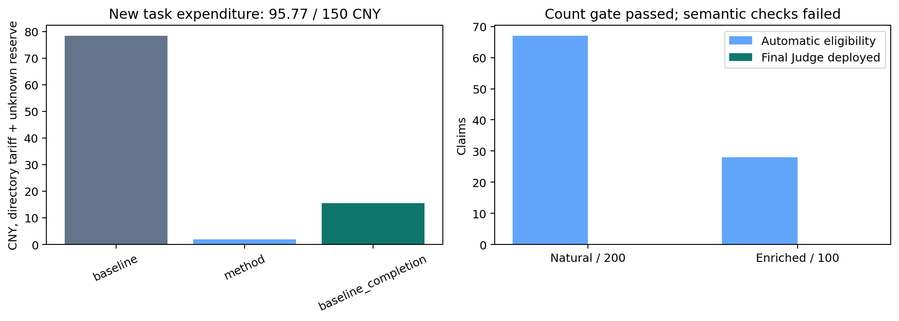

# 095 先读这个：全量基准、来源诊断与最小差异对照核验

**当前最小差异对照版本在构造语义核对阶段停止，尚未形成可解释的分类增益证据；完成B基准与论文收束，默认不变。** 默认仍为C48 → DeepSeek T-S无示例B（thinking-high）→ Frozen PriorG，本轮不自动升级或启动下一任务。

全部9065个ID已有当前B成功回执。其中core有效8997、raw有效9034；成功但core无效68条保留原回答，不因失败或成绩重发、不填旧标签。新增收费目录价及未知预留合计 **¥95.769536/150**；7597次尝试、7597个HTTP200、0次重试。

## 结论先行

1. 在当前B共同core有效的8997个同ID上，B＋G相对原作者净正确+267，MCC 0.4983→0.5976，Macro-F1 0.5931→0.6663，错误支持564→347。这是当前系统比较，不能归为本轮新对比操作的贡献，也不是独立外部测试。
2. 同一B回答的raw→PriorG产生769救回、84伤害，净+685；新增/避免错误支持为180/0。固定决策边界改变标签，不代表找到了新病历信息。
3. 指定的唯一新候选完成300条构造；程序来源通过117条，自动核对拟触发95条（自然67、富集28）。数量gate通过，但来源内容审查发现时点、对象关系和并列作用域误放行，语义实施gate失败，实际候选最终Judge调用为0。自动标记不等于真实合格，不能把未执行写成分类阴性或等效。
4. 80例/50患者的发现性阅读说明状态、数值、事件范围及分数边界混杂；对来源不足保留unknown，不新增医生gold。四例有限包外搜索没有建立新的包外见证；一条最初未定位的目标日期信息在完整C48中找到，已追加补正。

全量系统优势有明确类别来源：相对原作者，S/NS/NA分别净正确-114/-23/+404。NA召回由40.24%升至70.69%，S召回91.82%→90.19%、NS召回49.34%→46.00%。因此可主张PA/MCC/Macro-F1与错误支持的综合优势，不能主张各类召回全面提高。

## A：完整母体、缓存与有效性

母体为092的100患者9065有效atomic claim（S/NS/NA=7035/693/1337），原GT、原作者预测及时间元数据异常不变。历史20 exploration、40 development、40 reserved在本轮均经用户授权可用；全部已暴露，不称新holdout。036的早期最终验证地位不继承到T-S/PriorG或本轮。

扫描outputs与.local_models中40777份标准原生request.json，得到2479兼容成功回执、1885不同ID；按最早成功UTC、请求路径、回执路径选取，不按有效性或正确性选优。14条core无效的入选旧回执仍保留。claim/reference、system prompt、模型、thinking、输出接口一致；仅显式默认参数做等价规范化。扫描范围与其他非标准容器核查边界见独立阶段A报告，不能宣称任意外部缓存绝无遗漏。

逐ID实际reference来源保持：032冻结3675、036冻结3573、本地BGE补齐1817。后者不冒称与API检索逐字等价。新增B沿固定ID哈希顺序补缺；任何阶段已有同ID/同body成功B均可复用，包括core无效HTTP200，不重复制造更好答案。原方案规定D的同期B与历史主表选择分开；实际D最终比较未运行，历史答案没有被替换。

092两臂保持原五折患者OOF；B和Frozen PriorG没有按这五折重新训练或拟合，并包含历史提示开发、先验与校准材料的暴露。相同ID比较描述已冻结系统，**不表示所有系统具有同等训练监督或无开发暴露的OOF地位**。本轮不为改善表格而重新拟合B。

### 完整9065：已有作者与092对照

|实验配置|MCC|PA|正确/N|错误支持/non-S|AC1|Macro-F1|
|---|---:|---:|---:|---:|---:|---:|
|原VeriFact，同ID发布预测|0.4959|80.87%|7331/9065|573/2030|0.7648|0.5918|
|092 Frozen（患者OOF）|0.4433|79.47%|7204/9065|764/2030|0.7490|0.5167|
|092 Fine-tuned（患者OOF）|0.5156|83.07%|7530/9065|745/2030|0.7954|0.5569|

### 同ID共同core集合：所有配置

|实验配置|MCC|PA|正确/N|错误支持/non-S|AC1|Macro-F1|
|---|---:|---:|---:|---:|---:|---:|
|原VeriFact，同ID发布预测|0.4983|80.97%|7285/8997|564/2014|0.7661|0.5931|
|B原生判定|0.5262|76.33%|6867/8997|167/2014|0.6926|0.6242|
|B＋Frozen PriorG|0.5976|83.94%|7552/8997|347/2014|0.7998|0.6663|
|092 Frozen（患者OOF）|0.4444|79.52%|7154/8997|756/2014|0.7496|0.5167|
|092 Fine-tuned（患者OOF）|0.5161|83.08%|7475/8997|737/2014|0.7956|0.5568|
|B分数最高类U0|0.5262|76.33%|6867/8997|167/2014|0.6926|0.6242|
|B固定U2|0.5713|81.53%|7335/8997|274/2014|0.7664|0.6508|

|配置|S precision/recall/F1|NS precision/recall/F1|NA precision/recall/F1|NS→S|NA→S|
|---|---|---|---|---:|---:|
|原VeriFact，同ID发布预测|0.919 / 0.918 / 0.919|0.267 / 0.493 / 0.346|0.713 / 0.402 / 0.514|250|314|
|B原生判定|0.971 / 0.792 / 0.872|0.203 / 0.571 / 0.300|0.689 / 0.713 / 0.701|80|87|
|B＋Frozen PriorG|0.948 / 0.902 / 0.924|0.318 / 0.460 / 0.376|0.691 / 0.707 / 0.699|158|189|
|092 Frozen（患者OOF）|0.892 / 0.892 / 0.892|0.299 / 0.064 / 0.106|0.473 / 0.665 / 0.553|335|421|
|092 Fine-tuned（患者OOF）|0.899 / 0.936 / 0.917|0.343 / 0.089 / 0.141|0.569 / 0.664 / 0.613|359|378|
|B分数最高类U0|0.971 / 0.792 / 0.872|0.203 / 0.571 / 0.300|0.689 / 0.713 / 0.701|80|87|
|B固定U2|0.957 / 0.867 / 0.910|0.262 / 0.501 / 0.344|0.691 / 0.707 / 0.699|130|144|

### 原生标签自己的共同有效集合

|实验配置|MCC|PA|正确/N|错误支持/non-S|AC1|Macro-F1|
|---|---:|---:|---:|---:|---:|---:|
|原VeriFact，同ID发布预测|0.4975|80.95%|7313/9034|569/2022|0.7658|0.5927|
|B原生判定|0.5253|76.29%|6892/9034|169/2022|0.6921|0.6236|
|092 Frozen（患者OOF）|0.4447|79.53%|7185/9034|759/2022|0.7498|0.5174|
|092 Fine-tuned（患者OOF）|0.5164|83.10%|7507/9034|740/2022|0.7958|0.5573|

|比较|救回/伤害/净正确|患者胜/负/平|ΔPA 95%区间(pp)|ΔMCC 95%区间|
|---|---|---|---|---|
|B_PriorG-Original|878/611/+267|[61, 32, 7]|[+1.84,+4.05]|[+0.0780,+0.1188]|
|B_PriorG-B_raw|769/84/+685|[98, 1, 1]|[+6.93,+8.29]|[+0.0614,+0.0811]|
|B_PriorG-092_Frozen|1005/607/+398|[73, 23, 4]|[+3.20,+5.69]|[+0.1289,+0.1774]|
|B_PriorG-092_Finetuned|707/630/+77|[51, 40, 9]|[-0.17,+1.90]|[+0.0581,+0.1053]|
|raw_B-Original|841/1262/-421|[20, 71, 9]|[-5.94,-3.43]|[+0.0068,+0.0465]|

全9065逐行大表包括缺失与无效字段，不删ID：[统一预测](unified_9065_predictions.jsonl)；[覆盖](baseline_coverage.json)；[剩余ID](baseline_remaining.jsonl)；[剩余费用估算](baseline_gap_forecast.json)。原生有效而分数无效37条，原生无效而分数有效0条。保守已知正确/9065为83.31%，是覆盖下界，不替代三分类共同有效PA/MCC。

这里raw有效指**冻结解析规则下有效**；其余响应不一定完全没有出现verdict字段。独立复核发现，少量截断文本虽有verdict片段，但未完成核心分数字段会被原严格解析契约一并拒绝。本轮不事后修改解析或补标签，详见[解析边界说明](parser_boundary_note.md)。

[患者、human/LLM、证据来源、调用批次及数据异常分层](baseline_strata.json) · [NS→S/NA→S和逐例救回伤害](baseline_case_transitions.jsonl) · [类别转移](baseline_class_transitions.json)。患者bootstrap固定预测重抽1000次，不包含开发选择或服务波动，区间跨零不解释为等效。

[结果解释](baseline_findings.md)进一步列出三类救回/伤害、raw与分数最高类的分歧、常见评分组合、患者分布、来源分层及历史重复，区分边界作用、病例组成和未测批次影响。

## B：源文定位与历史去重

[历史差异表](history_difference.md)核对004/013、028–031、042–049、065–070、079–083、093–094。过去已有要求分解、引用、关系Gate、补证、聚焦及学习融合；本轮没有把它们换名。特别保留067 v1实现失败/v2来源争议、043成功定位条件集合、048仅触发子集、093低实际操作率、094引用无效相关净差等限制。

发现80例含raw正确被G改错16、G救回raw错误12、作者正确B错16、B正确作者错12、双方错12及正确保护12；S/NS/NA=30/32/18，非自然错误率调查。执行者和独立来源复核者各40。多数读取相关完整来源条目，部分整包回查；并非80份完整EHR逐字穷尽。阅读显示原文已有判别信息、事件/日期/对象对应、范围与模态、边界取舍以及无法判断同时存在。模型reason只作输出材料，不作为医学机制自证。

[80例可核查记录](source_review_80.jsonl) · [读取范围与分布](source_review_80_summary.json) · [补充回查与四次包外搜索](source_review_supplement.json)。这80个ID全部排除于首轮和扩量，患者本身仍有开发暴露。源文见证不等于新医生gold，模型核对器通过也不认证近邻完整命题真值。

[B相对作者及raw→G的代表性救回/伤害](baseline_cases.md)连接到同ID最终表，既展示可定位关系，也保留日期/范围unknown。它们是发现性解释，不作为新候选分类效果或原作者内部推理原因的证据。

## C/D：唯一冻结操作与辨识性对照

辅助构造器只读原claim、原C48，以一次连续跨度替换构造一个近邻。新取值必须在1–2个原文锚点内出现，程序核验引用与偏移，第二个有限辅助检查确认单属性、实质差异、同事件与不编造。辅助均为同0731的非thinking接口，不训练核心模型。最终Judge保持T-S thinking-high、8192输出上限、temperature0；原claim和完整reference不变。

E只添加实际原文锚点；C在完全相同锚点上再添加明确标为生成假设的近邻及比较要求。允许两说法同时支持、同时不支持或无法区分；不强制二选一，不把未找到候选变成NA/NS。构造/来源/核对失败时E/C精确别名到B，不增加不可用提示再发Judge。

首轮自然200、富集100在任何候选结果前冻结；自然按ID哈希，富集按固定标签/属性词/患者规则，包含原本正确病例，不按历史能修好的错误抽样。自然实际162S/14NS/24NA，富集34S/33NS/33NA，分报而不合并为全量PA。程序与核对器判定决定部署，人工作源文检查不逐例选择应用。

主比较C−B看系统收益，C−E看对比增量，E−B看辅助摘录/呈现。主结果同一Frozen PriorG；raw/U0/U2诊断不事后选优。明确继续、停止、边缘扩量条件在结果前冻结于[协议](../../tasks/095_anchored_minimal_contrast/experiment_protocol.md)与[口径澄清](../../tasks/095_anchored_minimal_contrast/decision_clarification.md)。

数量门槛已通过，但实际单属性、同事件与保留限定的语义检查失败，因此没有执行收费B/E/C最终分类比较。不能把未测分类写成方法负效果或E/C与B等效。[逐ID实际部署状态](construction_deployment_status.jsonl)区分自动eligible与最终调用；旧构造审计的operated字段仅是自动拟触发标记，不代表已运行Judge。16例预检中3个自动通过均存在确定问题或unknown；另固定抽查24个自动通过输出，发现既有可读的单属性假设，也有同义改写、多属性、关系借用与时点迁移，详见[质量复核](construction_quality_summary.json)和[案例说明](candidate_cases.md)。这些人工阅读不转成逐例部署名单。只修复了5条空白绑定错误，复用原成功回答；没有通过改提示追逐更高通过率。A与F继续完成。

## E：扩量与稳定性边界

未执行收费B/E/C最终比较、顺序控制或条件式扩量。300构造与117核对已完成，数量通过不抵消具体时点/作用域误放行。全局停止后不人工挑好例子；未用的新方法预算在同一150元总账下用于补齐原固定B，额外补齐阶段最多25元、总常规130元。

[既有B重复](repeat_analysis.json)使用同ID兼容请求的最早/最晚成功回答，不选最好答案。重复子集来自历史混合选样，不能据少量相同标签证明全系统稳定，也不能把缺少重复当方法无效。本轮未执行候选阶段同期B、额外批次桥接或顺序控制，历史缓存与新补齐的分层不能单独排除服务批次影响。

## 成本、恢复和可复现性

7597次新尝试包含构造、核对、主Judge、重试及未知保留；未知保留¥0.000000，GPU新租赁0、检索新API0。既有缓存历史费用不重新计入本轮新增支出；整个部署的累计历史检索成本和092 GPU租金并非0，也未取得全部账单。

全覆盖所选B回答中，平均输入3171 token（中位3161，P95 3461），平均输出1849 token（中位1496，P95 4253，包含thinking）。输出达到8192的有41条；是否有效仍以实际解析为准，不仅按长度判定。该usage摘要包括复用缓存，不全是本轮新增支出。

普通北京0731目录价忙时输入/输出/缓存输入3/9/0.3、闲时1.5/4.5/0.15元/百万token；官方普通服务公告核实22–08 UTC+8。初版保守忙时账本快照原位保留，新版只对同一闲时窗口的成功usage重算；HTTP0/未知始终保留最大bound。发送前SQLite事务检查所有已发生、未知、在途与下一请求上界，任务硬限150不变；不以赠金或促销扩大预算。

[总账](cost_ledger.json) · [每次尝试](attempt_ledger.jsonl) · [官方价核实](../../tasks/095_anchored_minimal_contrast/pricing_verification.md) · [工程修订](../../tasks/095_anchored_minimal_contrast/runtime_v3_note.md)。实际辅助构造与核对费用为¥1.946946，是未进入最终分类之前已经发生的研究费用。本轮没有E/C实际部署成本或分类收益；未来部署估算必须包括失败构造后回B的辅助开销，共享构造不能重复记为本轮实际付费，也不能在单臂部署比较中当免费。

复现与准确恢复入口见[任务README](../../tasks/095_anchored_minimal_contrast/README.md)。私有原文/回执/模型缓存不推送；公开数据只有ID、哈希、标签、分数、数值分析和抽象病例说明。不修改.gitignore、历史成果或默认系统。

## F：论文主张与复核

本轮最可靠的新成果是统一实际输入与有效性的同ID比较、可回查的原生→最终边界归因，以及指定对比构造的可行性预检和停止依据。最终对比分类未运行，已有B的优势不是095候选的创新；普通偏置、来源匹配和单点替换也不是未经论证的算法首创。

对比/独立核验已有QAGS、CoVe、RAFTS、VitaminC及2026 ACV等直接近邻。本轮只作患者证据约束下的简化适配与实测，不宣称复现或超过未运行的完整文献方法。ACV全文本次访问受阻，仅核到摘要，相关算法级差异不能过度主张。

论文方法/实验/讨论及贡献更新见[中文稿](manuscript_zh.md)；[精简证据地图](evidence_map.md)区分主结果、对照、动机、阴性与附录。不把数据集错误支持减少称为已证实降低临床伤害。

执行者[自检](selfcheck.json)与[独立复核](../../reviews/095_anchored_minimal_contrast/final_review.md)分别列范围。阶段A、设计和费用修订已有独立记录；最终审计必须以真实完成的复核为准，不能拿阶段PASS代替全任务PASS或独立医学审核。
