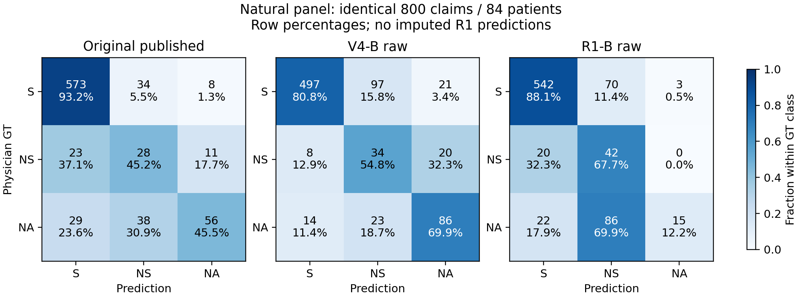

> 阅读镜像：已省略11行病例原文／标识；原始文件SHA见MIRROR_MANIFEST.json。

# 096：跨Judge原生比较与PriorG同配方迁移验证

## 先读结论

本轮完成AWQ-Marlin后端的143校准＋800自然＋200少数类诊断请求，1143个唯一HTTP200、0重试。**R1 raw未在新自然面板上超过原VeriFact或当前V4系统；同配方重新拟合PriorG也未带来综合收益。停止本轮适配，不升级默认，不搜索新的边界、提示或模型。**

自然800条上，原作者/V4 raw/R1 raw正确657/617/599；R1的NS召回较高，但NA召回只有15/123=12.20%，主要将NA判成NS。重新适配后正确595/800，较R1 raw净−4。旧V4 PriorG直接套R1为616/800，有+17的工作点收益，但false-S由42增至48；该结果与prior-only逐例相同，不是重新拟合G的贡献。

R1自报分数高度离散：自然767/800、校准135/142条给出单一类别100、其余0。G在原范围内达到−6下界，仍只改变少量非极端分数的标签。**这支持“评分接口与决策修正的效用依赖Judge输出形式”，不支持“PriorG配方已在R1实现可靠重新适配”。**结果不代表所有可能校准方法均无效，也不授权扩大范围继续搜索。

默认保持C48 → deepseek-v4-flash-0731 T-S thinking-high（无示例B）→ Frozen PriorG。G是一维分数修正，不是双模型Gate。完整数据与代码定位见末节。

## 1. 设计、监督和有效分母

起始HEAD `28daf95e9b12270d8089246176023c66c4cf298e`。096沿用户新冻结方向执行，旧被取消的构造修复不恢复；085及095成果原样保留。

从095的9065条/100患者母体排除051校准16患者、085旧180 ID、缺可复用V4 raw等记录，得到7484条/84患者的合格母体：S/NS/NA=5760/579/1145，human/LLM=4624/2860。按GT×author比例、固定SHA256与最大余数分配建立800/600/400嵌套面板；不按历史正确性、分数、error category或PriorG翻转抽样。

选择Tier A只依据新后端并发benchmark吞吐，加事前25%余量，预测剩余2.22小时。自然面板800条/84患者，S/NS/NA=615/62/123，human/LLM=495/305；各患者2–34条。它保持合格母体比例（S约76.96%→76.88%，NS约7.74%→7.75%，NA约15.30%→15.38%），不是原100人总体，也不是全新holdout。

诊断面板200条/73患者，NS/NA各100，human/LLM=180/20，与自然800条互斥；只用于少数类诊断。两个面板患者可重叠，不是两次独立验证，不合并总体PA。

|范围|冻结N|R1 raw有效|R1 score有效|与V4 score共同有效|
|---|---:|---:|---:|---:|
|校准|143|142|142|142|
|自然|800|800|800|798|
|诊断|200|200|200|200|

自然2条V4 raw有效但score无效，故三方raw用800，所有最终方法统一主表用798；无fallback填补新R1。两条ID在coverage.json中登记。100患者均已有开发暴露；本次校准/评价患者隔离不抹去历史暴露。

## 2. 原生比较：不同错误结构，而非单一强弱排序

|配置|MCC|PA|正确/N|false-S/non-S|false-S率|AC1|Macro-F1|S召回|NS召回|NA召回|
|---|---:|---:|---:|---:|---:|---:|---:|---:|---:|---:|
|原VeriFact发布预测|0.5281|82.12%|657/800|52/185|28.11%|0.7802|0.6118|93.17%|45.16%|45.53%|
|V4-B raw|0.5266|77.12%|617/800|22/185|11.89%|0.7039|0.6265|80.81%|54.84%|69.92%|
|R1-B raw|0.4206|74.88%|599/800|42/185|22.70%|0.6851|0.4800|88.13%|67.74%|12.20%|

R1相对原作者救回38、伤害96，净−58；患者10胜/43负/31平。相对V4 raw救回82、伤害100，净−18：真S净+45、真NS净+8、真NA净−71。R1 NS召回67.74%高于V4的54.84%，却以NA召回69.92%→12.20%的大幅损失为代价，Macro-F1下降0.1465。

自然R1混淆矩阵（行GT、列预测，顺序S/NS/NA）为 `[[542,70,3],[20,42,0],[22,86,15]]`。123条NA中，86条判NS、22条判S；不能仅说“过于偏S”而遗漏NA→NS这一主要错误。R1预测S占73.0%，高于V4 raw的64.875%、低于原作者的78.125%；S偏向是相对比较，不能无条件概括。

095观察到的V4 raw“PA较低、错误支持较少”在本面板继续出现：相对原作者PA低5.00个百分点、false-S 52→22、NS和NA召回提高。但本轮MCC为0.5266对0.5281，不能继续宣称raw MCC更高；差值区间跨0也不是等效证据。085中R1的NA弱点在本面板再次出现，不能将085的F4 raw增益推广为无示例B优势。

## 3. 六种主要配置：共同798条

|配置|MCC|PA|正确/N|false-S/non-S|false-S率|AC1|Macro-F1|S召回|NS召回|NA召回|
|---|---:|---:|---:|---:|---:|---:|---:|---:|---:|---:|
|原VeriFact发布预测|0.5300|82.21%|656/798|51/184|27.72%|0.7812|0.6130|**93.16%**|45.16%|45.90%|
|V4-B raw|0.5275|77.19%|616/798|**22/184**|**11.96%**|0.7049|0.6278|80.78%|54.84%|**70.49%**|
|R1-B raw|0.4205|74.94%|598/798|42/184|22.83%|0.6860|0.4808|88.11%|**67.74%**|12.30%|
|R1＋旧V4 Frozen PriorG|0.4359|77.07%|615/798|48/184|26.09%|0.7162|0.4888|91.37%|62.90%|12.30%|
|R1＋R1-adapted PriorG|0.4163|74.44%|594/798|40/184|21.74%|0.6786|0.4811|87.30%|**67.74%**|13.11%|
|当前V4-B＋Frozen PriorG|**0.5802**|**83.21%**|**664/798**|36/184|19.57%|**0.7904**|**0.6496**|90.39%|40.32%|68.85%|

同列最佳点值加粗，不意味着统计显著或所有风险指标同时占优。当前V4最终系统为664/798、MCC0.5802、Macro-F1 0.6496、false-S36/184；相对原作者净+8，但S/NS召回均较低、NA召回更高。其ΔPA为+1.00个百分点，95%患者区间[-1.90,+3.83]；ΔMCC为+0.0503，区间[-0.0125,+0.1044]。这是原默认系统的再评价，不是096新增方法贡献。

### 患者配对区间

|比较（候选−参照）|N|救回/伤害|ΔPA百分点 [95%区间]|ΔMCC [95%区间]|患者胜/负/平|
|---|---:|---:|---|---|---|
|R1-B raw − 原VeriFact发布预测|800|38/96|-7.25 [-10.41, -4.38]|-0.1075 [-0.1805, -0.0360]|10/43/31|
|V4-B raw − 原VeriFact发布预测|800|69/109|-5.00 [-8.57, -1.48]|-0.0014 [-0.0683, +0.0643]|19/40/25|
|R1-B raw − V4-B raw|800|82/100|-2.25 [-5.91, +1.18]|-0.1061 [-0.1697, -0.0442]|26/34/24|
|R1＋R1-adapted PriorG − R1-B raw|800|1/5|-0.50 [-1.08, +0.00]|-0.0042 [-0.0155, +0.0085]|1/5/78|
|R1＋R1-adapted PriorG − R1＋旧V4 Frozen PriorG|800|4/25|-2.62 [-3.95, -1.45]|-0.0195 [-0.0422, +0.0029]|2/20/62|
|R1＋R1-adapted PriorG − 原VeriFact发布预测|800|39/101|-7.75 [-10.98, -4.86]|-0.1117 [-0.1870, -0.0398]|11/45/28|
|R1＋R1-adapted PriorG − 当前V4-B＋Frozen PriorG|798|44/114|-8.77 [-12.50, -5.34]|-0.1639 [-0.2353, -0.0955]|10/47/27|

均为1000次患者cluster bootstrap（仓库paired_compare，固定预测、配对重采样）。800与798分母明确分开；区间不覆盖调用随机性、历史方法选择、重新训练或新医院泛化。R1 raw相对原作者的PA/MCC区间均为负；相对V4 raw的MCC区间为负，PA区间跨0。适配相对raw的微小差异不能单凭区间作等效结论，也没有实际综合升级信号。

## 4. 重新适配发生了什么

固定配方：z=log(max(score/100,1e−6))；只给S加theta；训练平均NLL＋0.01theta²，theta∈[−6,6]；再加log(reference比例/calibration比例)，NS/NA/S平局顺序。label_scores是LLM自报分数，不是真实token probability或已校准概率。

|参数/核验|实际值|
|---|---|
|V4旧Frozen theta|0.1342909508820116|
|R1 theta|−6.0，命中原下界；没有扩范围|
|R1正则化训练损失|5.229353472191|
|下界有符号梯度/投影梯度|+0.0627152094 / 0|
|原052 success标志|False（检查无约束梯度）；原值保留|
|约束最优核验|KKT＋正Hessian＋独立同目标求解通过|
|V4同142条交集theta|0.1346735220100590|
|交集reference/calibration counts|1108/100/170；48/46/48|
|计划143清单SHA256|`4e43eb998e50632acb8a342ace1fc0309b4f58db60ade7b339d6660cea6810bc`|
|实际142训练ID SHA256|`bd7008ffd0c524de6762d5e50781e3c7a9a62f7675ef6107760d6aba6e27a82f`|

原052实现到达边界时仍要求无约束梯度接近0，导致首次离线断言停止。保持其已经返回的theta=−6不变，采用约束KKT确认是原范围内最优，完整记录在engineering_amendment_003.md；未更换目标、样本或根据评价择优。模型文件在评价GT连接前冻结。V4在同142条交集重新拟合后，自然798和诊断200条均与原V4 Frozen PriorG逐例同标签，排除“多掉一条训练样本直接解释R1差异”的简单说法。

### 同800条R1输出的组件消融

|配置|MCC|PA|正确/N|false-S/non-S|false-S率|AC1|Macro-F1|S召回|NS召回|NA召回|
|---|---:|---:|---:|---:|---:|---:|---:|---:|---:|---:|
|R1-B raw|0.4206|74.88%|599/800|42/185|22.70%|0.6851|0.4800|88.13%|67.74%|12.20%|
|R1 U0|0.4206|74.88%|599/800|42/185|22.70%|0.6851|0.4800|88.13%|67.74%|12.20%|
|R1 fitted-G-only|0.4153|74.25%|594/800|40/185|21.62%|0.6762|0.4760|87.32%|67.74%|12.20%|
|R1 prior-only|0.4359|77.00%|616/800|48/185|25.95%|0.7152|0.4879|91.38%|62.90%|12.20%|
|R1＋旧V4 Frozen PriorG|0.4359|77.00%|616/800|48/185|25.95%|0.7152|0.4879|91.38%|62.90%|12.20%|
|R1＋R1-adapted PriorG|0.4163|74.38%|595/800|40/185|21.62%|0.6777|0.4803|87.32%|67.74%|13.01%|

raw与U0在全部1000条评价上逐例一致。旧V4 Frozen PriorG与R1 prior-only也在1000条上逐例一致。因此旧参数直接迁移的自然+17正确主要归于先验工作点调整：20条真S救回、3条真NS伤害，false-S +6；没有额外G标签增量。诊断面板反而净−3、false-S +5。

重新拟合G-only相对raw自然0救回/5伤害；完整适配相对G-only净+1，加入先验只救回一条NA。完整适配相对raw共7次改判：1救回、5伤害、1次错→错，false-S减2；患者1胜/5负/78平。相对直接迁移则4救回/25伤害、净−21，不能以少量错误支持减少宣称适配成功。

### 为什么−6仍只改变少量标签

校准142条R1有135条极端100/0/0分数、仅5种分数向量；对应V4为40条、47种向量。R1有61条把医生GT类别分数给成0，其中NA为42/48；V4同142条为8条。自然R1为767/800极端分数、177条GT分数为0；诊断为195/200极端分数。

对(100,0,0)，score-floor后S相对其他类别的log差约13.82；theta=−6仍不足以改变最高类。R1的主要NA→NS错误也无法由只改S的一维G直接重排NS与NA。少量非极端向量承担了几乎全部改判，且出现正确S损伤。这里解释的是已保存分数和决策规则的可观察关系，不是从reason推断模型内部机制，也不把极端自报分数当真实高置信概率。

## 5. 少数类诊断与作者分层

|方法|NS正确/100|NA正确/100|false-S/200|
|---|---:|---:|---:|
|原VeriFact发布预测|47|36|62|
|V4-B raw|54|75|15|
|R1-B raw|73|7|52|
|R1＋旧V4 Frozen PriorG|70|7|57|
|R1＋R1-adapted PriorG|73|7|52|
|当前V4-B＋Frozen PriorG|41|74|39|

诊断200条为人为NS/NA各100，不能与自然800混成总体PA。这里R1 NA只7/100；适配后200条标签完全不变，不能把“没有变化”称为已证明等效。S召回不适用，因为没有真S；底层指标库对空类别返回0的约定不被解释成性能证据。

|作者层|方法|N|正确|MCC|false-S|
|---|---|---:|---:|---:|---:|
|human|原VeriFact发布预测|493|374|0.5249|41|
|human|V4-B raw|493|362|0.5447|18|
|human|R1-B raw|493|325|0.4247|31|
|human|R1＋R1-adapted PriorG|493|325|0.4279|29|
|human|当前V4-B＋Frozen PriorG|493|386|0.5798|29|
|llm|原VeriFact发布预测|305|282|0.2278|10|
|llm|V4-B raw|305|254|0.2533|4|
|llm|R1-B raw|305|273|0.0953|11|
|llm|R1＋R1-adapted PriorG|305|269|0.0803|11|
|llm|当前V4-B＋Frozen PriorG|305|278|0.3022|7|

上表使用共同798条的作者分层。R1相对V4 raw在人写层少对37条，在LLM层多对19条；但LLM层MCC反而较低且false-S更多，不能用该层PA获益代表综合改善。LLM层仅9条NS、6条NA，三种raw方法NA召回均0，小分母不作强显著性宣称。适配在human层正确数不变、LLM层净−4，全部自然损伤分散在5名患者；不是单个患者带来的偶然汇总。

## 6. 可选桥接：复用078，不增加API

已核对078的published-reference＋V4 T-S请求/回执哈希，原192条中TS/RT共同核心有效184条。单独历史队列上，发布reference＋V4 raw正确144，C48＋V4 raw139；对应PriorG154/155。原作者为154/184。该结果不能证明C48精度优势，也不能据接近点值宣称等效；更紧凑输入和历史成本价值仍可讨论。

这叫**published-reference + V4 bridge**，不是完整Original VeriFact pipeline + V4：本研究提示/原生JSON解析没有重现原作者辅助结构化模型链。没有新Qdrant、embedding/rerank、额外GPU或V4调用。此历史桥接不是本096自然面板；历史自然/诊断/桥接各自分母独立。

## 7. 部署、时序、费用与复现

旧普通AWQ：P0 1个HTTP200，P1 0个HTTP200、2个unknown/incomplete；原request/response/receipt/hash保留，全部AWQ_DIAGNOSTIC_ONLY，不进入拟合或评价。用户切换为相同ModelScope权重的AWQ-Marlin后建立独立backend_id和request_id，同样本/body重新运行经明确授权；新backend内部不重发成功回答。

新服务由用户报告A80080GB PCIe、vLLM0.10.1.1、awq_marlin、float16、20K、deepseek_r1 parser；/models与M0独立验证精确模型名、上下文及tokenizer长度。模型为Valdemardi/DeepSeek-R1-Distill-Llama-70B-AWQ，不是Casperhansen；ModelScope路径snapshot master，远端不可变revision/完整启动命令/权重字节未独立取得，不能把本地HF tokenizer revision当ModelScope已验证revision。

同一M0输入，旧AWQ延迟377.016秒，新Marlin28.656秒；两者completion均824。085历史串行中位25.289秒、最长41.984秒、360 HTTP200/0重试。此对照说明部署速度恢复，不说明模型能力变化。并发2/4/8/12吞吐为4.04/6.76/9.02/10.34条/分钟，选12；12比8增益约14.7%，不足15%，未测16。41个Marlin benchmark答案计入正式自然800；新自然阶段实际发送759条，原早期进度ETA的复用计数问题另存更正，不影响事前Tier选择。

新backend共1143次请求、1143个HTTP200、0重试；142校准core＋800自然core＋200诊断core=1142。输入3,616,417 tokens、输出828,036 tokens；首请求至末回执103.18分钟，含benchmark/阶段间隙，平均11.08条/分钟。2026-09-28 03:21 UTC发出R1_INFERENCE_DONE并停止服务访问；用户随后确认AutoDL已关机，本次才离线拟合和评价。

新增按token收费API为0次/0元；GPU整实例小时单价、完整计费起点和账单未知，租金留空，不伪报0、不把API上限冒充租金预算。可观测新后端跨度约1.72小时×用户小时单价只是部分时段估算，不含旧AWQ诊断、加载和未观测开机等待。没有新租实例、下载权重或改变SSH。

执行者自检7653项通过：冻结样本重放、后台隔离、1143原生回执/hash、GT不入请求、原始模型不改、手写算式解码、sklearn指标和患者bootstrap重放。**这是执行者自检，不是独立审计。** 三次工程修复分别为空content元数据、自然阶段复用计数、边界KKT判据；均留痕，未修改科学输入、原GT或历史结果。

## 8. 可用于论文的结论与停止决定

1. 原生系统比较：R1在本配置下并未获胜；较强NS召回与严重NA→NS混淆并存。V4 raw减少错误支持，但PA较原作者低，本面板raw MCC并未提高。不能把同ID系统比较全部解释为纯权重能力差异。
2. 固定参数迁移：旧PriorG对R1自然PA有小幅收益和false-S代价，标签收益与prior-only一致；不是独立G增益，也未超过原作者或当前默认。
3. 同配方重拟合：本轮没有支持其重新适配效用。大幅theta变化、训练损失最优和新的参数文件本身不是分类贡献。极端分数与NS/NA排序缺口限定了一维边界操作的能力。
4. 论文可以把这项阴性结果作为决策层跨Judge适用边界的实证证据，结合既有V4正向结果讨论输出分数可用性。不能声称PriorG普遍可迁移、R1全面优于V4、C48是精度创新，或benchmark错误支持减少已经证实降低临床伤害。

本轮据实结项；默认不升级，不扩theta范围、不改score prompt、不做新Gate/F4/模型搜索，不自动启动097。独立确认仍需要另行设计的数据与授权，本结果不因缺独立新患者而被抹成“未做实验”，也不冒充独立外部测试。

## 工件与恢复

当前正式数据仅来自 `valdemardi_r1_70b_awq_marlin_vllm0101_fp16_20k/`。根目录旧READY_FOR_R1与live_v1是准备/旧AWQ快照，不得当作当前运行状态。

- 主指标/全部类别与混淆：main_metrics.json、publication_tables.md、metrics_appendix.md、native_confusion.png/svg。
- 原生与统一预测：R1_parsed_predictions.jsonl、unified_predictions.jsonl；配对：paired_bootstrap.json、class_transitions.json、paired_case_transitions.jsonl。
- 校准/机制：R1_calibration_model.json、PriorG_component_ablation.json、score_diagnostics.json、matched_supervision_V4.json。
- 覆盖/来源：freeze.json、natural800.jsonl、diagnostic200.jsonl、request_manifest.jsonl、response_reconciliation.jsonl、backend_transition.json。
- 成本/运行：cost_runtime_summary.json、concurrency_benchmark.json、runtime_ledger.jsonl；自检：selfcheck.json。
- 复现入口：[096 README](../../tasks/096_r1_native_priorg/README.md)。CPU重放禁止网络，不需要重启AutoDL；私有临床请求/原始回执只留本机忽略目录。
