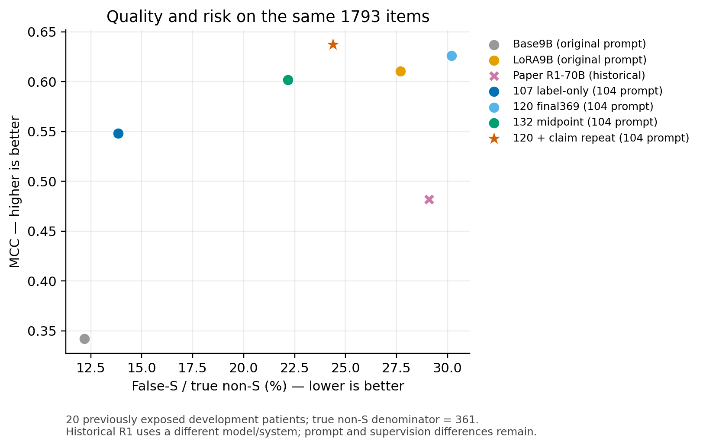

# 136 claim_repeat迁移：full1817

全1817均有效。claim_repeat相对120提高MCC约.0100、减少21次false-S，代价是正确数少6、S召回下降；NS/NA召回提高。保留为原生输入的质量—风险取舍候选，不升级默认。160与500门槛用于决定是否扩大；全量结果不再机械按500扩大门槛二次筛选。

实际目标1817，主比较共同有效1817。MCC 0.6250→0.6350，正确1599→1593，false-S 109→88（非S=362）。无效不填旧答案。

## 同120权重与104接口的主比较

|配置|MCC|PA|正确|false-S/非S|Macro-F1|S/NS/NA召回|
|---|---:|---:|---:|---:|---:|---|
|claim_repeat|0.6350|87.67%|1593|88/362|0.6849|93.68%/33.88%/78.42%|
|paper_r1|0.4842|82.11%|1492|105/362|0.5780|92.30%/43.80%/39.83%|
|full_pool120|0.6250|88.00%|1599|109/362|0.6697|95.74%/28.93%/70.95%|
|label_only107|0.5445|80.74%|1467|50/362|0.6260|84.05%/39.67%/81.33%|
|midpoint132|0.5988|85.80%|1559|80/362|0.6587|91.62%/33.88%/76.76%|

## 与三个基线的共同1793条

|配置|MCC|PA|正确|false-S/非S|Macro-F1|S/NS/NA召回|
|---|---:|---:|---:|---:|---:|---|
|author_base9b|0.3422|67.48%|1210|44/361|0.3729|77.86%/78.33%/0.41%|
|author_lora9b|0.6104|87.12%|1562|100/361|0.6689|94.76%/35.83%/67.22%|
|paper_r1|0.4819|81.87%|1468|105/361|0.5763|92.18%/43.33%/39.83%|
|full_pool120|0.6263|87.95%|1577|109/361|0.6712|95.74%/29.17%/70.95%|
|claim_repeat|0.6373|87.67%|1572|88/361|0.6870|93.72%/34.17%/78.42%|
|label_only107|0.5484|80.87%|1450|50/361|0.6285|84.22%/40.00%/81.33%|
|midpoint132|0.6017|85.83%|1539|80/361|0.6608|91.69%/34.17%/76.76%|

主表与三个基线表的有效交集可能不同，不跨表相减。author_base9b/author_lora9b使用原作者提示与768上限；本候选、107、120、132使用104任务接口及384上限。paper_r1是不同模型和系统的作者历史参照；详见[统一基线](../134_author_baselines/report.md)。

## 原面板与类别得失

|面板|共同N|MCC|PA|正确|FS/非S|Δ正确|ΔFS|
|---|---:|---:|---:|---:|---:|---:|---:|
|all|1817|0.6350|87.67%|1593|88/362|-6|-21|
|natural|400|0.6119|87.25%|349|20/79|+5|-6|
|pressure|100|0.3293|54.00%|54|28/100|+0|-1|
|new1317|1317|0.6426|90.36%|1190|40/183|-11|-14|
|history103_180|180|0.6526|78.89%|142|16/84|+7|-6|

|GT类别|救回|误伤|净正确|
|---|---:|---:|---:|
|Supported|2|32|-30|
|Not Supported|10|4|+6|
|Not Addressed|22|4|+18|

false-S避免25次、新增4次。患者正确数7升/9降/4持平。

- human：正确+0、false-S-22。
- llm：正确-6、false-S+1。

## 混淆矩阵

行GT、列预测，固定S/NS/NA顺序。

claim_repeat

|GT\预测|S|NS|NA|
|---|---:|---:|---:|
|S|1363|48|44|
|NS|47|41|33|
|NA|41|11|189|

paper_r1

|GT\预测|S|NS|NA|
|---|---:|---:|---:|
|S|1343|88|24|
|NS|52|53|16|
|NA|53|92|96|

full_pool120

|GT\预测|S|NS|NA|
|---|---:|---:|---:|
|S|1393|31|31|
|NS|52|35|34|
|NA|57|13|171|

1000次患者配对bootstrap：ΔMCC 95%区间[-0.0294, +0.0383]；ΔPA区间[-1.56%, +0.84%]。
区间仅描述当前开发患者的簇抽样，不覆盖历史选型、重训或新医院泛化；跨0不等于方法等效。风险与三类召回区间保留在统计JSON。

## 全量判断

错误支持率下降5.80个百分点，1000次患者配对95%区间为[−8.84, −2.26]个百分点；S召回下降2.06个百分点，区间[−3.05, −1.12]。NA召回提高7.47个百分点，区间[+2.50, +11.61]；NS提高4.96个百分点，区间[0.00, +12.50]。MCC提升的区间跨0，不称为稳定的全面质量提升。

人工来源命题正确总数不变、false-S少22；LLM来源正确少6、false-S多1。患者正确数7升、9降、4持平；收益和代价并不均匀。该输入方法保留为有证据的质量／风险取舍，未升级默认。新增1317中正确少11、false-S少14，与500初筛的纯正确数增量不同。

## 输入、覆盖与成本

缺失0，无效0；每个ID只保留首次返回，不因标签好坏重发。

|配置|模型与监督|输入／输出合同|
|---|---|---|
|author_base9b|未微调Qwen3.5-9B|原作者提示，完整作者reference；关闭thinking，768上限|
|author_lora9b|同9B＋120 final369|同原作者提示与768上限|
|paper_r1|原作者R1-70B发布结果，无本项目新增训练|历史作者系统，直接复用，不作为同模型对照|
|label_only107|同9B，196条标签监督的主要普通微调基线|104修改提示，384上限|
|full_pool120|107之后再用2945条训练369步|同104提示，384上限|
|midpoint132|107与120固定有效权重中点|同104提示，384上限；无新增训练|
|claim_repeat|完整复用120权重|同104提示，在reference之后重述原claim；384上限|

本轮推理复用已有权重，不表示原微调训练没有成本。103旧thinking4096/final768预测与本轮不合并；134已核对原提示来源、缓存资格及两9B的独立无效输出。
135的reason_first仅完成同一固定160条初筛，正确−6且false-S不变，已停止扩大；不把其小样本结果混入本表，也不据此否定理由监督整条路线。
133仍仅CPU准备，127仍未证明reason数据带来分类收益；120的415条训练拟合诊断取消且0完整回执，不能拿它解释本表。

重复原claim使每条输入平均增加43.9 tokens，中位数43.0、最大74；总输入增加0.53%。完整reference不变，输出上限仍384。

截至2026-10-31T05:56:48+08:00，23:40窗口GPU累计估算¥9.922/16，包含交接、准备、等待、加载、编译、推理与回传；新增API0/80。没有新训练，未关机或释放，平台精确账单未核。

全部20名患者有历史研究暴露，属于开发/选型证据。原医生GT、claim、reference和全部尝试保留，不使用评价数据训练。本方法只改变原生输入，不后接分类器或修改模型标签；未证明理由完整、正确或与标签逐例自洽，不能把旧reason配给本次标签。

[统计、三类precision/recall/F1与患者明细](full1817.json) · [逐ID有效状态](full1817_receipt_status_sanitized.jsonl) · [固定方案](../../tasks/136_claim_repeat_transfer/PROTOCOL.md)
