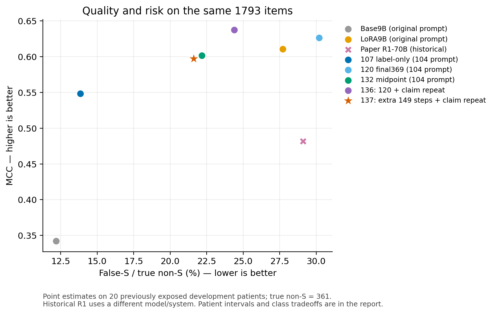

# 137 extra_steps：full1817

全1817均有效。固定追加149步降低10次false-S并改善NS，但相对同输入136少对38条、MCC下降.0398，S与NA损失明显，新增1317未保持初筛收益。停止当前续训配方扩大，完整模型与尝试保留；不将这一结果概括为全部微调失败。136保留为已有原生输入取舍候选，不升级默认。

固定149个新增更新全部完成，全局369→518；新增1192次呈现。主比较共同有效1817/1817。MCC 0.6350→0.5952，正确1593→1555，false-S 88→78/362。

## 同输入的权重更新比较

|配置|MCC|PA|正确|false-S/非S|Macro-F1|S/NS/NA召回|
|---|---:|---:|---:|---:|---:|---|
|extra_steps137|0.5952|85.58%|1555|78/362|0.6697|91.96%/47.11%/66.39%|
|paper_r1|0.4842|82.11%|1492|105/362|0.5780|92.30%/43.80%/39.83%|
|claim_repeat136|0.6350|87.67%|1593|88/362|0.6849|93.68%/33.88%/78.42%|
|full_pool120|0.6250|88.00%|1599|109/362|0.6697|95.74%/28.93%/70.95%|
|label_only107|0.5445|80.74%|1467|50/362|0.6260|84.05%/39.67%/81.33%|
|midpoint132|0.5988|85.80%|1559|80/362|0.6587|91.62%/33.88%/76.76%|

## 三基线共同1793条

|配置|MCC|PA|正确|false-S/非S|Macro-F1|S/NS/NA召回|
|---|---:|---:|---:|---:|---:|---|
|author_base9b|0.3422|67.48%|1210|44/361|0.3729|77.86%/78.33%/0.41%|
|author_lora9b|0.6104|87.12%|1562|100/361|0.6689|94.76%/35.83%/67.22%|
|paper_r1|0.4819|81.87%|1468|105/361|0.5763|92.18%/43.33%/39.83%|
|claim_repeat136|0.6373|87.67%|1572|88/361|0.6870|93.72%/34.17%/78.42%|
|extra_steps|0.5970|85.55%|1534|78/361|0.6713|91.97%/47.50%/66.39%|
|full_pool120|0.6263|87.95%|1577|109/361|0.6712|95.74%/29.17%/70.95%|
|label_only107|0.5484|80.87%|1450|50/361|0.6285|84.22%/40.00%/81.33%|
|midpoint132|0.6017|85.83%|1539|80/361|0.6608|91.69%/34.17%/76.76%|

primary的claim_repeat136与extra_steps137使用完全相同的136输入、384输出上限和parse105，仅权重更新；旧120原输入、107和132使用104提示，author_base9b/author_lora9b使用原作者提示及768上限。paper_r1是不同模型/系统的历史结果。不同覆盖不跨表直接作差。

## 面板与类别得失

|面板|N|ΔMCC|Δ正确|Δfalse-S|
|---|---:|---:|---:|---:|
|all|1817|-0.0398|-38|-10|
|natural|400|-0.0119|-4|-2|
|pressure|100|+0.0302|+4|-3|
|new1317|1317|-0.0710|-38|-5|
|history103_180|180|-0.0431|-4|-1|

|GT类别|救回|误伤|净正确|
|---|---:|---:|---:|
|Supported|2|27|-25|
|Not Supported|16|0|+16|
|Not Addressed|1|30|-29|

false-S新增0、避免10；患者正确数1升/15降/4持平。

- human：正确-30、false-S-10。
- llm：正确-8、false-S+0。

## 混淆矩阵

行GT、列预测，S/NS/NA顺序。

extra_steps137

|GT\预测|S|NS|NA|
|---|---:|---:|---:|
|S|1338|93|24|
|NS|43|57|21|
|NA|35|46|160|

paper_r1

|GT\预测|S|NS|NA|
|---|---:|---:|---:|
|S|1343|88|24|
|NS|52|53|16|
|NA|53|92|96|

claim_repeat136

|GT\预测|S|NS|NA|
|---|---:|---:|---:|
|S|1363|48|44|
|NS|47|41|33|
|NA|41|11|189|

1000次患者配对bootstrap的ΔMCC 95%区间[-0.0655, -0.0105]；不覆盖训练随机性、历史开发选择或新医院泛化。

|指标|变化（百分点）|95%患者区间（百分点）|
|---|---:|---|
|false-S/真实非S|-2.76|[-4.30, -1.67]|
|S召回|-1.72|[-2.25, -1.15]|
|NS召回|+13.22|[+8.06, +16.67]|
|NA召回|-12.03|[-17.26, -7.53]|

## 集中结论与图示

当前停止的是这次固定追加149步配方。NS预测100→196、precision41.00%→29.08%，加上S与NA损失，解释了为何false-S下降不等于整体更好；NS收益与风险改善仍保留。

[本轮集中比较、基线覆盖与后续成本](window_summary.md)

## 范围和成本

无效0、缺失0；不补旧答案、不重发成功或无效回答。全部原GT、claim、reference和实际尝试保留。

训练32人、评价20人无交集，新增训练使用原顺序的1192条，未按评价错误选样本；所有患者有历史暴露，不称全新holdout。518步只包括120阶段与本次延续，不包含更早的107微调。

截至2026-10-31T08:49:34+08:00，23:40窗口GPU累计估算¥14.472/16，API0/80。加载、编译、等待、训练、推理和回传均计入；平台精确账单未核。完整模型/优化器/RNG已回传，不关机或释放。

loss下降、梯度正常不当作分类收益。本模型输出的标签来自同次原生生成；不得配上旧模型理由。当前不宣称reason自洽已解决，不自动升级默认。

[完整统计与三类precision/recall/F1](full1817.json) · [训练完成摘要](training_summary.json) · [固定方案](../../tasks/137_extra_steps/PROTOCOL.md)
按全目标1817条计，候选已正确1555条，基线正确1593条；候选PA边界[85.58%, 85.58%]。无效仍是不作答，不在MCC中伪映射成任一类别。
