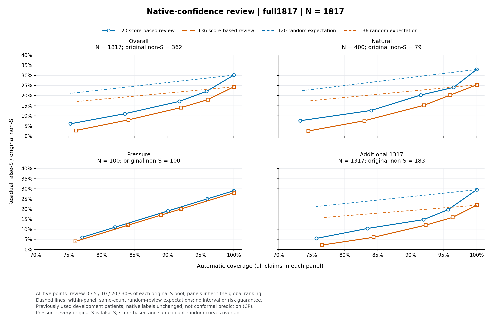

# 144 native_confidence：原生分数的选择性核验

**风险排序收益延续到新增1317条，原生标签与MCC不变。** 代价是把部分原本正确的S送审；送审项没有按“已纠正”计入成绩。1817条来自20名已反复用于开发的患者，并非独立验证。

两个配置均使用120 final369权重，136在104提示基础上重复claim；监督不变。仅在各配置原判S池按 `logit(S)−logit(Not)` 升序、ID平分，送审 `floor(比例×原S池N)`；保留预设全部五点，不按GT择点。批次分位数不是固定部署阈值，分数不是校准概率，也无CP保证或独立校准。原reason均为空，不生成或借用旧reason。

|原生模型|N|MCC|PA|正确|FS/非S|Macro-F1|
|---|---:|---:|---:|---:|---:|---:|
|native120|1817|0.6250|88.00%|1599|109/362|0.6697|
|claim_repeat136|1817|0.6350|87.67%|1593|88/362|0.6849|

下表MCC、PA和正确数均只属于自动处理子集；不能称为全量三分类提升。FS两列分别以原始非S和自动子集非S为分母；FDR是自动预测S中的错误比例。

|模型/原S池送审比例|送审数|自动N/覆盖率|自动MCC|自动PA|自动正确|FS/原非S|FS/自动非S|自动S FDR|送审正确S|
|---|---:|---:|---:|---:|---:|---:|---:|---:|---:|
|120/0%|0|1817/100.00%|0.6250|88.00%|1599|109/362|109/362|7.26%|0|
|120/5%|75|1742/95.87%|0.6587|89.15%|1553|80/362|80/333|5.61%|46|
|120/10%|150|1667/91.74%|0.6813|89.74%|1496|62/362|62/315|4.59%|103|
|120/20%|300|1517/83.49%|0.7095|90.18%|1368|40/362|40/293|3.33%|231|
|120/30%|450|1367/75.23%|0.7347|90.42%|1236|22/362|22/275|2.09%|363|
|136/0%|0|1817/100.00%|0.6350|87.67%|1593|88/362|88/362|6.06%|0|
|136/5%|72|1745/96.04%|0.6620|88.48%|1544|65/362|65/339|4.71%|49|
|136/10%|145|1672/92.02%|0.6788|88.82%|1485|51/362|51/325|3.91%|108|
|136/20%|290|1527/84.04%|0.7069|89.19%|1362|29/362|29/303|2.50%|231|
|136/30%|435|1382/76.06%|0.7335|89.44%|1236|10/362|10/284|0.98%|357|

20%点的自动子集S/NS/NA召回：120为94.93%/38.46%/84.65%，136为92.48%/43.62%/90.43%。全部点的三类P/R/F1、混淆矩阵见[详细分析](full1817_analysis.md)与[完整JSON](full1817_analysis.json)。

同一全局20%规则下，136在自然400、压力100、新增1317的FS分别20→6、28→12、40→11；新增覆盖84.36%，送审177个正确S。重叠的原180面板为16→6。human命题61→16、llm命题27→13；18名原有FS的患者均拦下一些，但12名仍有剩余，不能泛化为安全保证。

虚线为各面板等量随机送审期望；压力集原S全为错误S，因而与随机曲线重合。它不是安全置信区间。

[固定等工作量比较](full1817_equal_workload.md)：120在k=229时，两策略均残留50个FS、送审170个正确S；136在k=178时，原生分数残留44个FS、送审134个正确S，比107分歧规则分别少6。原生分数当前需额外同模型forward，107规则需额外107生成，不能按调用数视为相同耗时。

2953条有效分数含731条复用。本段2222次新forward为3231.5908秒；worker墙钟3320.1290秒、controller墙钟3324.1866秒分开列示，不能相加。含复用的分数耗时4426.7916秒不等于本段新增成本；[旧路径失败记录](old500_path_recovery.json)保留。费用终值另核。当前同次capture正在做24次工程验证，结果未出前不声称已实现或零额外开销。

[paper_r1、107及作者9B公平比较入口](../141_two_demos/window_summary.md)：1817主表与author_base9b的1793共同子集分开，不跨分母混比。上述结果支持后续风险排序研究，不是原生分类升级或临床安全承诺。
